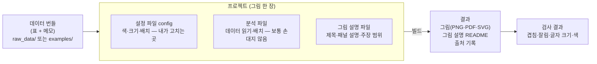

# 2. 한눈에 보기

> **이런 적 있으시죠?** 그림 파일, 엑셀 표, 분석 스크립트가 "최종", "최종_수정", "진짜최종"으로 흩어져 있어서, 어느 그림이 어느 데이터로 만들어졌는지 짝을 맞추기 어려웠다.

**핵심:** fig-atlas에서 그림 한 장은 **데이터 번들 → 프로젝트 → 빌드 → 결과**의 한 줄로 이어지고, 각 단계의 파일이 정해진 자리에 있습니다.

## 전체 흐름

| 단계 | 무엇인가 | 어디에 있나 | 누가 만드나 |
|---|---|---|---|
| **데이터 번들** | 패널 하나에 들어갈 표(`data.csv`)와 "무슨 그림인지" 적은 메모(`metadata.yaml`) | 실제 연구 데이터는 `raw_data/` 아래, 예제는 `examples/` | 분석 파이프라인이나 연구자. 한 번 놓으면 고치지 않음 |
| **설정 파일 (config)** | 그림의 모든 값. 줄마다 설명 주석이 붙어 있음 | `configs/` 아래 `config_프로젝트이름.yaml` | 처음에는 도구가 만들고, 이후 연구자가 고침 |
| **분석 파일** | 데이터를 읽어 패널을 배치하는 프로그램 | `analysis/` 아래 | 도구가 기본 틀을 만듦. 특별한 계산이 필요할 때만 수정 |
| **그림 설명 파일** | 그림 제목, 패널별 설명, 이 그림이 주장할 수 있는 범위 | `figure_specs/` 아래 | 연구자가 씀 |
| **결과** | 그림 파일, 설명 README, 출처 기록 | `outputs/프로젝트이름/` | 빌드할 때마다 새로 만들어짐. 손으로 고치지 않음 |

## 실험에 빗대면

| fig-atlas | 실험실 |
|---|---|
| 데이터 번들 | 라벨 붙은 시료. 받은 그대로 보관하고 덜어 쓰기만 합니다. |
| 설정 파일 | 프로토콜. 조건을 바꾸려면 프로토콜을 고치고 다시 실험합니다. |
| 빌드 | 실험 실행. 같은 프로토콜과 시료면 같은 결과가 나옵니다. |
| 검사 결과 | 품질 관리(QC) 결과 |
| 출처 기록 | 실험 노트. 언제, 무엇으로, 어떤 조건에서 했는지가 자동으로 적힙니다. |

이 비유에서 가장 중요한 점은 **결과(그림)를 직접 고치지 않는다**는 것입니다. 실험 결과 사진을 보정해서 바꾸지 않고 조건을 바꿔 다시 실험하듯, 그림이 마음에 들지 않으면 설정을 고치고 다시 빌드합니다. 그래야 그림과 기록이 항상 일치합니다.

## 프로젝트에는 종류가 있습니다

연구 단위(예: 연구자나 과제 이름)와 단계에 따라 폴더가 나뉩니다.

| 단계 | 폴더 | 쓰임 |
|---|---|---|
| 탐색 (exploratory) | `configs/연구단위/exploratory/` | 이것저것 그려 보는 단계. 데이터 하나에 그림 하나 |
| 논문 (paper) | `configs/연구단위/paper/` | 논문 Figure. 이름에 Figure 번호가 들어갑니다 (예: `…-paper-main-fig2-…`) |
| 보관 (archive) | `configs/연구단위/archive/` | 더 이상 쓰지 않는 그림. 지우지 않고 보관하며, 언제든 다시 빌드할 수 있습니다 |

탐색 그림을 논문 그림으로 옮기는 일(**승격**)과 보관하는 일(**은퇴**)은 명령 하나로 합니다. 11장에서 다룹니다.

## 규칙은 어디에 있나

모든 규칙(원본 데이터는 읽기만, 모든 시각 값은 설정 파일에, 이름 짓는 법 등)은 저장소 맨 위의 [`AGENTS.md`](../../AGENTS.md) 한 곳에 있습니다. AI 도우미도 같은 파일을 읽고 따릅니다. 이 안내서의 13장에서 연구자 눈높이로 요약합니다.

---
이전: [1. 왜 이런 도구가 필요한가](01-why.md) · 다음: [3. 데이터 준비: 번들](03-data-bundles.md)
