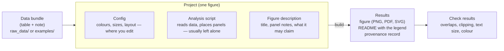

# 2. Overview

> **Sound familiar?** Figure files, spreadsheets and analysis scripts scattered as "final", "final_revised" and "really_final", so it was hard to match each figure with the data that made it.

**The key idea:** in fig-atlas a figure runs along one line, **data bundle → project → build → results**, and the files of each step have a fixed place.

## The whole flow

| Step | What it is | Where it is | Who makes it |
|---|---|---|---|
| **Data bundle** | The table for one panel (`data.csv`) and a note saying "what figure this is" (`metadata.yaml`) | Real research data under `raw_data/`, examples under `examples/` | An analysis pipeline or the researcher. Once in place, it is not changed |
| **Config** | Every value of the figure, each line with an explaining comment | `config_project-name.yaml` under `configs/` | The tool makes it first; the researcher edits it after that |
| **Analysis script** | The program that reads the data and places the panels | Under `analysis/` | The tool makes a starting version. Changed only when a special calculation is needed |
| **Figure description** | The figure's title, a note per panel, and what the figure may claim | Under `figure_specs/` | The researcher writes it |
| **Results** | The figure files, a README, the provenance record | `outputs/project-name/` | Made anew at every build. Never edited by hand |

## In lab terms

| fig-atlas | The lab |
|---|---|
| Data bundle | A labelled sample. Kept as received; you only take from it. |
| Config | The protocol. To change a condition, you change the protocol and run the experiment again. |
| Build | Running the experiment. The same protocol and sample give the same result. |
| Check results | Quality control (QC) results |
| Provenance record | The lab notebook. When, with what and under which conditions is written down automatically. |

The most important point of this comparison is that **you do not edit the result (the figure) directly**. Just as you would not retouch a result photo but rerun the experiment with new conditions, if a figure is not right you change its config and build again. That is how the figure and its record always agree.

## Projects come in kinds

Folders are divided by research unit (for example a researcher or a study) and by stage.

| Stage | Folder | Use |
|---|---|---|
| exploratory | `configs/<unit>/exploratory/` | Trying things out. One dataset, one figure |
| paper | `configs/<unit>/paper/` | Paper Figures. The Figure number is in the name (e.g. `…-paper-main-fig2-…`) |
| archive | `configs/<unit>/archive/` | Figures no longer used. Kept, not deleted, and they can be rebuilt any time |

Moving an exploratory figure to the paper (**promote**) and archiving one (**retire**) are one command each. Chapter 11 covers them.

## Where the rules are

All rules (raw data are only read, every visual value is in the config, how to name things, ...) are in one place, [`AGENTS.md`](../../AGENTS.md) at the top of the repository. AI assistants read and follow the same file. Chapter 13 of this guide summarises them for researchers.

---
Previous: [1. Why a tool like this](01-why.md) · Next: [3. Preparing data: bundles](03-data-bundles.md)
