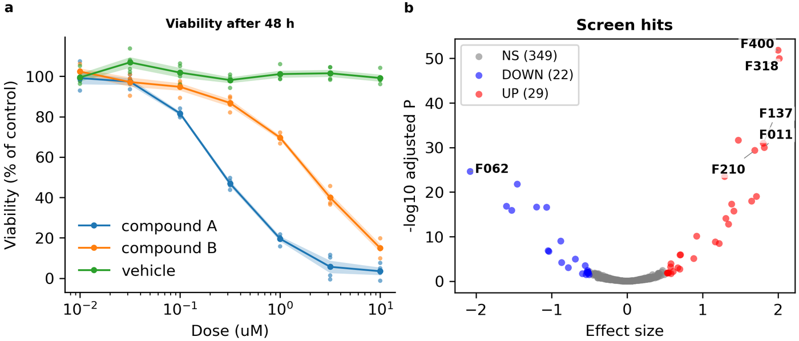

# 4. Making your first figure

> **Has this ever happened to you?** To draw a figure from new data, you copied last time's script and spent half a day fixing paths and column names.

**The key idea:** a new figure takes three steps: **create a project → attach bundles → build**. You write no code. At every step that creates or changes files, you first see what will change, then go ahead.

## What the tool does

| Step | What the tool does |
|---|---|
| **Create a project** | Makes the config, the analysis script and the figure description, in the places the naming rules give. |
| **Attach a bundle** | Checks the bundle and writes **every setting** that kind of figure uses into the config, with an explaining comment. Values from the bundle's note are copied as they are and marked "(from the bundle)". Each bundle becomes one panel (a, b, c, ...). |
| **Build** | Draws the figure from the config (at printed size), arranges the results folder, checks it and records its sources. |

## What you do

Make a two-panel figure from two example bundles (a dose-response curve and a screen's hits).

💬 **Ask an AI:**

> "Create a new project called `first-figure`, attach the bundles `examples/dose_response` and `examples/screen_hits`, and draw the figure. Show me what will change before you change any file."

The AI goes through these steps.

1. **It shows a preview of the new project.** You see the three files it will create and the line it will add to the build list. Nothing is created yet. Check it and answer "go ahead".
2. **For each bundle it shows what will be added to the config.** `dose_response:` and `screen_hits:` blocks appear under `plots:`, each line with an explaining comment. Check and go ahead.
3. **It builds and tells you the result.** You hear where the figure is and what the checks found (numbers of errors and warnings). Ask the AI "show me the figure" and it will look at the figure and describe it.

⌨ **Commands:** `fa new project first-figure` → `fa ingest bundle examples/dose_response --project first-figure` (the second bundle the same way) → to draw again later, `fa build first-figure`. Add `--dry-run` to a command that changes files and it only shows what would change.

💡 **Tip (if you use VS Code):** this repository has a build list for VS Code: `Ctrl+Shift+B` → **Build Figure Atlas (Select Project)** → choose the project to build it again. New projects are added to the list automatically.

## The result

The figure is made in `outputs/first-figure/figures/figure_01_main/` as PNG (for the screen) and PDF and SVG (for print and editing).

- The figure is as wide as the A4 text width (184.6 mm) and **prints at exactly this size**. It is not shrunk or enlarged afterwards.
- The panel tags a and b are placed automatically on each panel's outer edge (including its tick labels and axis titles).
- `README.md` in the same folder has the figure title, the panel notes and the list of data used (chapter 7).

This build ends with **one warning**: the orange and green of panel a look alike to colour-blind readers. Fixing that warning in the config is the first example of the next chapter.

## Good to know

- **Naming:** a practice project can have any name. For real research, also tell the AI the research unit and stage, for example "make it an exploratory project of the unit `lab`". It is then filed under that unit's exploratory folder (`configs/<unit>/exploratory/`; chapter 2).
- **Panel layout:** panels become a, b, c, ... in the order you attach the bundles, up to three in a row. You change the layout in the config (chapter 6).
- **If a kind of figure cannot be drawn,** the AI tells you. A new kind of figure can be made together with the AI, but you must confirm the shape you want (chapter 12).
- **To learn by doing:** [Tutorial: first figure](../tutorials/first_figure.md) goes through the same process step by step with commands.

---
Previous: [3. Preparing data: bundles](03-data-bundles.md) · Next: [5. Three ways in](05-entry-paths.md)
