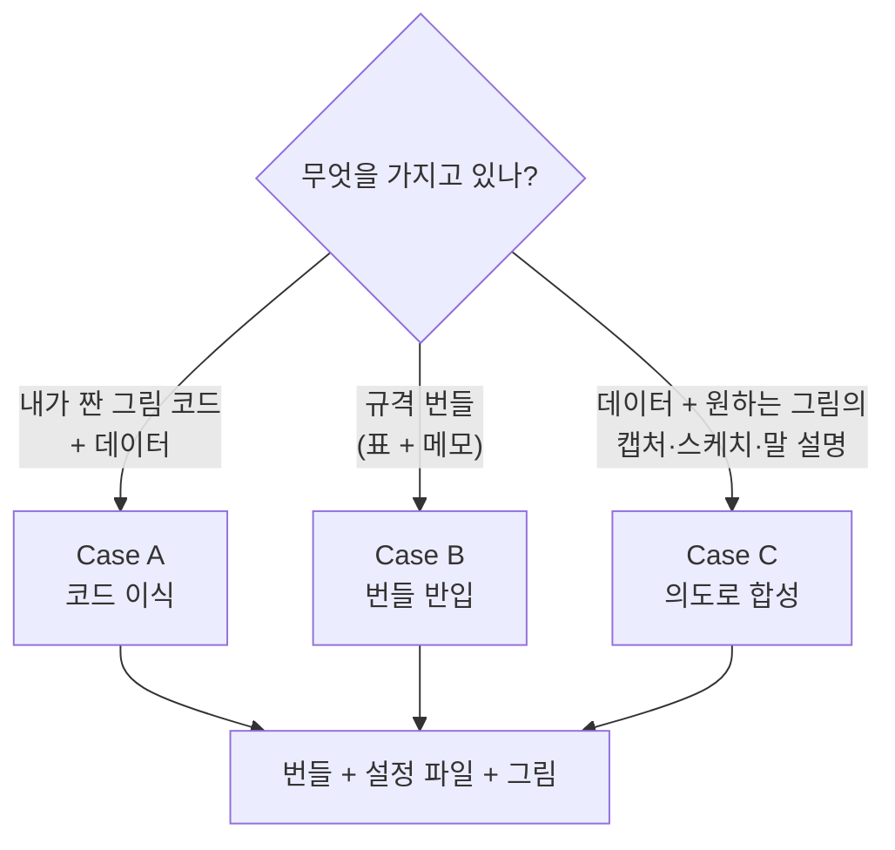

# 5. 그림을 들여오는 세 가지 길 (Case A·B·C)

> **이런 적 있으시죠?** 학생이 주피터 노트북에서 그린 그림이 마음에 들어서 논문에 쓰고 싶은데, 그 코드를 어떻게 정리해야 할지 막막했다. 또는 다른 논문의 그림을 보여 주며 "우리 데이터도 이렇게 그리고 싶다"고만 말할 수 있었다.

**핵심:** 새 그림이 들어오는 길은 **내가 무엇을 가지고 있느냐**에 따라 세 가지입니다. 어느 길이든 끝은 같습니다. 번들로 정리된 데이터와 모든 값이 적힌 설정 파일, 그리고 4장과 같은 그림이 됩니다.

## 어느 길인가



| | Case B: 번들 반입 | Case A: 코드 이식 | Case C: 의도로 합성 |
|---|---|---|---|
| **가진 것** | 규격 번들 (표 + 메모, 3장) | 직접 짠 그림 스크립트(파이썬, 노트북)와 데이터 | 데이터와 원하는 그림의 캡처·스케치, 또는 말 설명 |
| **도구·AI가 하는 일** | 번들을 검사하고 설정에 모든 값을 적고 빌드 (명령 하나) | 데이터를 번들로 옮기고, 코드의 숫자·색·글자를 설정으로 빼내고, 그림 부분을 재사용할 수 있는 부품으로 정리 | 그림을 해석해 해석안을 보여 주고, 승인받은 뒤 그림을 만듦 |
| **연구자가 확인할 것** | 바뀔 설정 미리보기 | 옮긴 뒤의 그림이 **원래 코드의 그림과 같은지** | ① 그리기 전에 **해석안** ② 그린 뒤 **원하는 모양인지** |
| **걸리는 시간** | 몇 분 | 코드 길이에 따라 수십 분 | 확인 대화를 포함해 수십 분 |
| **언제 좋은가** | 분석 도구가 번들로 내보낼 때 (가장 빠르고 안전) | 이미 만족스러운 그림 코드가 있을 때 | 코드는 없고 원하는 모양만 분명할 때 |

세 길의 이름(Case A·B·C)은 AI 도우미가 읽는 규칙([`AGENTS.md`](../../AGENTS.md))과 같습니다. AI에게 "Case A로 들여와 줘"라고 해도 통합니다.

## Case B: 번들이 있을 때

4장에서 한 방법입니다. 따라 해 볼 예제: [튜토리얼: 첫 그림](../tutorials/first_figure.md).

💬 **AI에게:** "`raw_data/…/volcano_bundle`을 프로젝트 `lab-acute-1d-de`에 붙여 줘."

⌨ **명령:** `fa ingest bundle 번들폴더 --project 이름`

번들의 그림 종류(`plot_type`)를 그리는 부품이 이미 있어야 합니다. 없으면 AI가 알려 주고, 그 그림 종류를 새로 만드는 일은 Case A나 C처럼 진행합니다.

## Case A: 내가 짠 그림 코드가 있을 때

따라 해 볼 예제: [튜토리얼: 내가 짠 스크립트 옮기기](../tutorials/case_a_port_script.md). 학생이 짠 qPCR 막대그래프 스크립트를 옮기고, 옮긴 그림이 원래 그림과 같은지 확인합니다.

💬 **AI에게:**

> "`analysis_notebook.py`와 `results.csv`로 그린 그림을 fig-atlas로 들여와 줘(Case A). 프로젝트는 `lab-acute-1d-heatmap`으로 새로 만들어 줘."

AI는 다음 순서로 진행합니다. 단계마다 무엇을 바꾸는지 보여 줍니다.

1. **코드를 읽고 세 부분으로 나눕니다.** 데이터를 읽는 부분, 그림의 값(축 범위·색·크기·임계값), 그리는 부분.
2. **데이터를 번들로 옮깁니다.** 원본 표를 `raw_data/…/inputs/data.csv`로 **그대로** 복사합니다. 값은 바꾸지 않습니다.
3. **그림의 값을 메모와 설정으로 옮깁니다.** 코드에 박혀 있던 `fontsize=12`, `color="red"` 같은 값이 설명 주석 달린 설정 줄이 됩니다.
4. **그리는 부분을 부품(렌더러)으로 정리합니다.** 같은 모양의 부품이 이미 있으면 그것을 씁니다. 없으면 새로 만들어 다음 프로젝트도 쓸 수 있게 남깁니다.
5. **빌드해서 원래 그림과 비교합니다.**

**연구자가 확인할 것:** 새 그림과 원래 코드의 그림을 나란히 놓고 **같은지** 봅니다. 색·순서·축 범위가 다르면 알려 주세요. 처음 옮길 때는 원래 그림과 똑같이 만드는 것이 목표입니다. 바꾸고 싶은 점은 옮긴 뒤에 설정으로 바꿉니다.

## Case C: 원하는 모양만 있을 때

따라 읽을 예제: [튜토리얼: 스케치와 데이터로 그림 만들기](../tutorials/case_c_from_sketch.md). 실제로 있었던 한 번의 진행(해석안, 질문과 답, 결과 검토)을 기록했습니다.

다른 논문의 그림 캡처, 손으로 그린 스케치, 또는 "가로축은 용량, 화합물별로 선을 나누고, 오차 띠를 넣어 줘" 같은 말 설명이면 됩니다.

💬 **AI에게:**

> "`results.csv`를 이 그림(첨부)처럼 그리고 싶어(Case C). 그리기 전에 어떻게 해석했는지 먼저 보여 줘."

1. **해석안을 먼저 확인받습니다.** 예: "`log2FC`를 가로축, `-log10(padj)`를 세로축으로 보고 volcano plot으로 해석했습니다. 기준은 padj ≤ 0.05, |log2FC| ≥ 1입니다. 이대로 진행할까요?" 그림에서 알 수 없는 값(임계값, 어느 열이 무엇인지)은 **추측하지 않고 묻습니다.** 여기서 정확히 답하는 것이 결과를 가장 크게 좌우합니다.
2. **승인 뒤에 그립니다.** 같은 모양의 부품이 있으면 그것을 쓰고, 없으면 새로 만듭니다. 메모에는 이 값들이 "참조 그림에서 추론함"이라고 표시되고, 참조 그림도 번들에 함께 보관됩니다.
3. **결과를 보여 줍니다.** 원하는 모양과 비슷한지는 **연구자가 판단합니다.** 다른 점을 말해 주면 설정으로 조정합니다.

## 처음부터 번들로 받기

분석 파이프라인이나 다른 AI(ChatGPT 등)에게 분석·그림을 맡길 때, 결과를 처음부터 번들 모양으로 달라고 하면 Case B로 바로 들여올 수 있습니다. 아래 글을 요청에 붙이세요.

<!-- i18n: prose -->
```text
[fig-atlas 번들 형식으로 결과 내기]
그림에 쓸 데이터를 아래 폴더 구조로 저장해 주세요.

<번들이름>/
  inputs/data.csv            # 그림이 읽는 표. 한 행 = 한 관측(또는 한 항목). 값은 가공·반올림하지 않음
  metadata/metadata.yaml     # 아래 항목
  scripts/figure.py          # (있으면) 그림을 다시 그리는 코드. 상대 경로 ../inputs/data.csv 사용
  outputs/figure.png         # (있으면) 그 코드로 그린 그림

metadata.yaml 항목:
  plot_type: 그림 종류 (예: line_band, threshold_scatter, venn, volcano)
  plot_params: 그 그림의 값 -- 어느 열을 가로축·세로축·집단으로 쓰는지, 축 범위, 임계값, 색, 제목
```

`plot_type`에 쓸 수 있는 이름과 그림 종류별로 필요한 열은 [데이터 번들 계약서](../contracts/README.md)에 있습니다(⌨ `fa bundle contracts`).

## 알아 두면 좋은 것

- **어느 길이든 원본 데이터는 그대로입니다.** Case A에서도 표를 옮겨 놓을 뿐 고치지 않습니다(3장).
- **새 그림 종류는 자산이 됩니다.** Case A·C에서 새로 만든 그림 부품은 저장소에 남아, 다음에는 같은 종류의 데이터를 Case B처럼 바로 들여올 수 있습니다.
- **그림 모양은 분야와 무관하게 만듭니다.** 예를 들어 "효과 대 유의성 산점도"는 오믹스의 volcano에도, 약물 스크리닝에도 같은 부품을 씁니다. 분야별 이름과 기본값은 따로 둡니다([설계 결정 0003](../decisions/0003-renderers-are-shapes.md)).

---
이전: [4. 첫 그림 만들기](04-first-figure.md) · 다음: [6. 그림 고치기: config 읽고 쓰기](06-config.md)
