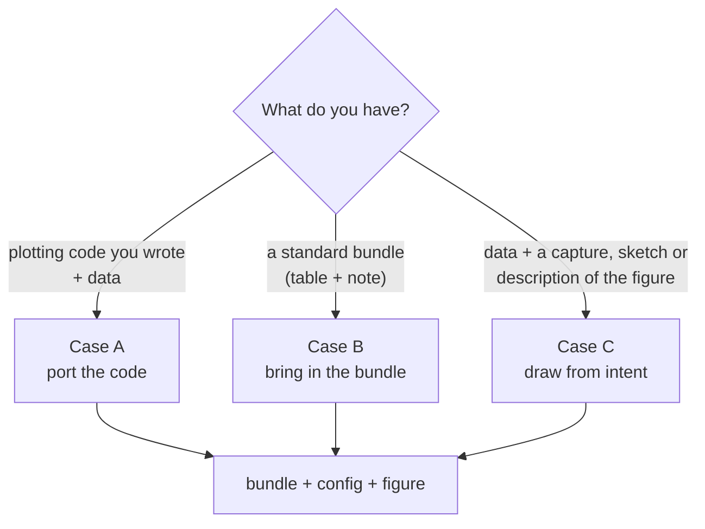

# 5. Three ways in (Case A, B, C)

> **Has this ever happened to you?** A student drew a figure in a Jupyter notebook that you wanted for the paper, but you had no idea how to tidy that code. Or all you could do was show a figure from another paper and say "we want our data to look like this".

**The key idea:** there are three ways for a new figure to come in, depending on **what you have**. Every way ends in the same place: data arranged as a bundle, a config with every value written out, and a figure like the one in chapter 4.

## Which way?



| | Case B: bring in a bundle | Case A: port code | Case C: draw from intent |
|---|---|---|---|
| **What you have** | A standard bundle (table + note, chapter 3) | A plotting script you wrote (Python, notebook) and its data | Data and a capture or sketch of the figure you want, or a description in words |
| **What the tool or AI does** | Checks the bundle, writes every value into the config and builds (one command) | Moves the data into a bundle, takes the numbers, colours and text out of the code into the config, and turns the drawing part into a reusable component | Interprets the figure, shows its interpretation, and draws after you approve |
| **What you check** | A preview of the config changes | That the ported figure is **the same as the original code's figure** | ① before drawing, **the interpretation** ② after drawing, **whether it is the shape you wanted** |
| **Time** | A few minutes | Tens of minutes, depending on the code | Tens of minutes, including the confirming conversation |
| **Best when** | An analysis tool exports bundles (fastest and safest) | You already have plotting code you are happy with | There is no code, only a clear idea of the shape |

The three names (Case A, B, C) are the same as in the rules AI assistants read ([`AGENTS.md`](../../AGENTS.md)). Telling an AI "bring it in as Case A" works too.

## Case B: when you have a bundle

This is what you did in chapter 4. Example to follow: [Tutorial: first figure](../tutorials/first_figure.md).

💬 **Ask an AI:** "Attach `raw_data/…/volcano_bundle` to the project `lab-acute-1d-de`."

⌨ **Command:** `fa ingest bundle bundle-folder --project name`

A component that draws the bundle's kind of figure (`plot_type`) must already exist. If not, the AI tells you, and making that kind of figure goes like Case A or C.

## Case A: when you have plotting code you wrote

Example to follow: [Tutorial: port a script you wrote](../tutorials/case_a_port_script.md). A student's qPCR bar chart script is ported, and the ported figure is checked against the original.

💬 **Ask an AI:**

> "Bring the figure drawn by `analysis_notebook.py` and `results.csv` into fig-atlas (Case A). Make a new project called `lab-acute-1d-heatmap`."

The AI goes through these steps, showing what it changes at each one.

1. **It reads the code and splits it into three parts:** reading the data, the figure's values (axis ranges, colours, sizes, thresholds), and drawing.
2. **It moves the data into a bundle.** The original table is copied **unchanged** to `raw_data/…/inputs/data.csv`. No value is changed.
3. **It moves the figure's values into the note and the config.** Values typed into the code, such as `fontsize=12` or `color="red"`, become config lines with explaining comments.
4. **It turns the drawing part into a component (a renderer).** If a component of the same shape exists, it uses that. If not, it makes one and leaves it for later projects.
5. **It builds and compares with the original figure.**

**What you check:** put the new figure next to the original code's figure and see **whether they are the same**. Tell the AI if colours, order or axis ranges differ. The first port aims to be identical to the original; what you want to change, you change in the config afterwards.

## Case C: when you only have the shape you want

Example to read: [Tutorial: from a sketch and a table](../tutorials/case_c_from_sketch.md). It records one real session: the interpretation, the questions and answers, and the review of the result.

A capture of a figure from another paper, a hand-drawn sketch, or a description such as "dose on the x axis, one line per compound, with an error band" is enough.

💬 **Ask an AI:**

> "I want to draw `results.csv` like this figure (attached) (Case C). Show me how you interpret it before drawing."

1. **It has you confirm its interpretation first.** For example: "I read `log2FC` as the x axis and `-log10(padj)` as the y axis, as a volcano plot, with padj ≤ 0.05 and |log2FC| ≥ 1 as the criteria. Shall I go ahead?" Values the figure cannot tell (thresholds, which column is which) are **asked, not guessed**. Answering precisely here matters most for the result.
2. **It draws after you approve.** If a component of that shape exists, it uses it; if not, it makes one. The note marks these values as "inferred from the reference figure", and the reference figure is kept in the bundle too.
3. **It shows you the result.** Whether it is close to the shape you wanted is **for you to judge**. Tell it what differs and it adjusts the config.

## Getting results as a bundle from the start

When you hand analysis or plotting to an analysis pipeline or another AI (ChatGPT and the like), ask for the results in bundle shape from the start, and they come in directly as Case B. Add the text below to your request.

<!-- i18n: prose -->
```text
[Results in fig-atlas bundle format]
Please save the data for the figure in this folder structure.

<bundle-name>/
  inputs/data.csv            # the table the figure reads. One row = one observation (or item). Values not processed or rounded
  metadata/metadata.yaml     # the entries below
  scripts/figure.py          # (if any) code that redraws the figure, reading ../inputs/data.csv
  outputs/figure.png         # (if any) the figure that code drew

metadata.yaml entries:
  plot_type: the kind of figure (e.g. line_band, threshold_scatter, venn, volcano)
  plot_params: the figure's values -- which columns are the x axis, y axis and groups, axis ranges, thresholds, colours, title
```

The names you can use for `plot_type`, and the columns each kind of figure needs, are in the [data bundle contracts](../contracts/README.md) (⌨ `fa bundle contracts`).

## Good to know

- **On every way, the raw data stay as they are.** In Case A too, the table is only moved, never edited (chapter 3).
- **New kinds of figure become assets.** A component made in Case A or C stays in the repository, so the next time data of that kind come in directly, like Case B.
- **Figure shapes are made independent of the field.** For example, the "effect versus significance scatter" is the same component for an omics volcano plot and for a drug screen. Field-specific names and defaults are kept separately ([design decision 0003](../decisions/0003-renderers-are-shapes.md)).

---
Previous: [4. Making your first figure](04-first-figure.md) · Next: [6. Changing a figure: reading and writing the config](06-config.md)
