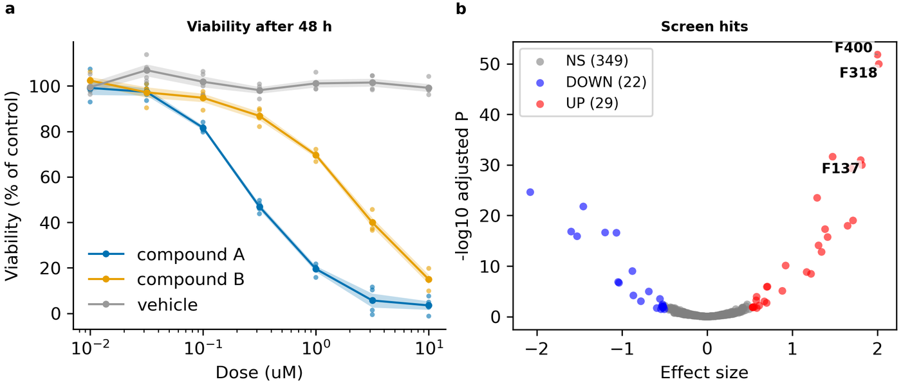

# 6. 그림 고치기: config 읽고 쓰기

> **이런 적 있으시죠?** "패널 제목 크기를 맞춰 주세요"라는 요청을 받고 그림 편집 프로그램에서 글자를 하나씩 고쳤는데, 데이터를 다시 그리면서 그 수정이 모두 사라졌다.

**핵심:** 그림의 모든 값은 **설정 파일(config) 한 곳**에 있습니다. 한 줄을 고치고 다시 빌드하면 그림이 바뀌고, 그 수정은 사라지지 않습니다. 각 줄에는 그 값이 무엇인지 설명이 붙어 있어서, 프로그램을 열지 않고도 무엇을 바꿔야 할지 알 수 있습니다.

## 설정 파일 한 줄 읽기

설정 파일은 `configs/` 아래의 `config_프로젝트이름.yaml`입니다. 메모장이나 아무 글 편집기로 열 수 있는 글 파일입니다. 한 줄은 이렇게 생겼습니다.

```yaml
    title_size: 8.0                    # Panel title size; pt
```

| 부분 | 뜻 |
|---|---|
| `title_size` | 값의 이름 (바꾸지 않습니다) |
| `8.0` | 값 — **여기를 고칩니다** |
| `#` 뒤 | 설명. 무엇을 조절하는지(Panel title size), 단위(pt)가 적혀 있습니다. 어떤 줄에는 "늘리면/줄이면 어떻게 되는지"도 있습니다(예: *lower for dense plots* = 점이 빽빽하면 줄이세요). |

설명이 영어로 되어 있는 이유는, 프로그램이 자동으로 만들고 AI 도우미도 같은 설명을 읽기 때문입니다. 자주 나오는 단어는 이 장 끝의 표를 보세요.

## 설정 파일의 구조

```yaml
project:            # 프로젝트 이름, 스타일(인쇄 크기·A4 지면) — 거의 고치지 않음
paths:              # 데이터와 결과 위치 — 거의 고치지 않음
figures:            # 그림 전체: 높이, 한 줄에 놓을 패널 수, 패널 사이 간격, 패널 태그 크기
plots:              # 패널마다 한 블록
  dose_response:    #   패널 a: 용량-반응 곡선의 모든 값
  screen_hits:      #   패널 b: 스크리닝 산점도의 모든 값
```

번들을 붙일 때 도구가 각 패널 블록에 **그 그림 종류가 쓰는 값을 빠짐없이** 적어 둡니다. 그래서 "이 그림에서 바꿀 수 있는 것"이 무엇인지 이 파일만 보면 다 나옵니다.

## 특별한 표시 세 가지

| 표시 | 뜻 |
|---|---|
| `(from the bundle)` | 번들의 메모에서 옮겨 온 값입니다. 고쳐도 됩니다. 번들은 그대로이고, 이제 설정 파일의 값이 쓰입니다. |
| `null` | "정해 두지 않음 = 자동"입니다. 예를 들어 `y_max: null`이면 축 범위를 데이터에 맞춰 자동으로 정합니다. 숫자를 넣으면 그 값으로 고정됩니다. |
| 줄 맨 앞의 `#` | 꺼져 있는 줄입니다. 설명에 *(computed when unset)* 이 붙은 값은 비워 두면 프로그램이 계산해 정합니다. 직접 정하려면 `#`를 지우고 값을 넣습니다. |

## 예: 경고 고치기와 제목 크기 맞추기

4장의 그림에는 두 가지 고칠 점이 있었습니다.

1. **색:** 패널 a의 주황과 초록이 색각이상 독자에게 비슷해 보인다는 경고.
2. **일관성:** 패널 a의 제목은 8 pt, 패널 b의 제목은 10 pt로 서로 다릅니다. 그림 종류마다 기본값이 달라서 생긴 차이입니다.

`dose_response` 블록에서:

```yaml
    group_colors:                      # 집단별 색: 색각이상에도 구분되는 Okabe–Ito 색
      "compound A": "#0072B2"
      "compound B": "#E69F00"
      vehicle: "#999999"
```

`screen_hits` 블록에서:

```yaml
    title_size: 8                      # Panel title font size; pt   ← 10에서 8로, 패널 a와 맞춤
    label_top_n: 3                     # Points labelled in top_n mode   ← 이름 붙일 점 6개에서 3개로
```

다시 빌드한 결과입니다. 패널 a의 색이 바뀌었고, 두 패널의 제목 크기가 같아졌고, 패널 b의 라벨이 줄었습니다.



## 내가 할 일

💬 **AI에게:**

> "first-figure의 패널 b 제목 크기를 패널 a와 같은 8 pt로 맞추고, 이름 붙는 점을 3개로 줄여 줘."

AI는 설정 파일에서 바뀔 줄을 먼저 보여 줍니다. **그 줄들이 말한 내용과 맞는지 확인**하고 진행하라고 답합니다. AI는 설정 파일의 설명 주석을 지우지 않고 값만 고칩니다(규칙입니다).

✏ **직접 고치기:** 글 편집기로 설정 파일을 열어 값을 고치고 저장한 뒤 다시 빌드합니다(💬 "first-figure 다시 빌드해 줘" 또는 ⌨ `fa build first-figure`).

💡 **팁 (VS Code를 쓴다면):** 설정 파일을 열면 들여쓰기가 색으로 구분되어 실수가 줄고, 저장 뒤 `Ctrl+Shift+B`로 바로 다시 빌드할 수 있습니다.

💬 **값이 어디서 왔는지 궁금할 때:** "first-figure의 `plots.dose_response.band_alpha` 값은 어디서 온 거야?" 하고 물으면, 기본값인지, 스타일 설정에서 온 것인지, 이 설정 파일에서 정한 것인지 알려 줍니다.

## 고칠 때 주의할 것

설정 파일은 YAML이라는 형식입니다. 세 가지만 지키면 됩니다.

| 주의 | 예 |
|---|---|
| **들여쓰기(앞 공백)를 그대로 둡니다.** 공백 수가 소속을 나타냅니다. | `    title_size: 8` 앞의 공백 4칸을 지우면 다른 블록으로 넘어갑니다. |
| **`:` 뒤에 한 칸 띄웁니다.** | `title_size: 8` (O), `title_size:8` (X) |
| **글자에 `:`, `#`가 들어가면 따옴표로 감쌉니다.** | `labels_title: "Dose: 48 h"` |

잘못 고쳐서 빌드가 실패하면 오류 메시지에 몇 번째 줄인지 나옵니다. AI에게 오류 메시지를 보여 주며 고쳐 달라고 해도 됩니다.

## 자주 고치는 값

| 하고 싶은 일 | 찾을 이름 | 어디에 |
|---|---|---|
| 글자 크기 (제목, 축 제목, 눈금, 범례) | `title_size`, `axes_label_size`, `tick_label_size`, `legend_fontsize` | 패널 블록 |
| 색 | `…_color`, `group_colors` | 패널 블록 |
| 축 범위 | `x_min`, `x_max`, `y_min`, `y_max` | 패널 블록 |
| 축·패널 제목 글 | `labels_title`, `labels_xlabel`, `labels_ylabel` | 패널 블록 |
| 점·선 크기 | `dot_size`, `point_size`, `line_width`, `marker_size` | 패널 블록 |
| 판정 기준(임계값) | `…_threshold` | 패널 블록 |
| 그림 높이 | `height_mm` (폭은 A4 본문 폭으로 고정) | `figures:` |
| 한 줄에 놓을 패널 수 | `columns` (0이면 패널 수만큼, 최대 3) | `figures:` |
| 패널 둘레 여백 | `panel_pad_mm` | `figures:` |

## 설명 주석에 자주 나오는 단어

| 단어 | 뜻 |
|---|---|
| pt | 포인트. 글자·선 굵기 단위 (1 pt ≈ 0.35 mm) |
| mm | 밀리미터. 실제 지면 위 길이 |
| hex color | `#0072B2` 같은 색 코드 |
| [0-1] opacity | 불투명도. 0은 투명, 1은 불투명 |
| data coords | 축 눈금과 같은 단위 (예: 축이 0–100이면 그 숫자) |
| default | 정하지 않았을 때 쓰는 값 |
| raise / lower | 늘리세요 / 줄이세요 |

---
이전: [5. 그림을 들여오는 세 가지 길](05-entry-paths.md) · 다음: [7. 결과 확인](07-results.md)
