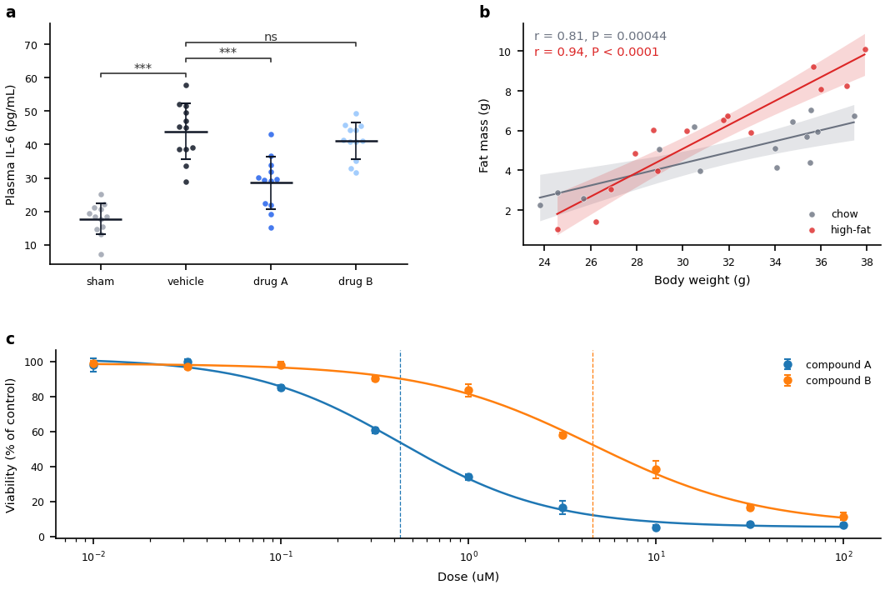
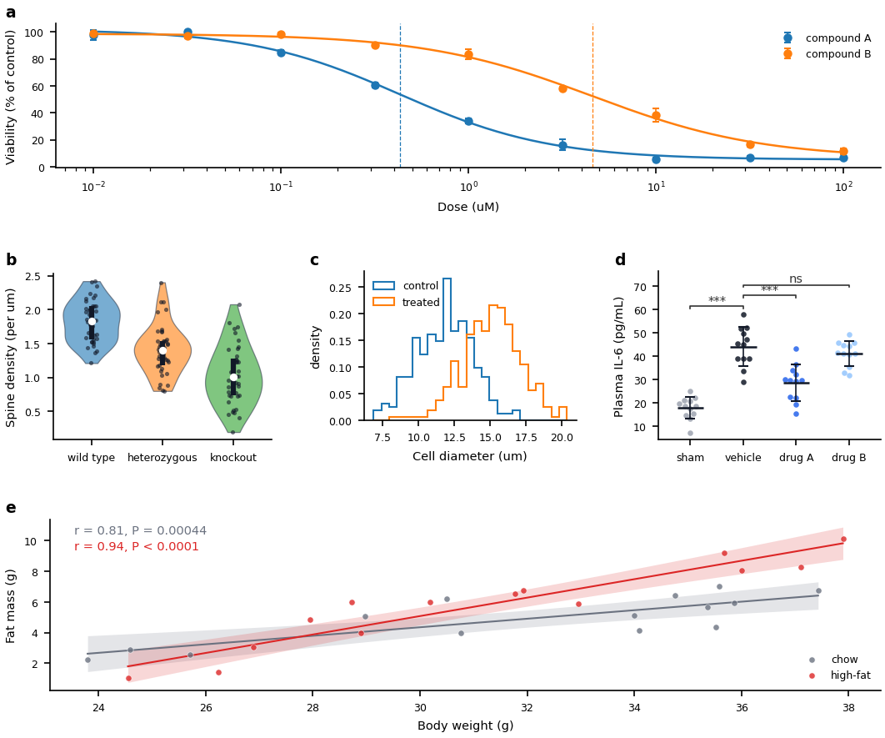

# 7. 패널 배치: 레이아웃

> **이런 적 있으시죠?** 논문 그림에 작은 패널 두 개를 위에, 넓은 시간 경과 그림 하나를 아래에 놓아야 했다. 도구는 패널을 한 줄로 똑같이 늘어놓았고, 누군가 옛 그림의 배치 코드를 복사해 고쳤다. 그 뒤로는 그 안의 어떤 숫자가 어느 패널을 움직이는지 아무도 몰랐다.

**핵심:** 패널 배치는 검증된 레이아웃 몇 가지 중에서 **이름으로 고릅니다**. 모양은 프로그램에 정해져 있고, 간격과 비율은 그림의 다른 값과 마찬가지로 설정 파일의 한 줄입니다.

## 패널을 배치하는 두 가지 방법

| | 스크립트 없이 | 레이아웃으로 |
|---|---|---|
| **모양** | 한 줄에 최대 세 개씩 놓이는 등분 그리드 (4·5장) | 아래 다섯 가지 모양 중 하나 |
| **언제** | 무게가 같은 패널, 번들 하나에 패널 하나 | 논문 그림: 넓은 패널, 한 열, 작은 패널을 빽빽이 늘어놓은 벽 |
| **누가 무엇을 쓰나** | 아무것도: 번들을 붙이면 끝 | 분석 스크립트가 레이아웃 이름을 한 줄로 부릅니다. AI가 씁니다 |
| **어디서 바꾸나** | 설정 파일의 `figures:` | 설정 파일의 `figures:` (같은 자리) |

어느 쪽이든 패널 글자(a, b, c, …)는 축 이름까지 포함한 패널의 바깥 테두리에 놓이고, 아래 패널의 글자와 세로로 줄을 맞춥니다(저장소 규칙, 14장).

## 다섯 가지 레이아웃

| 레이아웃 | 모양 | 쓰는 곳 |
|---|---|---|
| `grid` | 행과 열, 왼쪽에서 오른쪽으로 채움. 크기를 정하지 않으면 모두 같음 | 무게가 같은 패널들 (스크립트 없이 그릴 때와 같은 칸), 또는 한 열만 넓은 그리드 |
| `wide_bottom` | 위에 패널 한 줄, 아래에 전체 폭 패널 하나 | 가장 흔한 논문 모양: 위에 세부, 아래에 전체 |
| `stack` | 한 열, 패널을 위아래로 | 위에서 아래로 읽는 패널, 한 단 폭 그림 |
| `row` | 한 줄, 나란히 | 왼쪽에서 오른쪽으로 비교하는 띠 |
| `matrix` | 작은 패널을 빽빽이 늘어놓은 벽 | 유전자·시료·조건마다 같은 그림 |



[레이아웃 카탈로그](../reference/layouts.md)에 레이아웃마다 그림, 모양, 읽는 설정값이 모두 있습니다. 그림은 저장소의 짧은 예제(`examples/layouts/`)가 그린 것이라, 보이는 그대로 예제가 만듭니다.

## 할 일

💬 **AI에게 말하기:**

> "first-figure에서 패널 a와 b를 위에, 패널 c를 아래에 전체 폭으로 놓아 줘 (wide_bottom 레이아웃)."

AI는 바꿀 내용을 먼저 보여 줍니다. 분석 스크립트의 레이아웃 한 줄과 `figures:` 아래 새 값들이며, 값마다 설명 주석이 붙습니다. **모양이 요청한 대로인지 확인**하고 진행하라고 하면, 검사를 켜고 그림을 빌드해 결과를 보여 줍니다.

⌨ **명령:** `fa build first-figure --preflight`는 그림을 다시 빌드하고 겹침과 잘림을 보고합니다.

✏ **모양을 직접 다듬기:** 값은 설정 파일의 `figures:` 아래에 있습니다. `wide_bottom` 예제의 블록입니다.

```yaml
figures:
  width_mm: 180               # 그림 폭, mm (저널 두 단)
  height_mm: 120              # 그림 높이, mm
  wspace: 0.15                # 위 패널 사이 간격, 평균 칸 폭에 대한 비율
  hspace: 0.12                # 줄 사이 간격, 평균 칸 높이에 대한 비율
  panel_pad_mm: 1.0           # 패널 바깥 테두리와 칸 사이 여백, mm
  tags:
    size: 9.0                 # 글자 크기, pt
  wide_bottom:
    height_ratios: [1.0, 0.9] # 위 줄 : 아래 줄
```

`height_ratios`의 두 번째 숫자를 올리면 넓은 패널이 높아지고, `wspace`를 올리면 위 패널들이 벌어집니다. 다시 빌드하면 바뀐 모양이 보입니다.

## 칸 나누기: 레이아웃 안의 레이아웃

모양 하나로 맞지 않을 때(예: 세 줄 중 가운데 줄에 패널이 세 개) 한 칸을 두 번째 레이아웃으로 나눕니다. 두 번째 레이아웃은 그림 대신 그 칸에서 부르고, 그 칸의 글자로 시작합니다.

```python
lay = layouts.stack(fig, fcfg, letters=("a", "b", "e"))
layouts.row(lay.cells["b"], fcfg, letters=("b", "c", "d"))   # 칸 b가 b | c | d가 됨
```



그림은 a, b, c, d, e 순서가 되고, 두 단계의 글자가 저절로 줄을 맞춥니다. 안쪽 레이아웃의 값은 그 칸의 글자 아래에 두므로, 같은 방식으로 나눈 두 칸도 각자의 값을 가집니다.

```yaml
figures:
  cells:
    b:                                  # 칸 b를 나누는 레이아웃
      row:
        width_ratios: [1.0, 1.0, 1.0]   # b, c, d의 폭
```

💬 **AI에게 말하기:** "first-figure에서 가운데 줄을 패널 세 개로 나눠 줘." 예제는 `examples/layouts/compose/`에 있습니다. 레이아웃은 두 단계까지만 겹칩니다.

## 자주 바꾸는 값

| 하고 싶은 것 | 바꿀 값 | 위치 |
|---|---|---|
| 패널 사이를 벌리거나 좁히기 | `wspace` (좌우), `hspace` (위아래) | `figures:` (`matrix`는 `figures.matrix`) |
| 한 줄을 더 높게 | `height_ratios` (줄마다 숫자 하나) | `figures.wide_bottom`, `figures.stack`, `figures.grid`, `figures.matrix` |
| 한 열을 더 넓게 | `width_ratios` (열마다 숫자 하나) | `figures.row`, `figures.grid`, `figures.matrix` |
| 한 줄의 패널 수 | `columns` | `figures:` (`grid`), `figures.matrix` |
| 나눈 칸의 값 | 같은 키 | `figures.cells.<글자>` |
| 패널 둘레 여백 늘리기 | `panel_pad_mm` | `figures:` |
| 패널 글자 바꾸기 | `tags.size`, `tags.show` | `figures:` |

## 알아 두면 좋은 것

- **간격은 mm가 아니라 비율입니다.** `wspace: 0.15`는 패널 평균 폭의 15%입니다. 그림이 넓어져도 같은 값이면 같은 느낌이 유지됩니다.
- **카탈로그에 없는 모양**은 대개 한 레이아웃의 칸 안에 다른 레이아웃을 넣은 것입니다(위). 아니면 가장 가까운 예제에서 시작합니다. AI에게 "이 스케치는 어떤 레이아웃들로 만들 수 있어?"라고 물어보세요. 캔버스 전체에 그리는 패널(모식도, 타임라인)은 레이아웃이 아니라 그림 종류입니다(5장).
- **레이아웃을 바꿔도 데이터와 패널 값은 그대로입니다.** 패널이 놓이는 자리만 바뀌므로 여러 모양을 시험해 보고 마음에 드는 것을 고르면 됩니다.
- **레이아웃을 가장 많이 쓰는 곳은 논문 그림입니다.** 논문으로 승격한 탐색 그림(12장)은 흔히 이 모양들 중 하나로 다시 배치됩니다.

---
이전: [6. 그림 고치기: config 읽고 쓰기](06-config.md) · 다음: [8. 결과 확인](08-results.md)
