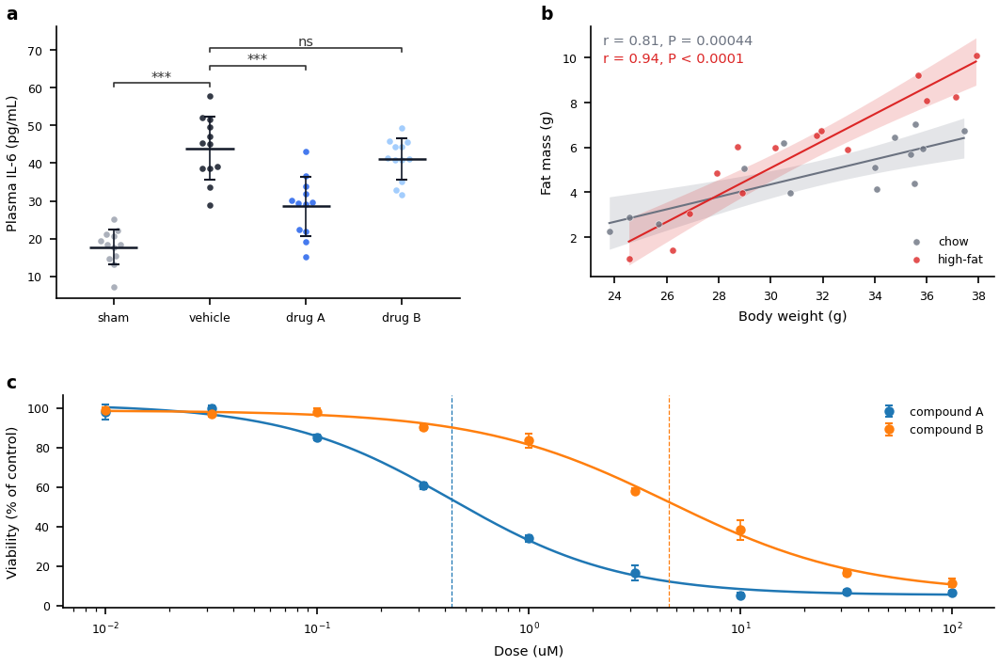
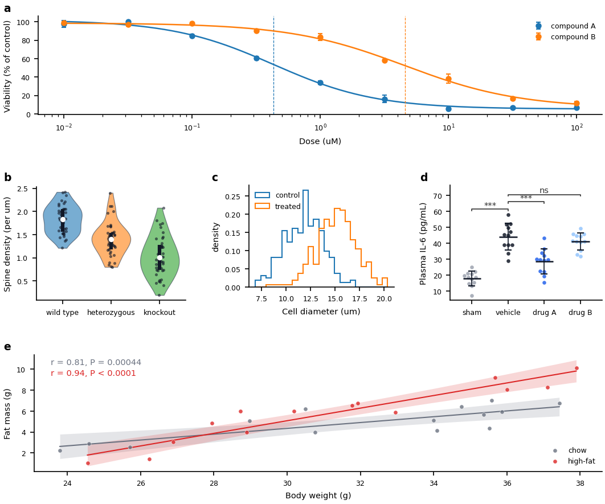

# 7. Arranging panels: layouts

> **Has this ever happened to you?** The paper figure needed two small panels on top and one wide time course across the bottom. The tool laid the panels out in an even row, so someone copied the layout code of an old figure, and no one could say any more which number in it moved which panel.

**The key idea:** the arrangement of the panels is **chosen by name** from a short catalog of tested layouts. The shape is fixed in the program; every gap and ratio is a line of the config, like any other value of the figure.

## Two ways to arrange panels

| | Without a script | With a layout |
|---|---|---|
| **Shape** | An even grid, up to three panels in a row (chapters 4 and 5) | One of the five shapes below |
| **When** | Panels of equal weight, one bundle each | A paper figure: a wide panel, a column, a wall of small panels |
| **Who writes what** | Nothing: attaching the bundles is enough | The analysis script names the layout in one line; the AI writes it |
| **Where you change it** | `figures:` of the config | `figures:` of the config (the same place) |

Either way, the panel letters (a, b, c, …) are placed on each panel's outer edge, labels included, and line up with the panel below (a rule of the repository, chapter 14).

## The five layouts

| Layout | Shape | Use it for |
|---|---|---|
| `grid` | Rows and columns, filled left to right; equal unless you set their sizes | Panels of equal weight (the same cells as without a script), or a grid with one wider column |
| `wide_bottom` | A row of panels, one full-width panel beneath | The most common paper shape: details on top, the overview below |
| `stack` | One column, one panel above another | Panels read top to bottom; a one-column figure |
| `row` | One row, side by side | One band compared left to right |
| `matrix` | Many small panels in a dense wall | The same plot for each gene, sample or condition |



The [layout catalog](../reference/layouts.md) shows a picture of each layout, its shape and every value it reads. Each picture is drawn by a short example in the repository (`examples/layouts/`), so what you see is what the example makes.

## What you do

💬 **Ask an AI:**

> "In first-figure, put panels a and b on top and panel c full width below (the wide_bottom layout)."

The AI first shows the change: the layout line in the analysis script and the new values under `figures:`, each with its explaining comment. **Check that the shape is the one you asked for**, then tell it to go ahead. It builds the figure with the checks on and shows you the result.

⌨ **Command:** `fa build first-figure --preflight` builds the figure again and reports overlaps and clipping.

✏ **Adjusting the shape yourself:** the values are under `figures:` in the config. This is the block of the `wide_bottom` example:

```yaml
figures:
  width_mm: 180               # Figure width in mm (two journal columns)
  height_mm: 120              # Figure height in mm
  wspace: 0.15                # Gap between the top panels, fraction of the mean cell width
  hspace: 0.12                # Gap between the rows, fraction of the mean cell height
  panel_pad_mm: 1.0           # Margin in mm between a panel's outer edge and its cell
  tags:
    size: 9.0                 # Letter size in pt
  wide_bottom:
    height_ratios: [1.0, 0.9] # Top row : bottom row
```

Raise the second number of `height_ratios` to give the wide panel more height; raise `wspace` to move the top panels apart. Build again to see the change.

## Splitting a cell: a layout inside a layout

When no single shape fits -- say three rows where the middle row holds three panels -- split one cell with a second layout. The second layout is called on the cell instead of on the figure, and starts with that cell's letter:

```python
lay = layouts.stack(fig, fcfg, letters=("a", "b", "e"))
layouts.row(lay.cells["b"], fcfg, letters=("b", "c", "d"))   # cell b becomes b | c | d
```



The figure reads a, b, c, d, e, and the letters line up across both levels on their own. The values of the inner layout go under the cell's letter, so two cells split the same way keep their own numbers:

```yaml
figures:
  cells:
    b:                                  # the layout that splits cell b
      row:
        width_ratios: [1.0, 1.0, 1.0]   # widths of b, c and d
```

💬 **Ask an AI:** "In first-figure, split the middle row into three panels." The example is in `examples/layouts/compose/`. Layouts nest two levels at most.

## Values often changed

| You want to | Change | Where |
|---|---|---|
| Move panels apart or closer | `wspace` (side by side), `hspace` (above and below) | `figures:` (`figures.matrix` for `matrix`) |
| Give one row more height | `height_ratios` (one number per row) | `figures.wide_bottom`, `figures.stack`, `figures.grid` or `figures.matrix` |
| Make one column wider | `width_ratios` (one number per column) | `figures.row`, `figures.grid` or `figures.matrix` |
| Change the panels per row | `columns` | `figures:` (`grid`), `figures.matrix` |
| Change a split cell | the same keys | `figures.cells.<letter>` |
| Leave more air around each panel | `panel_pad_mm` | `figures:` |
| Change the letters | `tags.size`, `tags.show` | `figures:` |

## Good to know

- **The gaps are fractions, not millimetres.** `wspace: 0.15` means 15% of the average panel width. The same value keeps the same look when the figure gets wider.
- **A shape not in the catalog** is usually two layouts, one inside a cell of the other (above), or starts from the closest example: ask the AI "which layouts make this sketch?". A panel that draws on the whole canvas (a schematic, a timeline) is a kind of figure, not a layout (chapter 5).
- **Moving an existing figure to a layout takes a short re-tuning pass.** The layout fits each panel to its cell, so ratios tuned for the old placement change, and labels a script placed outside the axes by fractions of the axes move closer. Build with the checks on and adjust the ratios.
- **Changing the layout does not touch the data or the panel values.** Only where the panels sit changes, so you can try several shapes and keep the one you like.
- **Paper figures** are where layouts are used most: an exploratory figure promoted to the paper (chapter 12) is often rearranged into one of these shapes.

---
Previous: [6. Changing a figure: reading and writing the config](06-config.md) · Next: [8. Checking the results](08-results.md)
