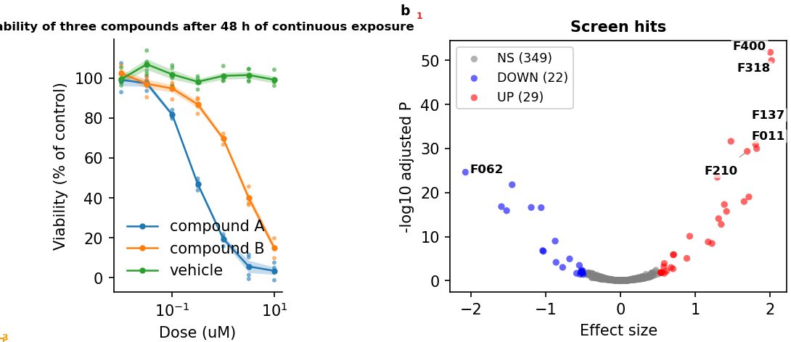

# 8. 검사 결과 읽기

> **이런 적 있으시죠?** 교정쇄를 받고서야 눈금 숫자가 겹쳐 있고, 패널 제목이 잘려 있고, 빨강·초록으로만 구분한 선이 흑백 인쇄에서 구분되지 않는다는 걸 알았다.

**핵심:** 빌드할 때 **두 가지 검사**가 자동으로 돕니다. **인쇄 전 검사(preflight)**는 그림 자체의 문제를, **검증(verify)**은 결과물이 빠짐없는지를 봅니다. 오류는 반드시 고치고, 경고는 읽고 판단합니다.

## 인쇄 전 검사 (preflight)

그림을 실제 크기로 그려 보고 사람이 교정쇄에서 찾을 문제를 미리 찾습니다.

| 무엇을 보나 | 예 |
|---|---|
| 글자 겹침 | 눈금 숫자끼리, 이웃 패널의 글자끼리 겹침 |
| 잘림·침범 | 글자가 그림 밖으로 나감, 범례나 축 제목이 옆 패널을 덮음 |
| 크기 | 인쇄했을 때 너무 작은 글자(5 pt 미만)나 너무 가는 선, 해상도가 낮은 이미지 |
| 폰트 | 저널이 받지 않는 폰트 형식, 없는 폰트를 다른 폰트로 바꿔 그림 |
| 색 | 색각이상 독자가 구분하기 어려운 색 쌍, 무지개형 색 막대, 글자와 배경의 대비 부족 |
| 일관성 | 패널 태그(a, b, c)의 줄 맞춤·크기, 한두 개만 크기가 다른 글자(대개 실수) |

결과는 세 단계로 나옵니다.

| 단계 | 뜻 | 할 일 |
|---|---|---|
| **error** (오류) | 인쇄물에서 분명히 문제가 됩니다. | **반드시 고칩니다.** 오류가 남은 그림은 "완성"이 아닙니다. |
| **warn** (경고) | 문제일 수 있습니다. | 읽고 판단합니다. 의도한 것이면 그대로 둬도 됩니다. |
| **info** (참고) | 알아 두면 좋은 정보입니다. | 필요할 때만 봅니다. |

## 예: 잘린 제목

패널 a의 제목을 길게 바꿨더니 이런 결과가 나왔습니다.

```
error  clipped_by_saved_area  text 'Viability of three compounds after 48 h ' extends 4.4 mm past the saved area
error  clipped_by_saved_area  text 'a' extends 4.4 mm past the saved area
warn   cvd_indistinct         legend of axes[0]: #ff7f0e and #2ca02c look alike with protanomaly
```

- 첫 두 줄(오류): 제목과 패널 태그 a가 그림 왼쪽 밖으로 4.4 mm 나가 잘립니다.
- 셋째 줄(경고): 주황과 초록이 적색약 독자에게 비슷해 보입니다(6장에서 고친 것).

문제 위치는 **표시 그림(오버레이)**에서 볼 수 있습니다. 문제마다 번호가 붙은 상자로 표시됩니다.



고치는 방법은 설정에서 제목을 줄이거나(`labels_title`), 그림 높이·여백을 늘리는 것입니다. 각 지적에는 고치는 방향이 `hint`로 함께 적혀 있습니다(이 예에서는 "여백을 늘리거나 글자를 안쪽으로").

## 검증 (verify)

결과물이 빠짐없고 서로 맞는지 봅니다.

| 무엇을 보나 | 실패하는 경우 |
|---|---|
| 그림 파일 | PNG·PDF·SVG 중 빠지거나 빈 파일이 있음 |
| 그림 설명서 | README가 없거나 패널 설명이 빠짐 |
| 살아 있는 숫자 | 설명에 `{n_hits}` 같은 자리가 있는데 분석이 값을 기록하지 않음 (9장) |
| 통계표 | 별표가 있는 그림인데 통계표가 없음 (9장) |
| 이미지 원본 | 현미경 이미지 원본이 기록된 지문과 달라짐 (9장) |
| 인쇄 전 검사 | 오류·경고 수를 함께 보고 |

결과는 **PASS / WARN / FAIL**입니다. FAIL이면 빌드가 실패로 끝나고 무엇이 문제인지 알려 줍니다.

## 내가 할 일

💬 **AI에게:** "first-figure를 인쇄 전 검사까지 해서 빌드하고, 오류와 경고를 설명해 줘." 그다음 "오류를 설정으로 고쳐 줘. 색이나 디자인을 바꿔야 하면 먼저 물어봐."

AI는 오류를 설정으로 고치되, **색·디자인처럼 그림의 의미가 바뀌는 수정은 먼저 묻도록** 규칙에 적혀 있습니다. 경고는 고치지 않고 보고만 합니다. 결정은 연구자가 합니다.

⌨ **명령:** `fa build first-figure --preflight`

💡 **팁 (VS Code를 쓴다면):** `Ctrl+Shift+B` 빌드 버튼은 인쇄 전 검사 없이 빌드합니다. 검사까지 하려면 위 명령이나 AI를 씁니다.

## 알아 두면 좋은 것

- **경고를 그대로 둬도 되는 경우:** 일부러 흐린 회색으로 처리한 배경 점, 글자 대비가 낮아도 장식인 요소 등. 연구자가 의도를 확인했으면 됩니다.
- **결함을 일부러 보여 주는 그림:** 교육용 그림이나 "고치기 전" 패널처럼 결함을 보여 주는 것이 목적이면, 그 축에 `fa-allow:<이름>` 표시를 달고(AI에게 부탁하면 됩니다) 설정의 `preflight:` 아래 `allow:`에 `<이름>: "<이유>"`를 적습니다. 그 축 안의 지적은 이유와 함께 참고(info)로 바뀝니다. 이유를 적지 않으면 아무것도 허용되지 않습니다.
- **투고 직전에는 엄격 모드로:** 설정의 `preflight:` 아래에 `mode: enforce`를 넣으면, 인쇄 전 검사의 오류가 검증 실패로 이어집니다. 오류가 남은 채로 넘어가는 일을 막습니다.
- **표시 그림 위치:** `outputs/preflight/프로젝트이름/`. 전체 지적 목록은 `outputs/preflight/preflight_findings.csv`에 있습니다.

---
이전: [7. 결과 확인](07-results.md) · 다음: [9. 숫자·통계·이미지의 정직성](09-integrity.md)
