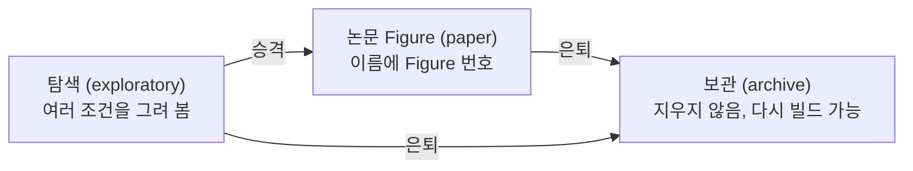

# 11. 논문으로: 그림의 생애주기

> **이런 적 있으시죠?**
> - 논문 구성을 바꾸면서 Figure 3이 Figure 4가 되고, 옛 Figure 4는 보충 그림으로 갔다. 석 달 뒤 회의록의 "Figure 3"이 지금의 어느 그림인지 헷갈렸다.
> - 지운 그림을 리뷰어가 다시 보자고 해서 옛 버전을 찾느라 고생했다.

**핵심:** 그림은 **탐색 → 논문 Figure → 보관**의 길을 갑니다. 논문의 그림 배치는 **스토리라인 문서 한 곳**에 적고, 바뀔 때마다 **이유와 근거를 기록**합니다. 그림은 지우지 않고 보관하며, 언제든 다시 만들 수 있습니다.

## 세 단계

| 단계 | 언제 | 무엇이 바뀌나 |
|---|---|---|
| **승격** | 탐색 그림이 논문 Figure N으로 쓰이기로 정해졌을 때 | 프로젝트가 `paper/` 폴더로 옮겨지고, 이름이 `연구단위-paper-main-figN-짧은이름`으로 바뀌고, 안쪽의 경로가 모두 맞춰지고, 한 번 빌드해 확인합니다. |
| **은퇴** | 논문에서 빠지거나 새 버전으로 대체될 때 | 프로젝트가 `archive/` 폴더로 옮겨지고, 빌드 목록에서 빠지고, 한 번 빌드해 여전히 만들어지는지 확인합니다. **데이터와 코드는 지우지 않습니다.** |

💬 **AI에게:** "lab-acute-1d 프로젝트를 논문 Figure 2로 승격해 줘. 짧은 이름은 acute-comparison으로." 옮겨질 파일과 바뀔 내용을 먼저 보여 주고, 확인하면 진행합니다.

💬 **AI에게:** "옛 Figure 4 프로젝트를 은퇴시켜 줘."

## 스토리라인 문서

논문 전체의 그림 배치와 이야기는 `docs/storylines/` 아래에 있습니다.

| 파일 | 내용 | 누가 고치나 |
|---|---|---|
| `storyline.yaml` | **배치표.** "Main Figure 1 = 어느 프로젝트" 같은 짝. 컴펜디움 PDF, 검사, 대응표가 모두 여기를 읽습니다. | 연구자 (AI에게 부탁) |
| `figure_plan_주제.md` | **이야기.** 각 Figure가 무엇을 보여 주고 왜 그 순서인지, 그리고 개편 기록 | 연구자 (AI에게 부탁) |
| 맨 위의 대응표 | Figure 번호 ↔ 설정·분석·설명 파일 링크 | **자동 생성.** 손으로 고치지 않습니다. |

**Figure 번호와 프로젝트 이름은 1:1로 맞춥니다.** 스토리라인의 Main Figure 3은 반드시 이름에 `fig3`이 들어간 논문 프로젝트를 가리킵니다. 어긋나면 검사가 알려 줍니다.

## 개편 기록: 무엇을, 왜 바꿨나

스토리라인을 바꿀 때마다 번호 붙은 **개편 기록**을 남깁니다. 기록은 이런 모양입니다.

> **개편(12) — 보충 그림 순서 교체(2026-10-02)**: 리뷰어가 먼저 볼 그림이 앞에 오도록 옛 S2를 Supplementary Figure S1로, 옛 S1을 S2로 바꿨다. 근거 데이터는 그대로 …

기록에는 다음이 함께 들어갑니다.

- **바뀐 것:** 배치, 번호
- **이유:** 사용자 지시, 판단 근거
- **근거 데이터:** 어느 데이터 요청으로 어떤 파일을 받았는지
- **바뀐 결과 숫자:** 손으로 옮기지 않고, 지난 스냅샷과 비교해 도구가 뽑아 줍니다.

순서는 이렇습니다.

1. 💬 "지난 스냅샷 이후 스토리라인에서 실제로 바뀐 것을 정리해 줘." 바뀐 배치·데이터·숫자가 초안으로 나옵니다.
2. 연구자가 **왜** 바꿨는지를 한두 문장으로 씁니다(또는 AI에게 받아쓰게 합니다).
3. 💬 "개편 기록을 동기화하고, 컴펜디움 PDF를 엄격 모드로 만들고, 바뀐 내용 기록을 저장해 줘." 컴펜디움을 만들 때 이 개편 시점의 **스냅샷**(배치, 그림 출처, 숫자)이 함께 저장되어, 다음 개편 때 비교의 기준이 됩니다.

이렇게 하면 석 달 뒤에도 "그때 Figure 3이 무엇이었고 왜 바꿨는지"를 기록에서 찾을 수 있습니다. 기록 속 옛 번호도 당시 프로젝트로 거슬러 올라갈 수 있습니다.

## 데이터 요청과 근거 추적

분석 파이프라인에 새 데이터를 요청할 때는 `docs/data_contracts/` 아래에 요청 문서를 씁니다. 문서 머리에 상태(요청함 / 받음), 날짜, 받은 파일 위치를 적어 두면, 💬 "Main Figure 3의 근거를 보여 줘"라고 했을 때 **그림 → 프로젝트 → 입력 파일 → 데이터 요청 → 관련 개편 기록**이 한 줄로 이어져 나옵니다.

## 컴펜디움 PDF

스토리라인의 모든 Figure를 순서대로 한 PDF에 모은 것입니다. 공동저자와 공유하거나 회의에서 볼 때 씁니다.

⌨ **명령:** `fa storyline compile`

💡 **팁 (VS Code를 쓴다면):** `Ctrl+Shift+B` → **Compile Storyline Multi-Page PDF**로도 만들 수 있습니다.

💬 **엄격 모드:** "컴펜디움을 엄격 모드로 만들어 줘." 낡은 그림이나 검사 오류가 있는 그림이 있으면 PDF를 만들지 않고 무엇이 문제인지 알려 줍니다.

---
이전: [10. 데이터가 바뀌었을 때](10-freshness.md) · 다음: [12. AI와 함께 일하기](12-ai.md)
