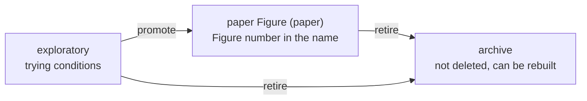

# 11. Into the paper: a figure's life

> **Has this ever happened to you?**
> - Reorganising the paper, Figure 3 became Figure 4 and the old Figure 4 went to the supplement. Three months later you could not tell which figure the "Figure 3" of the meeting notes was.
> - A reviewer wanted to see a figure you had dropped, and finding the old version was a struggle.

**The key idea:** a figure goes **exploration → paper Figure → archive**. The paper's figure plan is written in **one place, the storyline document**, and every change **records its reason and evidence**. Figures are archived, never deleted, and can be rebuilt any time.

## Three stages

| Step | When | What changes |
|---|---|---|
| **Promote** | When an exploratory figure is chosen as paper Figure N | The project moves to the `paper/` folder, is renamed `unit-paper-main-figN-short-name`, every path inside it is updated, and it is built once to check. |
| **Retire** | When a figure leaves the paper or is replaced by a new version | The project moves to the `archive/` folder, leaves the build list, and is built once to check it still builds. **Data and code are never deleted.** |

💬 **Ask an AI:** "Promote the project lab-acute-1d to paper Figure 2, with the short name acute-comparison." It first shows the files that will move and what will change; once you confirm, it goes ahead.

💬 **Ask an AI:** "Retire the old Figure 4 project."

## The storyline documents

The paper's figure plan and story are under `docs/storylines/`.

| File | Content | Who edits it |
|---|---|---|
| `storyline.yaml` | **The assignment.** Pairs such as "Main Figure 1 = which project". The compendium PDF, the checks and the mapping table all read it. | The researcher (asking the AI) |
| `figure_plan_topic.md` | **The story.** What each Figure shows and why in that order, plus the revision records | The researcher (asking the AI) |
| The mapping table at the top | Figure number ↔ links to the config, analysis script and figure description | **Generated.** Never edited by hand. |

**Figure numbers and project names match one to one.** Main Figure 3 in the storyline always points to a paper project with `fig3` in its name. If they disagree, the checks tell you.

## Revision records: what changed, and why

Each time the storyline changes, a numbered **revision record** is written. A record looks like this:

> **Revision (12) — supplementary figures swapped (2026-10-02)**: the old S2 became Supplementary Figure S1 and the old S1 became S2, so that reviewers see first the figure they need first. The underlying data are unchanged …

A record holds together:

- **What changed:** the assignment, the numbers
- **Why:** the instruction given, the reasoning
- **The evidence:** which data request delivered which files
- **Changed result numbers:** not copied by hand but extracted by the tool, by comparison with the last snapshot.

The steps:

1. 💬 "Summarise what actually changed in the storyline since the last snapshot." The changed assignment, data and numbers come out as a draft.
2. The researcher writes **why** in a sentence or two (or dictates it to the AI).
3. 💬 "Sync the revision records, compile the compendium PDF in strict mode and save the record of what changed." Compiling the compendium also saves a **snapshot** of this revision (assignment, figure provenance, numbers), the baseline for the next comparison.

Three months later you can still find in the records "what Figure 3 was then, and why it changed". The old numbers in the records can also be traced back to the projects of the time.

## Data requests and tracing evidence

When you ask an analysis pipeline for new data, write a request document under `docs/data_contracts/`. Note at its top the status (requested / delivered), the date and where the files landed, and 💬 "Show the evidence for Main Figure 3" gives one chain: **figure → project → input files → data request → related revision records**.

## The compendium PDF

All the storyline's Figures in order in one PDF, for sharing with co-authors or looking at in meetings.

⌨ **Command:** `fa storyline compile`

💡 **Tip (if you use VS Code):** `Ctrl+Shift+B` → **Compile Storyline Multi-Page PDF** makes it too.

💬 **Strict mode:** "Compile the compendium in strict mode." If a figure is stale or has check errors, no PDF is made and you are told what is wrong.

---
Previous: [10. When the data change](10-freshness.md) · Next: [12. Working with AI](12-ai.md)
