<!-- generated by scripts/make_reference.py (fa reference); edit the code, not this page -->

# Renderer gallery

## Start from an example (no code)

Each picture below is drawn from a small synthetic data bundle in `examples/gallery/`, exactly as `fa ingest bundle` would draw it, at single-column size (85 mm). Pick the picture closest to the figure you need, copy its folder, replace `inputs/data.csv` with your table -- same column names, or name yours in `plot_params` -- and run the commands under it. The config block `fa ingest bundle` writes lists every setting with its unit and what it changes ([config reference](config.md)). A test builds every example and checks it with preflight.

### boxplot

Values per category: one row per observation (category, value)

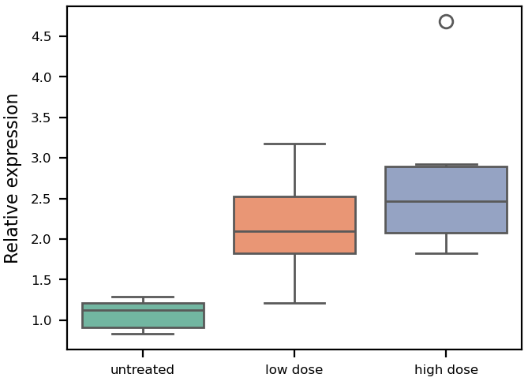

Inputs: `data.csv`. `metadata/metadata.yaml`:

```yaml
# Gallery example (examples/make_gallery.py): synthetic data, not measurements.
# inputs/data.csv: one row per sample -- treatment (category), relative_expression (value).
plot_type: boxplot
plot_params:
  x_col: treatment
  y_col: relative_expression
  labels_xlabel: ""
  labels_ylabel: "Relative expression"
```

Use it (in your project repository; `<fig-atlas>` is where fig-atlas is cloned):

```bash
cp -r <fig-atlas>/examples/gallery/boxplot raw_data/<project>/
fa bundle check raw_data/<project>/boxplot
fa ingest bundle raw_data/<project>/boxplot --project <project>
fa build <project> --preflight
```

### dose_response

Dose series: one row per replicate (dose > 0, response), optional group

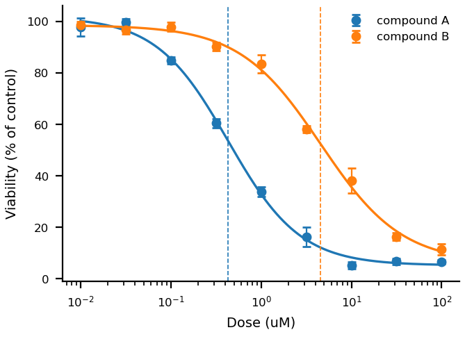

Inputs: `data.csv`. `metadata/metadata.yaml`:

```yaml
# Gallery example (examples/make_gallery.py): synthetic data, not measurements.
# inputs/data.csv: one row per replicate -- compound (group), dose_uM (x, > 0), viability (y).
# The fitted EC50 per compound is in the figure's source data (four-parameter logistic).
plot_type: dose_response
plot_params:
  x_col: dose_uM
  y_col: viability
  group_col: compound
  show_ec50: true
  labels_xlabel: "Dose (uM)"
  labels_ylabel: "Viability (% of control)"
```

Use it (in your project repository; `<fig-atlas>` is where fig-atlas is cloned):

```bash
cp -r <fig-atlas>/examples/gallery/dose_response raw_data/<project>/
fa bundle check raw_data/<project>/dose_response
fa ingest bundle raw_data/<project>/dose_response --project <project>
fa build <project> --preflight
```

### histogram

Distribution of a value: one row per observation, optional group

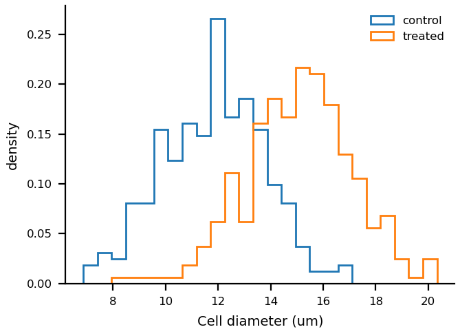

Inputs: `data.csv`. `metadata/metadata.yaml`:

```yaml
# Gallery example (examples/make_gallery.py): synthetic data, not measurements.
# inputs/data.csv: one row per cell -- condition (group), cell_diameter_um (value).
plot_type: histogram
plot_params:
  x_col: cell_diameter_um
  group_col: condition
  bins: 25
  density: true
  labels_xlabel: "Cell diameter (um)"
```

Use it (in your project repository; `<fig-atlas>` is where fig-atlas is cloned):

```bash
cp -r <fig-atlas>/examples/gallery/histogram raw_data/<project>/
fa bundle check raw_data/<project>/histogram
fa ingest bundle raw_data/<project>/histogram --project <project>
fa build <project> --preflight
```

### image_panel

Image files (one per channel) with pixel size and channel list in metadata.yaml

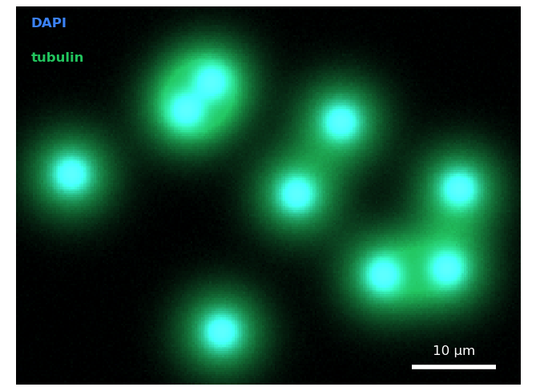

Inputs: `dapi.tif`, `tubulin.tif`. `metadata/metadata.yaml`:

```yaml
# Gallery example (examples/make_gallery.py): synthetic data, not measurements.
# inputs/: one image file per channel (16-bit TIFF here). Images are shown from these files,
# never from an adjusted copy; the display range per channel is set below.
plot_type: image_panel
pixel_size: 0.25
pixel_unit: "µm"
channels:
  - file: "dapi.tif"
  - file: "tubulin.tif"
plot_params:
  channel_colors: ["#3b82f6", "#22c55e"]
  channel_labels: ["DAPI", "tubulin"]
  display_ranges: [[100, 3000], [100, 1600]]
  show_channel_labels: true
  pixel_size: 0.25
  scale_bar: 10
```

Use it (in your project repository; `<fig-atlas>` is where fig-atlas is cloned):

```bash
cp -r <fig-atlas>/examples/gallery/image_panel raw_data/<project>/
fa bundle check raw_data/<project>/image_panel
fa ingest bundle raw_data/<project>/image_panel --project <project>
fa build <project> --preflight
```

### line_band

Lines with error bands: replicate rows (x, value, optional group), or summarised rows

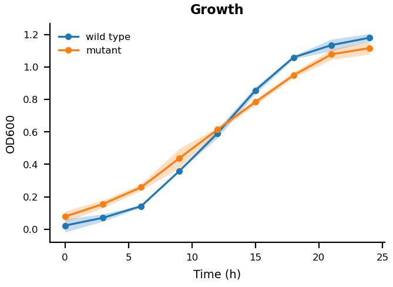

Inputs: `data.csv`. `metadata/metadata.yaml`:

```yaml
# Gallery example (examples/make_gallery.py): synthetic data, not measurements.
# inputs/data.csv: one row per replicate measurement -- strain (line), hour (x), od600 (y).
# With your data: keep these columns, or name yours in plot_params (x_col, y_col, group_col).
plot_type: line_band
plot_params:
  x_col: hour
  y_col: od600
  group_col: strain
  error: sd
  labels_title: "Growth"
  labels_xlabel: "Time (h)"
  labels_ylabel: "OD600"
```

Use it (in your project repository; `<fig-atlas>` is where fig-atlas is cloned):

```bash
cp -r <fig-atlas>/examples/gallery/line_band raw_data/<project>/
fa bundle check raw_data/<project>/line_band
fa ingest bundle raw_data/<project>/line_band --project <project>
fa build <project> --preflight
```

### multi_group_heatmap

One row per gene: label plus normalised expression for every sample of every condition

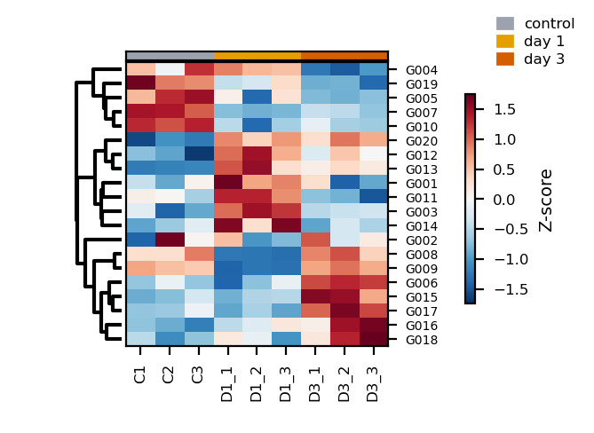

Inputs: `data.csv`. `metadata/metadata.yaml`:

```yaml
# Gallery example (examples/make_gallery.py): synthetic data, not measurements.
# inputs/data.csv: one row per gene -- gene_label, then one column per sample (values, e.g. z-scores).
# sample_groups names which columns belong to which group (annotation strip above the heatmap).
plot_type: multi_group_heatmap
plot_params:
  gene_label_col: gene_label
  sample_groups:
    control: ["C1", "C2", "C3"]
    "day 1": ["D1_1", "D1_2", "D1_3"]
    "day 3": ["D3_1", "D3_2", "D3_3"]
  cluster_rows: true
  gene_fontsize: 5              # pt; row labels
  tick_label_size: 6            # pt; sample names and colour-bar ticks
  axes_label_size: 7            # pt; colour-bar title
  colorbar_pad: 0.22            # fraction of the axes width between the gene names and the colour bar
  group_colors: {control: "#9CA3AF", "day 1": "#E69F00", "day 3": "#D55E00"}   # hex; the group strip above the columns
  margin_bottom: 0.2            # fraction of the figure; room for the sample names below
  margin_right: 0.8             # fraction of the figure; room for the colour bar and its title
```

Use it (in your project repository; `<fig-atlas>` is where fig-atlas is cloned):

```bash
cp -r <fig-atlas>/examples/gallery/multi_group_heatmap raw_data/<project>/
fa bundle check raw_data/<project>/multi_group_heatmap
fa ingest bundle raw_data/<project>/multi_group_heatmap --project <project>
fa build <project> --preflight
```

### stacked_bar

Composition: one row per (category, part) with a count

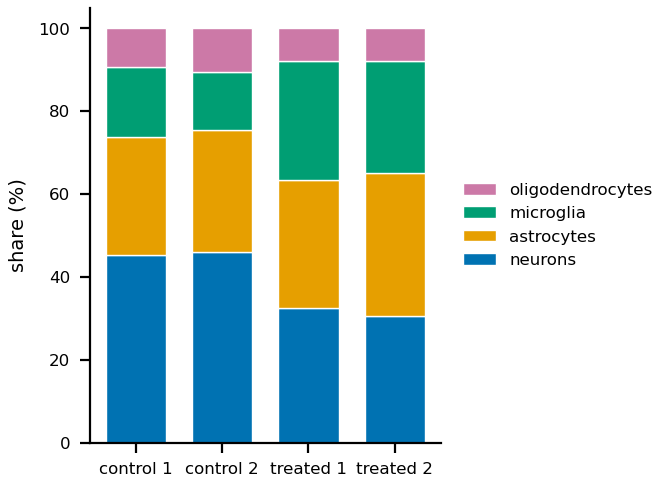

Inputs: `data.csv`. `metadata/metadata.yaml`:

```yaml
# Gallery example (examples/make_gallery.py): synthetic data, not measurements.
# inputs/data.csv: one row per (sample, cell type) -- sample (bar), cell_type (part), cells (count).
plot_type: stacked_bar
plot_params:
  x_col: sample
  stack_col: cell_type
  value_col: cells
  stack_colors: {neurons: "#0072B2", astrocytes: "#E69F00", microglia: "#009E73", oligodendrocytes: "#CC79A7"}   # Okabe-Ito: safe for colour-blind readers
  labels_xlabel: ""
```

Use it (in your project repository; `<fig-atlas>` is where fig-atlas is cloned):

```bash
cp -r <fig-atlas>/examples/gallery/stacked_bar raw_data/<project>/
fa bundle check raw_data/<project>/stacked_bar
fa ingest bundle raw_data/<project>/stacked_bar --project <project>
fa build <project> --preflight
```

### survival

Time to event: one row per subject (time, event 1/0), optional group

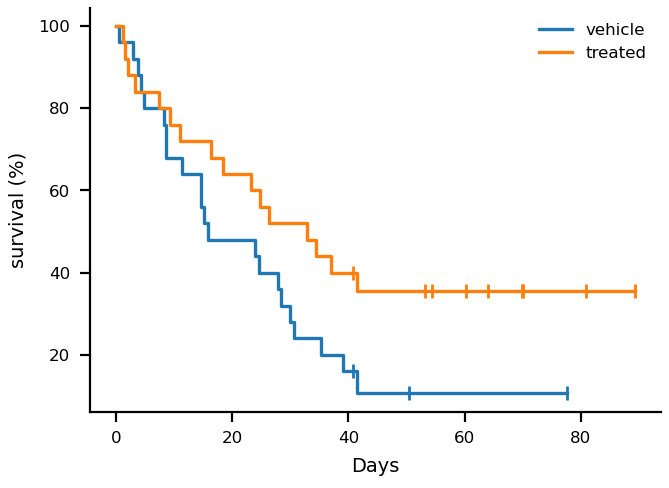

Inputs: `data.csv`. `metadata/metadata.yaml`:

```yaml
# Gallery example (examples/make_gallery.py): synthetic data, not measurements.
# inputs/data.csv: one row per animal -- group, days (to death or last follow-up), died (1) or censored (0).
# No test is drawn; compare groups with a log-rank test through fig_atlas.stats.
plot_type: survival
plot_params:
  time_col: days
  event_col: died
  group_col: group
  labels_xlabel: "Days"
```

Use it (in your project repository; `<fig-atlas>` is where fig-atlas is cloned):

```bash
cp -r <fig-atlas>/examples/gallery/survival raw_data/<project>/
fa bundle check raw_data/<project>/survival
fa ingest bundle raw_data/<project>/survival --project <project>
fa build <project> --preflight
```

### threshold_scatter

Effect vs significance points: one row per item, columns named in plot_params

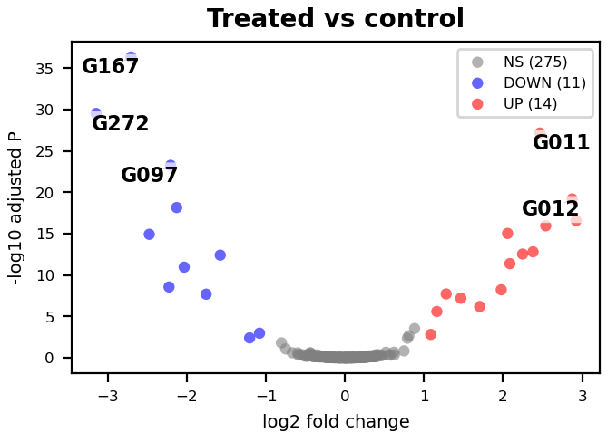

Inputs: `data.csv`. `metadata/metadata.yaml`:

```yaml
# Gallery example (examples/make_gallery.py): synthetic data, not measurements.
# inputs/data.csv: one row per gene -- log2_fold_change (x), padj (y, shown as -log10).
plot_type: threshold_scatter
plot_params:
  x_col: log2_fold_change
  y_col: padj
  effect_col: log2_fold_change
  sig_col: padj
  y_transform: neg_log10
  effect_threshold: 1.0
  sig_threshold: 0.05
  label_mode: top_n
  label_cols: ["gene"]
  label_top_n: 5
  labels_title: "Treated vs control"
  labels_xlabel: "log2 fold change"
  labels_ylabel: "-log10 adjusted P"
```

Use it (in your project repository; `<fig-atlas>` is where fig-atlas is cloned):

```bash
cp -r <fig-atlas>/examples/gallery/threshold_scatter raw_data/<project>/
fa bundle check raw_data/<project>/threshold_scatter
fa ingest bundle raw_data/<project>/threshold_scatter --project <project>
fa build <project> --preflight
```

### venn

Set membership: one row per (set, item); 2-3 sets

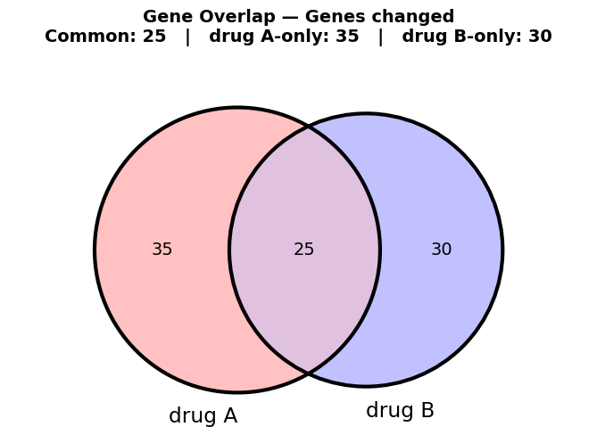

Inputs: `data.csv`. `metadata/metadata.yaml`:

```yaml
# Gallery example (examples/make_gallery.py): synthetic data, not measurements.
# inputs/data.csv: one row per (list, item) -- dataset (which list), item (e.g. a gene); 2 or 3 lists.
plot_type: venn
plot_params:
  set_labels: ["drug A", "drug B"]
  filter_name: "Genes changed"
  title_size: 7                 # pt; the title and its count line (the renderer's own default is for a larger canvas)
```

Use it (in your project repository; `<fig-atlas>` is where fig-atlas is cloned):

```bash
cp -r <fig-atlas>/examples/gallery/venn raw_data/<project>/
fa bundle check raw_data/<project>/venn
fa ingest bundle raw_data/<project>/venn --project <project>
fa build <project> --preflight
```

### violin

Distribution per category: one row per observation (category, value)

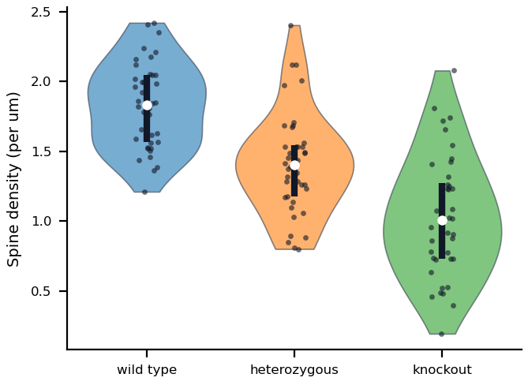

Inputs: `data.csv`. `metadata/metadata.yaml`:

```yaml
# Gallery example (examples/make_gallery.py): synthetic data, not measurements.
# inputs/data.csv: one row per measurement -- genotype (category), spines_per_um (value).
plot_type: violin
plot_params:
  x_col: genotype
  y_col: spines_per_um
  x_order: ["wild type", "heterozygous", "knockout"]
  show_points: true
  labels_ylabel: "Spine density (per um)"
  labels_xlabel: ""
```

Use it (in your project repository; `<fig-atlas>` is where fig-atlas is cloned):

```bash
cp -r <fig-atlas>/examples/gallery/violin raw_data/<project>/
fa bundle check raw_data/<project>/violin
fa ingest bundle raw_data/<project>/violin --project <project>
fa build <project> --preflight
```

## Every renderer

One example per renderer, drawn from small synthetic data by the renderer snapshot tests (`tests/renderers/cases.py`). Parameters for each are in the [config reference](config.md).

### binary_motif_heatmap

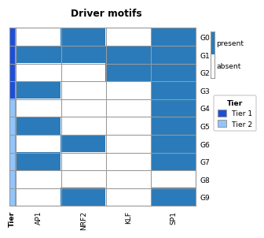

### clustered_go_heatmap

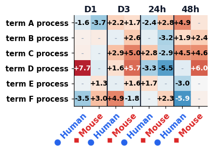

### cross_condition_dotplot

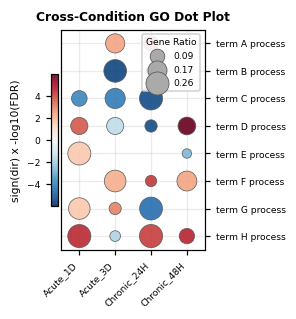

### cross_condition_heatmap

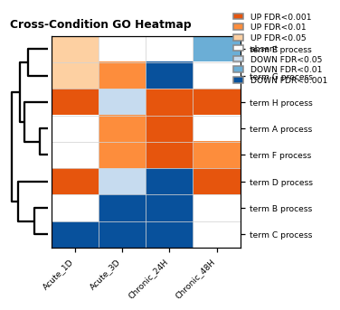

### grouped_hbar

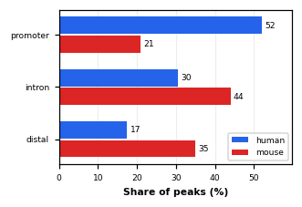

### image_panel

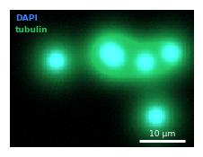

### line_band

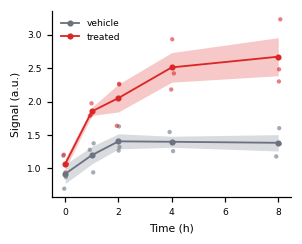

### ma_plot

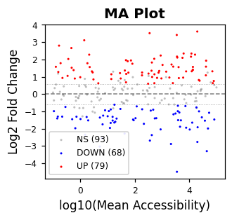

### paired_dumbbell

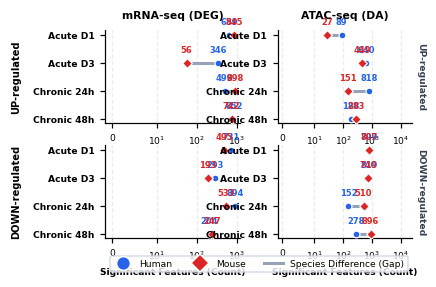

### panel_tags

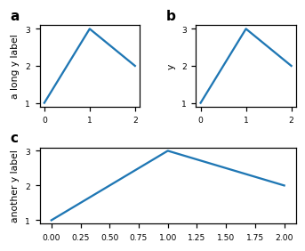

### pathway_test_matrix

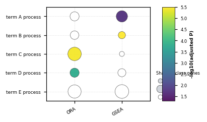

### signed_heatmap

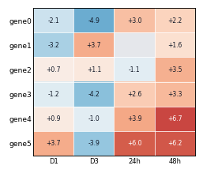

### species_response_scatter

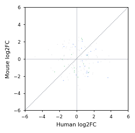

### stacked_share_hbar

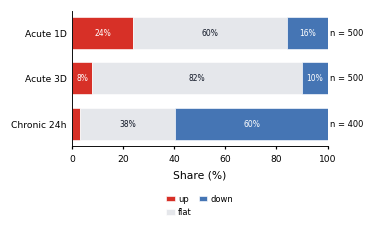

### tf_expression_scatter_grid

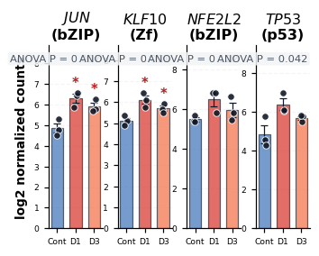

### threshold_scatter

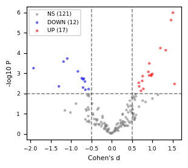

### tier_hbar

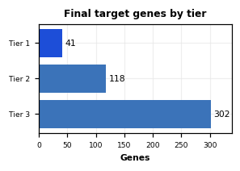

### treatment_schematic

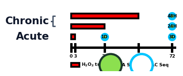

### two_set_euler

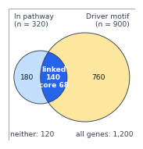

### volcano

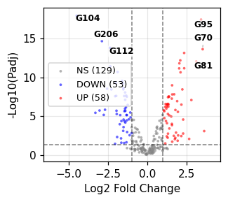

