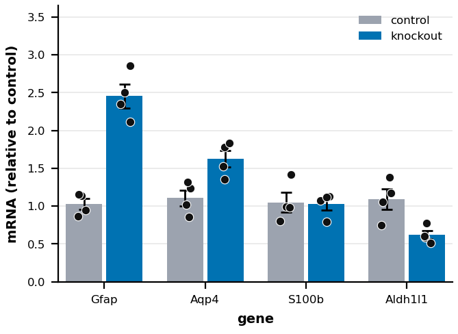
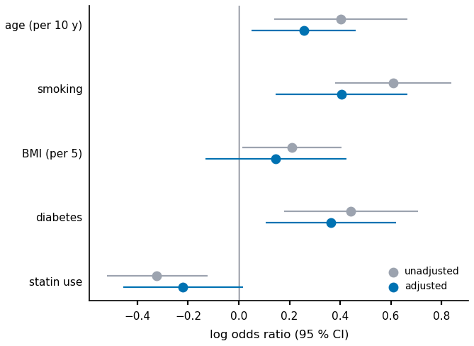
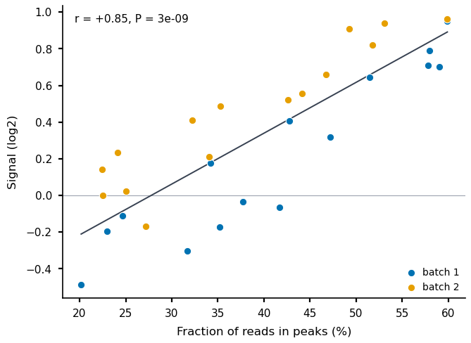
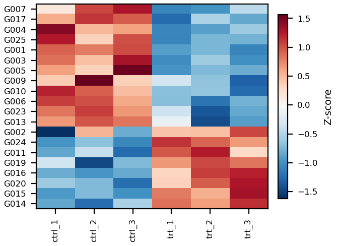
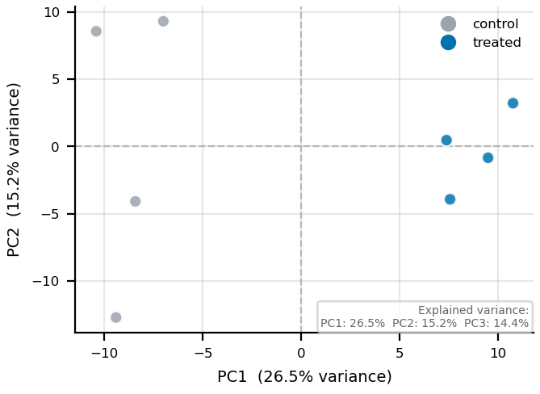

<!-- generated by scripts/make_reference.py (fa reference); edit the code, not this page -->

# Renderer gallery

## Start from an example (no code)

Each picture below is drawn from a small synthetic data bundle in `examples/gallery/`, exactly as `fa ingest bundle` would draw it, at single-column size (85 mm). Pick the picture closest to the figure you need, copy its folder, replace `inputs/data.csv` with your table -- same column names, or name yours in `plot_params` -- and run the commands under it. The config block `fa ingest bundle` writes lists every setting with its unit and what it changes ([config reference](config.md)). A test builds every example and checks it with preflight.

### bar_scatter

Bars (mean +/- error) with replicate dots: one row per replicate (category, group, value), or one row per category with replicate columns



`inputs/data.csv`, first 5 of 32 rows (3 columns):

```text
gene,condition,relative_mrna
Gfap,control,0.944
Gfap,control,1.137
Gfap,control,1.154
Gfap,control,0.864
Gfap,knockout,2.501
```

Inputs: `data.csv`. `metadata/metadata.yaml`:

```yaml
# Gallery example (examples/make_gallery.py): synthetic data, not measurements.
# inputs/data.csv: one row per replicate -- gene (category), condition (bar colour), relative_mrna (value).
# Bars are the mean +/- SEM of the replicates; the dots are the replicates.
plot_type: bar_scatter
plot_params:
  category_col: gene
  group_col: condition
  value_col: relative_mrna
  group_colors: {control: "#9CA3AF", knockout: "#0072B2"}
  labels_ylabel: "mRNA (relative to control)"
  axes_label_size: 7            # pt; this renderer's own defaults are for a larger canvas
  tick_label_size: 6            # pt
  title_size: 8                 # pt
```

Use it (in your project repository; `<fig-atlas>` is where fig-atlas is cloned):

```bash
cp -r <fig-atlas>/examples/gallery/bar_scatter raw_data/<project>/
fa bundle check raw_data/<project>/bar_scatter
fa ingest bundle raw_data/<project>/bar_scatter --project <project>
fa build <project> --preflight
```

### boxplot

Values per category: one row per observation (category, value)


`inputs/data.csv`, first 5 of 24 rows (2 columns):

```text
treatment,relative_expression
untreated,1.191
untreated,1.285
untreated,0.884
untreated,1.148
untreated,0.833
```

Inputs: `data.csv`. `metadata/metadata.yaml`:

```yaml
# Gallery example (examples/make_gallery.py): synthetic data, not measurements.
# inputs/data.csv: one row per sample -- treatment (category), relative_expression (value).
plot_type: boxplot
plot_params:
  x_col: treatment
  y_col: relative_expression
  labels_xlabel: ""
  labels_ylabel: "Relative expression"
```

Use it (in your project repository; `<fig-atlas>` is where fig-atlas is cloned):

```bash
cp -r <fig-atlas>/examples/gallery/boxplot raw_data/<project>/
fa bundle check raw_data/<project>/boxplot
fa ingest bundle raw_data/<project>/boxplot --project <project>
fa build <project> --preflight
```

### dose_response

Dose series: one row per replicate (dose > 0, response), optional group


`inputs/data.csv`, first 5 of 54 rows (4 columns):

```text
compound,dose_uM,replicate,viability
compound A,0.01,1,90.89
compound A,0.01,2,99.93
compound A,0.01,3,102.86
compound A,0.0316,1,102.07
compound A,0.0316,2,99.64
```

Inputs: `data.csv`. `metadata/metadata.yaml`:

```yaml
# Gallery example (examples/make_gallery.py): synthetic data, not measurements.
# inputs/data.csv: one row per replicate -- compound (group), dose_uM (x, > 0), viability (y).
# The fitted EC50 per compound is in the figure's source data (four-parameter logistic).
plot_type: dose_response
plot_params:
  x_col: dose_uM
  y_col: viability
  group_col: compound
  show_ec50: true
  labels_xlabel: "Dose (uM)"
  labels_ylabel: "Viability (% of control)"
```

Use it (in your project repository; `<fig-atlas>` is where fig-atlas is cloned):

```bash
cp -r <fig-atlas>/examples/gallery/dose_response raw_data/<project>/
fa bundle check raw_data/<project>/dose_response
fa ingest bundle raw_data/<project>/dose_response --project <project>
fa build <project> --preflight
```

### effect_dots

Estimates with confidence intervals (forest plot): one row per item and series



`inputs/data.csv`, first 5 of 10 rows (5 columns):

```text
factor,model,log_odds_ratio,ci_low,ci_high
age (per 10 y),unadjusted,0.403,0.14,0.665
age (per 10 y),adjusted,0.256,0.051,0.46
smoking,unadjusted,0.609,0.379,0.839
smoking,adjusted,0.406,0.146,0.665
BMI (per 5),unadjusted,0.209,0.013,0.405
```

Inputs: `data.csv`. `metadata/metadata.yaml`:

```yaml
# Gallery example (examples/make_gallery.py): synthetic data, not measurements.
# inputs/data.csv: one row per (factor, model) -- the estimate and its 95 % confidence limits.
plot_type: effect_dots
plot_params:
  item_col: factor
  series_col: model
  estimate_col: log_odds_ratio
  low_col: ci_low
  high_col: ci_high
  series_colors: {unadjusted: "#9CA3AF", adjusted: "#0072B2"}
  xlabel: "log odds ratio (95 % CI)"
```

Use it (in your project repository; `<fig-atlas>` is where fig-atlas is cloned):

```bash
cp -r <fig-atlas>/examples/gallery/effect_dots raw_data/<project>/
fa bundle check raw_data/<project>/effect_dots
fa ingest bundle raw_data/<project>/effect_dots --project <project>
fa build <project> --preflight
```

### group_scatter

Two measurements per item, coloured by group, with a fitted line and Pearson r



`inputs/data.csv`, first 5 of 30 rows (4 columns):

```text
library,batch,frip_pct,signal_log2
101,batch 1,35.22,-0.174
102,batch 1,42.74,0.408
103,batch 1,20.17,-0.486
104,batch 1,34.21,0.175
105,batch 1,51.44,0.644
```

Inputs: `data.csv`. `metadata/metadata.yaml`:

```yaml
# Gallery example (examples/make_gallery.py): synthetic data, not measurements.
# inputs/data.csv: one row per library -- frip_pct (x), signal_log2 (y), batch (group), library (label).
plot_type: group_scatter
plot_params:
  x_col: frip_pct
  y_col: signal_log2
  group_col: batch
  group_colors: {"batch 1": "#0072B2", "batch 2": "#E69F00"}
  legend: true
  xlabel: "Fraction of reads in peaks (%)"
  ylabel: "Signal (log2)"
```

Use it (in your project repository; `<fig-atlas>` is where fig-atlas is cloned):

```bash
cp -r <fig-atlas>/examples/gallery/group_scatter raw_data/<project>/
fa bundle check raw_data/<project>/group_scatter
fa ingest bundle raw_data/<project>/group_scatter --project <project>
fa build <project> --preflight
```

### heatmap

A matrix: one row per feature, one numeric column per sample



`inputs/data.csv`, first 5 of 25 rows (7 columns):

```text
gene,ctrl_1,ctrl_2,ctrl_3,trt_1,trt_2,trt_3
G001,5.042,4.961,5.106,3.814,3.918,3.7
G002,4.25,5.44,4.698,5.388,5.402,5.728
G003,5.098,4.652,5.613,2.987,3.461,3.001
G004,6.118,5.096,5.224,3.379,3.573,3.892
G005,4.828,4.542,5.719,3.244,3.478,3.394
```

Inputs: `data.csv`. `metadata/metadata.yaml`:

```yaml
# Gallery example (examples/make_gallery.py): synthetic data, not measurements.
# inputs/data.csv: one row per gene -- gene (label), then one column per sample (values).
plot_type: heatmap
plot_params:
  label_col: gene
  sample_columns: ["ctrl_1", "ctrl_2", "ctrl_3", "trt_1", "trt_2", "trt_3"]
  sorting: clustering
  n_genes: 20                   # rows shown; up to max_gene_labels (20) are named
  tick_label_size: 6            # pt; this renderer's own defaults are for a larger canvas
  axes_label_size: 7            # pt
```

Use it (in your project repository; `<fig-atlas>` is where fig-atlas is cloned):

```bash
cp -r <fig-atlas>/examples/gallery/heatmap raw_data/<project>/
fa bundle check raw_data/<project>/heatmap
fa ingest bundle raw_data/<project>/heatmap --project <project>
fa build <project> --preflight
```

### histogram

Distribution of a value: one row per observation, optional group


`inputs/data.csv`, first 5 of 600 rows (2 columns):

```text
condition,cell_diameter_um
control,7.75
control,10.6
control,12.46
control,12.0
control,10.09
```

Inputs: `data.csv`. `metadata/metadata.yaml`:

```yaml
# Gallery example (examples/make_gallery.py): synthetic data, not measurements.
# inputs/data.csv: one row per cell -- condition (group), cell_diameter_um (value).
plot_type: histogram
plot_params:
  x_col: cell_diameter_um
  group_col: condition
  bins: 25
  density: true
  labels_xlabel: "Cell diameter (um)"
```

Use it (in your project repository; `<fig-atlas>` is where fig-atlas is cloned):

```bash
cp -r <fig-atlas>/examples/gallery/histogram raw_data/<project>/
fa bundle check raw_data/<project>/histogram
fa ingest bundle raw_data/<project>/histogram --project <project>
fa build <project> --preflight
```

### image_panel

Image files (one per channel) with pixel size and channel list in metadata.yaml


Inputs: `dapi.tif`, `tubulin.tif`. `metadata/metadata.yaml`:

```yaml
# Gallery example (examples/make_gallery.py): synthetic data, not measurements.
# inputs/: one image file per channel (16-bit TIFF here). Images are shown from these files,
# never from an adjusted copy; the display range per channel is set below.
plot_type: image_panel
pixel_size: 0.25
pixel_unit: "µm"
channels:
  - file: "dapi.tif"
  - file: "tubulin.tif"
plot_params:
  channel_colors: ["#3b82f6", "#22c55e"]
  channel_labels: ["DAPI", "tubulin"]
  display_ranges: [[100, 3000], [100, 1600]]
  show_channel_labels: true
  pixel_size: 0.25
  scale_bar: 10
```

Use it (in your project repository; `<fig-atlas>` is where fig-atlas is cloned):

```bash
cp -r <fig-atlas>/examples/gallery/image_panel raw_data/<project>/
fa bundle check raw_data/<project>/image_panel
fa ingest bundle raw_data/<project>/image_panel --project <project>
fa build <project> --preflight
```

### line_band

Lines with error bands: replicate rows (x, value, optional group), or summarised rows


`inputs/data.csv`, first 5 of 54 rows (4 columns):

```text
strain,hour,replicate,od600
wild type,0,1,0.042
wild type,3,1,0.087
wild type,6,1,0.144
wild type,9,1,0.357
wild type,12,1,0.595
```

Inputs: `data.csv`. `metadata/metadata.yaml`:

```yaml
# Gallery example (examples/make_gallery.py): synthetic data, not measurements.
# inputs/data.csv: one row per replicate measurement -- strain (line), hour (x), od600 (y).
# With your data: keep these columns, or name yours in plot_params (x_col, y_col, group_col).
plot_type: line_band
plot_params:
  x_col: hour
  y_col: od600
  group_col: strain
  error: sd
  labels_title: "Growth"
  labels_xlabel: "Time (h)"
  labels_ylabel: "OD600"
```

Use it (in your project repository; `<fig-atlas>` is where fig-atlas is cloned):

```bash
cp -r <fig-atlas>/examples/gallery/line_band raw_data/<project>/
fa bundle check raw_data/<project>/line_band
fa ingest bundle raw_data/<project>/line_band --project <project>
fa build <project> --preflight
```

### multi_group_heatmap

One row per gene: label plus normalised expression for every sample of every condition


`inputs/data.csv`, first 5 of 20 rows (10 columns):

```text
gene_label,C1,C2,C3,D1_1,D1_2,D1_3,D3_1,D3_2,D3_3
G001,0.002,-0.334,0.321,1.442,0.752,0.866,0.471,-0.69,-0.332
G002,-1.452,-0.78,-1.138,-1.032,-1.371,-1.316,-0.912,-1.214,-1.118
G003,-0.669,-1.273,-1.022,-0.086,0.172,0.053,-0.816,-0.772,-0.748
G004,0.022,-0.337,0.476,0.237,0.052,0.008,-1.071,-1.196,-0.917
G005,-0.362,0.054,0.164,-0.63,-1.442,-0.538,-1.114,-1.153,-1.092
```

Inputs: `data.csv`. `metadata/metadata.yaml`:

```yaml
# Gallery example (examples/make_gallery.py): synthetic data, not measurements.
# inputs/data.csv: one row per gene -- gene_label, then one column per sample (values, e.g. z-scores).
# sample_groups names which columns belong to which group (annotation strip above the heatmap).
plot_type: multi_group_heatmap
plot_params:
  gene_label_col: gene_label
  sample_groups:
    control: ["C1", "C2", "C3"]
    "day 1": ["D1_1", "D1_2", "D1_3"]
    "day 3": ["D3_1", "D3_2", "D3_3"]
  cluster_rows: true
  gene_fontsize: 5              # pt; row labels
  tick_label_size: 6            # pt; sample names and colour-bar ticks
  axes_label_size: 7            # pt; colour-bar title
  colorbar_pad: 0.22            # fraction of the axes width between the gene names and the colour bar
  group_colors: {control: "#9CA3AF", "day 1": "#E69F00", "day 3": "#D55E00"}   # hex; the group strip above the columns
  margin_bottom: 0.2            # fraction of the figure; room for the sample names below
  margin_right: 0.8             # fraction of the figure; room for the colour bar and its title
```

Use it (in your project repository; `<fig-atlas>` is where fig-atlas is cloned):

```bash
cp -r <fig-atlas>/examples/gallery/multi_group_heatmap raw_data/<project>/
fa bundle check raw_data/<project>/multi_group_heatmap
fa ingest bundle raw_data/<project>/multi_group_heatmap --project <project>
fa build <project> --preflight
```

### pca

Samples by principal components: one row per feature, one numeric column per sample



`inputs/data.csv`, first 5 of 300 rows (9 columns):

```text
gene,ctrl_1,ctrl_2,ctrl_3,ctrl_4,trt_1,trt_2,trt_3,trt_4
G0001,484,485,461,485,478,547,483,511
G0002,33,22,23,24,29,33,42,31
G0003,117,89,88,89,83,84,97,105
G0004,63,75,69,71,70,67,73,57
G0005,176,193,159,153,173,171,185,159
```

Inputs: `data.csv`. `metadata/metadata.yaml`:

```yaml
# Gallery example (examples/make_gallery.py): synthetic data, not measurements.
# inputs/data.csv: one row per gene -- gene, then one column of counts per sample.
# sample_groups names which columns belong to which group (point colour and legend).
plot_type: pca
plot_params:
  sample_groups:
    control: ["ctrl_1", "ctrl_2", "ctrl_3", "ctrl_4"]
    treated: ["trt_1", "trt_2", "trt_3", "trt_4"]
  group_colors: {control: "#9CA3AF", treated: "#0072B2"}
  show_labels: false
  title: ""
  point_size: 30                # pt^2; this renderer's own defaults are for a larger canvas
  axes_label_size: 7            # pt
  tick_label_size: 6            # pt
```

Use it (in your project repository; `<fig-atlas>` is where fig-atlas is cloned):

```bash
cp -r <fig-atlas>/examples/gallery/pca raw_data/<project>/
fa bundle check raw_data/<project>/pca
fa ingest bundle raw_data/<project>/pca --project <project>
fa build <project> --preflight
```

### stacked_bar

Composition: one row per (category, part) with a count


`inputs/data.csv`, first 5 of 16 rows (3 columns):

```text
sample,cell_type,cells
control 1,neurons,226
control 1,astrocytes,143
control 1,microglia,84
control 1,oligodendrocytes,47
control 2,neurons,230
```

Inputs: `data.csv`. `metadata/metadata.yaml`:

```yaml
# Gallery example (examples/make_gallery.py): synthetic data, not measurements.
# inputs/data.csv: one row per (sample, cell type) -- sample (bar), cell_type (part), cells (count).
plot_type: stacked_bar
plot_params:
  x_col: sample
  stack_col: cell_type
  value_col: cells
  stack_colors: {neurons: "#0072B2", astrocytes: "#E69F00", microglia: "#009E73", oligodendrocytes: "#CC79A7"}   # Okabe-Ito: safe for colour-blind readers
  labels_xlabel: ""
```

Use it (in your project repository; `<fig-atlas>` is where fig-atlas is cloned):

```bash
cp -r <fig-atlas>/examples/gallery/stacked_bar raw_data/<project>/
fa bundle check raw_data/<project>/stacked_bar
fa ingest bundle raw_data/<project>/stacked_bar --project <project>
fa build <project> --preflight
```

### survival

Time to event: one row per subject (time, event 1/0), optional group


`inputs/data.csv`, first 5 of 50 rows (4 columns):

```text
group,mouse,days,died
vehicle,V01,28.4,1
vehicle,V02,27.9,1
vehicle,V03,35.3,1
vehicle,V04,15.1,1
vehicle,V05,3.0,1
```

Inputs: `data.csv`. `metadata/metadata.yaml`:

```yaml
# Gallery example (examples/make_gallery.py): synthetic data, not measurements.
# inputs/data.csv: one row per animal -- group, days (to death or last follow-up), died (1) or censored (0).
# No test is drawn; compare groups with a log-rank test through fig_atlas.stats.
plot_type: survival
plot_params:
  time_col: days
  event_col: died
  group_col: group
  labels_xlabel: "Days"
```

Use it (in your project repository; `<fig-atlas>` is where fig-atlas is cloned):

```bash
cp -r <fig-atlas>/examples/gallery/survival raw_data/<project>/
fa bundle check raw_data/<project>/survival
fa ingest bundle raw_data/<project>/survival --project <project>
fa build <project> --preflight
```

### threshold_scatter

Effect vs significance points: one row per item, columns named in plot_params


`inputs/data.csv`, first 5 of 300 rows (3 columns):

```text
gene,log2_fold_change,padj
G001,-0.667,0.25
G002,0.058,0.987
G003,0.213,0.94
G004,-0.177,0.967
G005,0.261,0.711
```

Inputs: `data.csv`. `metadata/metadata.yaml`:

```yaml
# Gallery example (examples/make_gallery.py): synthetic data, not measurements.
# inputs/data.csv: one row per gene -- log2_fold_change (x), padj (y, shown as -log10).
plot_type: threshold_scatter
plot_params:
  x_col: log2_fold_change
  y_col: padj
  effect_col: log2_fold_change
  sig_col: padj
  y_transform: neg_log10
  effect_threshold: 1.0
  sig_threshold: 0.05
  label_mode: top_n
  label_cols: ["gene"]
  label_top_n: 5
  labels_title: "Treated vs control"
  labels_xlabel: "log2 fold change"
  labels_ylabel: "-log10 adjusted P"
```

Use it (in your project repository; `<fig-atlas>` is where fig-atlas is cloned):

```bash
cp -r <fig-atlas>/examples/gallery/threshold_scatter raw_data/<project>/
fa bundle check raw_data/<project>/threshold_scatter
fa ingest bundle raw_data/<project>/threshold_scatter --project <project>
fa build <project> --preflight
```

### venn

Set membership: one row per (set, item); 2-3 sets


`inputs/data.csv`, first 5 of 115 rows (2 columns):

```text
dataset,item
drug A,G002
drug A,G003
drug A,G004
drug A,G005
drug A,G006
```

Inputs: `data.csv`. `metadata/metadata.yaml`:

```yaml
# Gallery example (examples/make_gallery.py): synthetic data, not measurements.
# inputs/data.csv: one row per (list, item) -- dataset (which list), item (e.g. a gene); 2 or 3 lists.
plot_type: venn
plot_params:
  set_labels: ["drug A", "drug B"]
  filter_name: "Genes changed"
  title_size: 7                 # pt; the title and its count line (the renderer's own default is for a larger canvas)
```

Use it (in your project repository; `<fig-atlas>` is where fig-atlas is cloned):

```bash
cp -r <fig-atlas>/examples/gallery/venn raw_data/<project>/
fa bundle check raw_data/<project>/venn
fa ingest bundle raw_data/<project>/venn --project <project>
fa build <project> --preflight
```

### violin

Distribution per category: one row per observation (category, value)


`inputs/data.csv`, first 5 of 120 rows (2 columns):

```text
genotype,spines_per_um
wild type,2.053
wild type,1.655
wild type,1.586
wild type,1.961
wild type,1.36
```

Inputs: `data.csv`. `metadata/metadata.yaml`:

```yaml
# Gallery example (examples/make_gallery.py): synthetic data, not measurements.
# inputs/data.csv: one row per measurement -- genotype (category), spines_per_um (value).
plot_type: violin
plot_params:
  x_col: genotype
  y_col: spines_per_um
  x_order: ["wild type", "heterozygous", "knockout"]
  show_points: true
  labels_ylabel: "Spine density (per um)"
  labels_xlabel: ""
```

Use it (in your project repository; `<fig-atlas>` is where fig-atlas is cloned):

```bash
cp -r <fig-atlas>/examples/gallery/violin raw_data/<project>/
fa bundle check raw_data/<project>/violin
fa ingest bundle raw_data/<project>/violin --project <project>
fa build <project> --preflight
```

## Every renderer

One example per renderer, drawn from small synthetic data by the renderer snapshot tests (`tests/renderers/cases.py`). Parameters for each are in the [config reference](config.md).

### binary_motif_heatmap


### clustered_go_heatmap


### cross_condition_dotplot


### cross_condition_heatmap


### grouped_hbar


### image_panel


### line_band


### ma_plot


### paired_dumbbell


### panel_tags


### pathway_test_matrix


### signed_heatmap


### species_response_scatter


### stacked_share_hbar


### tf_expression_scatter_grid


### threshold_scatter


### tier_hbar


### treatment_schematic


### two_set_euler


### volcano


