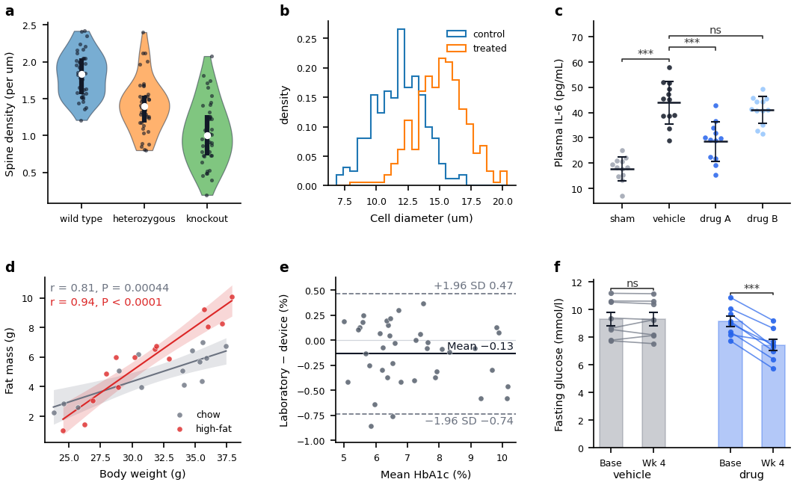
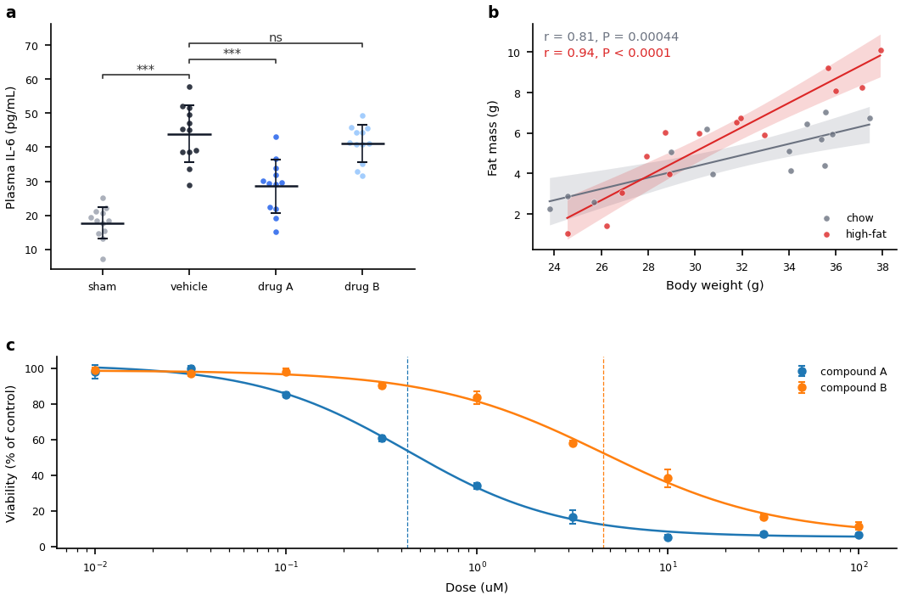
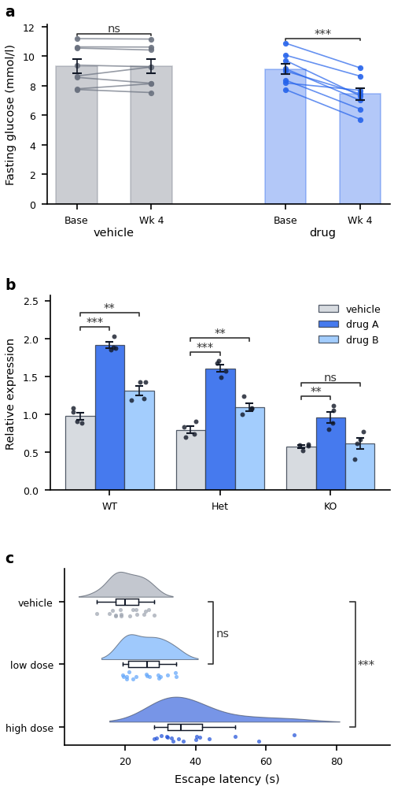
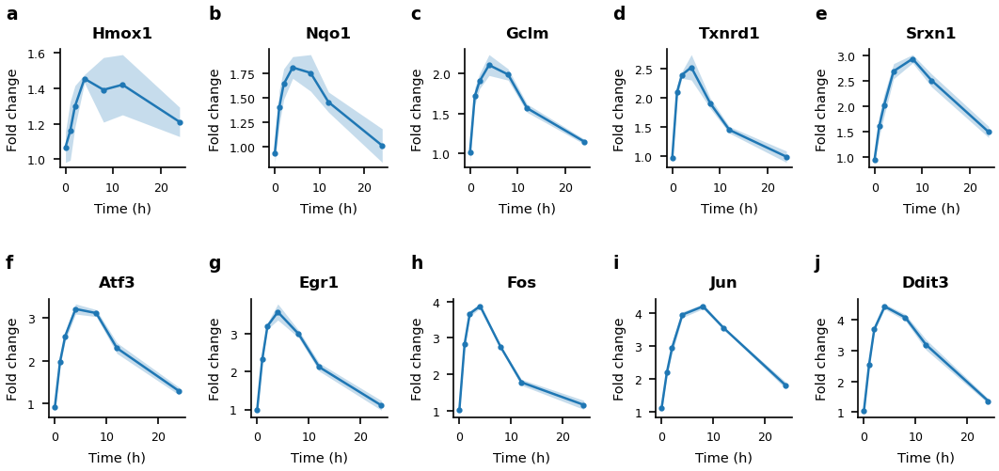
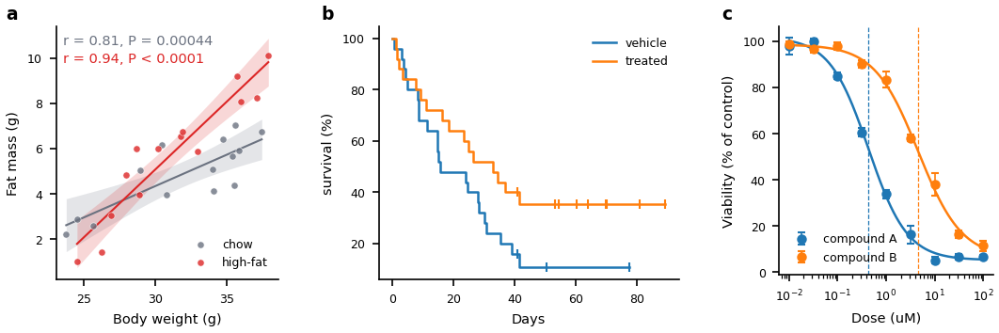
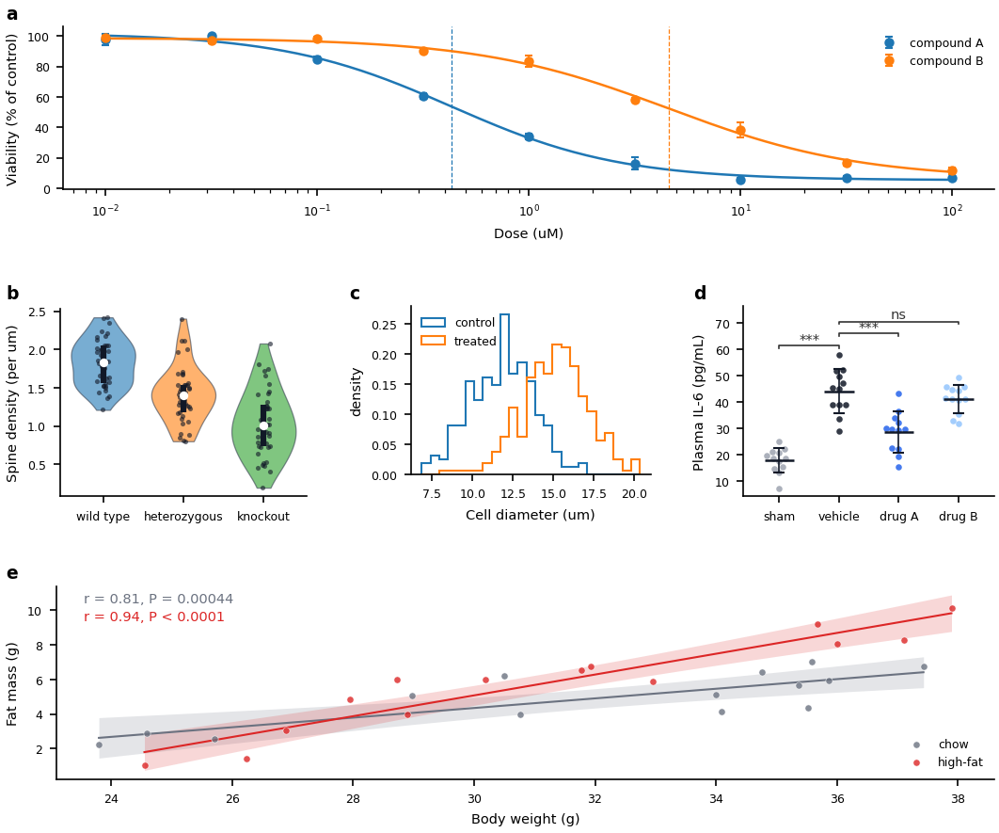
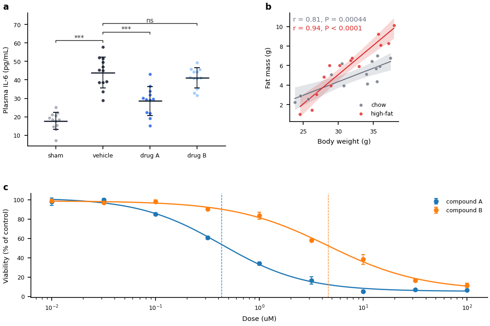

<!-- generated by scripts/make_reference.py (fa reference); edit the code, not this page -->

# Layout catalog

A layout arranges the panels of a figure; the renderers draw them. Each layout below is a function in `fig_atlas.layouts` that turns the config's `figures:` block into named cells: draw each panel into `layout.cells[letter]`, then call `layouts.finish(fig, layout, fcfg)` to fit the panels into their cells and place the panel letters. Structure is code, values are config: every number a layout uses (ratios, gaps, padding, tag size) comes from `figures:` with a default.

Each picture is drawn by the layout's example in `examples/layouts/<name>/` (a commented `config.yaml` and a short `script.py`), with the gallery's synthetic bundles as panels. Copy the example, keep the layout call and `layouts.finish`, and draw your own data in the cells. A shape not listed here starts from the closest example.

| layout | shape | example | script (lines of code) |
|---|---|---|---|
| [grid](#grid) | A grid of cells, filled left to right, top to bottom. | `examples/layouts/grid/` | 20 |
| [wide_bottom](#wide_bottom) | A row of panels with one full-width panel beneath it. | `examples/layouts/wide_bottom/` | 20 |
| [stack](#stack) | One column of panels, one above another. | `examples/layouts/stack/` | 20 |
| [matrix](#matrix) | Many small panels in a dense, even wall. | `examples/layouts/matrix/` | 20 |
| [row](#row) | One row of panels, side by side. | `examples/layouts/row/` | 20 |

## grid

A grid of cells, filled left to right, top to bottom.

```text
+---+---+---+
| a | b | c |
+---+---+---+
| d | e | f |
+---+---+---+
| g | h |
+---+---+
```



`grid(fig, fcfg: 'dict', letters, columns=None, width_ratios=None, height_ratios=None) -> 'Layout'`

The example (`examples/layouts/grid/`, script 20 lines of code) calls `layouts.grid(fig, fcfg, letters="abcdef")`.

`grid(fig, fcfg, "abcdefgh")` -- 8 panels, 3 columns (the default), 3 rows,
the last row part-filled. The cells are the ones `draw_plots` makes from the
same panel count and `figures.columns` (tests/test_layouts_core.py checks
it), so a script can move from `draw_plots` to an explicit layout without the
figure changing.

Use it for panels of equal weight: a 2x2 of comparisons, a 5x3 wall of small
multiples. Rows or columns of different sizes take `width_ratios` /
`height_ratios`; panels that span cells: `wide_bottom` (a strip under a
row), `stack` (a column), `row` (one band), `matrix` (dense small panels).

Config (`figures:`) -- copy the keys into the project config with a comment;
the values in brackets are the defaults:

- `columns` [3, or the panel count when smaller] -- cells per row.
- `grid.width_ratios` / `grid.height_ratios` [equal] -- one number per
  column / per row, e.g. `[1.4, 1.0, 1.0]` widens the first column; equal
  cells are the ones `draw_plots` makes.
- `wspace` [0] / `hspace` [0] -- gaps between cells, in fractions of the
  mean cell width/height; 0 gives exactly the cells `draw_plots` makes, so
  raise them to separate panels that would otherwise share an edge.
- `panel_pad_mm` [1.0] -- padding inside each cell, millimetres.
- `tags.show` [true], `tags.size` [9.0] (pt), `tags.pad_pt` [2.0] --
  the panel letters; see `layouts.finish`.

Adapt by editing those keys, not this file.

## wide_bottom

A row of panels with one full-width panel beneath it.

```text
+-------+-------+
|   a   |   b   |
+-------+-------+
|       c       |
+---------------+
```



`wide_bottom(fig, fcfg: 'dict', top, bottom) -> 'Layout'`

The example (`examples/layouts/wide_bottom/`, script 20 lines of code) calls `layouts.wide_bottom(fig, fcfg, top=("a", "b"), bottom="c")`.

`wide_bottom(fig, fcfg, top=("a", "b"), bottom="c")` -- the commonest
publication shape: data panels on top, a wide summary, legend strip, timeline
or schematic underneath. The bottom cell spans every column, so its left edge
lines up with panel `a`; its tag belongs to that first column and shares the
column's plumb line.

More than two top panels is fine (`top=("a", "b", "c")`); one top panel is
a stack of two with unequal heights -- use `stack` for that instead.

Config (`figures:`) -- copy the keys into the project config with a comment;
values in brackets are the defaults:

- `wide_bottom.height_ratios` [equal] -- e.g. `[1.0, 1.4]` makes the
  bottom row taller than the top; the list needs one number per row.
- `wspace` [0] / `hspace` [0] -- gaps between cells (fractions of the
  mean cell width/height); raise them to separate panels that share an edge.
- `panel_pad_mm` [1.0] -- padding inside each cell, millimetres.
- `tags.show` [true], `tags.size` [9.0] (pt), `tags.pad_pt` [2.0] --
  the panel letters; see `layouts.finish`.

Adapt by editing those keys, not this file.

## stack

One column of panels, one above another.

```text
+-------+
|   a   |
+-------+
|   b   |
+-------+
|   c   |
+-------+
```



`stack(fig, fcfg: 'dict', letters, height_ratios=None) -> 'Layout'`

The example (`examples/layouts/stack/`, script 20 lines of code) calls `layouts.stack(fig, fcfg, letters=("a", "b", "c"))`.

`stack(fig, fcfg, "abc")` -- panels that read top to bottom: a timeline and
its measurements, a heatmap and the row/column summaries beside it, a series
of steps. All tags sit on one plumb line, the left edge of the cluster.

For a figure whose panels should be compared side by side use `row`; for
data on top and a wide strip below, `wide_bottom`.

Config (`figures:`) -- copy the keys into the project config with a comment;
values in brackets are the defaults:

- `stack.height_ratios` [equal] -- e.g. `[1.0, 2.0]` for two rows; the
  list needs one number per panel, top to bottom.
- `hspace` [0] -- the gap between rows (fraction of the mean row height);
  raise it when the panel above has x tick labels.
- `panel_pad_mm` [1.0] -- padding inside each cell, millimetres.
- `tags.show` [true], `tags.size` [9.0] (pt), `tags.pad_pt` [2.0] --
  the panel letters; see `layouts.finish`.

Adapt by editing those keys, not this file.

## matrix

Many small panels in a dense, even wall.

```text
+---+---+---+---+---+
| a | b | c | d | e |
+---+---+---+---+---+
| f | g | h | i | j |
+---+---+---+---+---+
| k | l | m |
+---+---+---+
```



`matrix(fig, fcfg: 'dict', letters, columns=None, width_ratios=None, height_ratios=None) -> 'Layout'`

The example (`examples/layouts/matrix/`, script 20 lines of code) calls `layouts.matrix(fig, fcfg, letters="abcdefghij")`.

`matrix(fig, fcfg, "abcdefghijklm")` -- 5 columns by default: screens of
small multiples (one sample per cell, a grid of dot plots) where the single
figure is the point and each panel is read at a glance.

It is `grid` with the small-panel defaults: tighter gaps of its own
(`figures.matrix.wspace` / `hspace`), so the dense wall stays readable
without retuning the gaps of every other figure in the project. Panels of
equal number and weight that need more air use `grid`; one band of panels
uses `row`; unequal panels use `wide_bottom` or `stack`.

Config (`figures:`) -- copy the keys into the project config with a comment;
values in brackets are the defaults:

- `matrix.wspace` [0.06] / `matrix.hspace` [0.12] -- gaps within the wall
  (fractions of the mean cell width/height); smaller than `grid`'s because
  the panels are small.
- `matrix.columns` [5, or the panel count when smaller] -- cells per row.
- `matrix.width_ratios` / `matrix.height_ratios` [equal] -- one number per
  column / per row, e.g. a wider first column for a heatmap beside dot plots.
- `panel_pad_mm` [1.0] -- padding inside each cell, millimetres; lower it
  (e.g. 0.5) to buy space for more cells.
- `tags.show` [true], `tags.size` [9.0] (pt), `tags.pad_pt` [2.0] --
  the panel letters; see `layouts.finish`.

Adapt by editing those keys, not this file.

## row

One row of panels, side by side.

```text
+-------+-------+-------+
|   a   |   b   |   c   |
+-------+-------+-------+
```



`row(fig, fcfg: 'dict', letters, width_ratios=None) -> 'Layout'`

The example (`examples/layouts/row/`, script 20 lines of code) calls `layouts.row(fig, fcfg, letters=("a", "b", "c"))`.

`row(fig, fcfg, "abc")` -- one band of panels compared left to right: three
conditions, a before/after/both triptych, five time points. Every panel sits in
one layout row, so their tags share a baseline even when the titles differ in
height.

`row` is the one-row case of `grid`; use it rather than `grid(columns=3)`
when the panels' widths differ (`row.width_ratios`) or when the figure is
deliberately one band and you want the intent to read from the code.

Config (`figures:`) -- copy the keys into the project config with a comment;
values in brackets are the defaults:

- `row.width_ratios` [equal] -- e.g. `[1.0, 1.6, 1.0]` gives the middle
  panel more width (a wider heatmap, a longer legend); one number per panel.
- `wspace` [0] -- the gap between panels (fraction of the mean width).
- `panel_pad_mm` [1.0] -- padding inside each cell, millimetres.
- `tags.show` [true], `tags.size` [9.0] (pt), `tags.pad_pt` [2.0] --
  the panel letters; see `layouts.finish`.

Adapt by editing those keys, not this file.

## Composition

A layout can be called on a cell of another layout to split that cell, so a shape not in the table is usually two of them, one inside the other.



The example (`examples/layouts/compose/`, script 22 lines of code) calls

```python
lay = layouts.stack(fig, fcfg, letters=("a", "b", "e"))
layouts.row(lay.cells["b"], fcfg, letters=("b", "c", "d"))
cells = layouts.panel_cells(lay)
```

and `layouts.finish(fig, lay, fcfg)` once, on the outer layout. The inner layout starts with the cell's letter, so the figure reads a, b, c,
d, e. It registers itself on the cell, and `finish` splices it in: its
panels are fitted like the others and their letters join the outer plumb
lines and rows. Its values come from `figures.cells.<letter>` over the
rest of `figures:` (e.g. `figures.cells.b.row.width_ratios`), so two
cells split the same way keep their own numbers. Two levels at most.

## Fixed size

`finish` scales each panel to fill its cell. A panel that must keep its printed size -- a diagram drawn in millimetres, a matrix of square cells, an image or a panel shown at the size it is printed -- names that size under its letter, `figures.cells.<letter>.size_mm: [width, height]` (mm, the data area of all the panel's axes together): `finish` places it at the cell's top-left corner and does not rescale it, so its tag keeps the column's plumb line. Give the cell room for it and its labels (ratios, gaps, canvas size); a panel larger than its cell overlaps its neighbour, which preflight reports.



The example (`examples/layouts/fixed_size/`, script 20 lines of code) is a `wide_bottom` whose panel b is kept at `figures.cells.b.size_mm`; a and c are fitted to their cells as usual.
