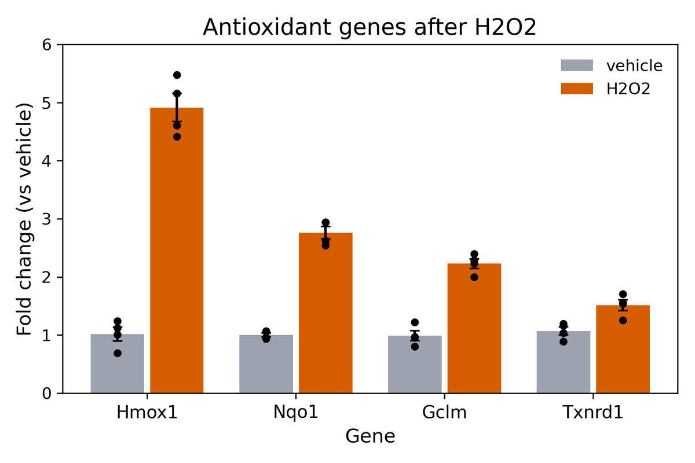
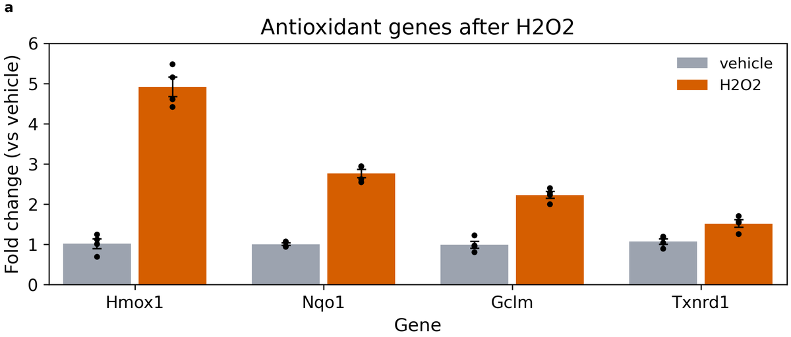

# Tutorial: 내가 짠 그림 스크립트 옮기기 (Case A)

그림이 들어오는 길은 내가 가진 것에 따라 셋입니다([가이드 5장](../guide/05-entry-paths.md)). 정리된 데이터 번들이 있으면 Case B([첫 그림](first_figure.md)), **직접 짠 그림 코드와 데이터가 있으면 Case A**, 원하는 그림의 캡처나 설명만 있으면 Case C입니다. 이 문서는 Case A를 한 예제로 끝까지 보여 줍니다.

예제는 학생이 짠 qPCR 막대그래프 스크립트입니다. 글자 크기, 색, 축 범위가 모두 코드에 적혀 있는 흔한 모양입니다. 옮기는 일은 두 부분입니다.

1. **스크립트 → 데이터 번들:** 코드를 읽고 값을 빼내는 일입니다. 판단이 필요해서 보통 AI 도우미가 합니다. 이 문서는 그 결과를 보여 주고, 무엇이 어디로 갔는지 설명합니다.
2. **번들 → 그림:** 명령 몇 개입니다. 직접 따라 합니다. 이 부분은 `tests/test_tutorials.py`가 CI에서 그대로 실행하고, 옮긴 그림이 원래 그림과 **같은 내용**(막대 높이, 오차 막대, 점, 색, 순서, 축 범위, 글자)인지도 검사합니다.

예제 파일은 [`examples/case_a/`](../../examples/case_a/)에 있습니다. 데이터는 시뮬레이션 값입니다.

## 1. 출발점: 스크립트와 그림

<!-- file: examples/case_a/original/plot_qpcr.py -->
```python
# plot_qpcr.py -- qPCR of four antioxidant genes after H2O2 (a student's script)
#
# Case A example of fig-atlas (docs/tutorials/case_a_port_script.md): the kind
# of script a figure starts from -- every size, colour and limit typed into the
# code. The data in qpcr_results.csv are synthetic, not measurements.
#
#   python plot_qpcr.py        -> qpcr_antioxidant.png
import numpy as np
import pandas as pd
import matplotlib.pyplot as plt

df = pd.read_csv("qpcr_results.csv")

genes = ["Hmox1", "Nqo1", "Gclm", "Txnrd1"]
conditions = ["vehicle", "H2O2"]
colors = {"vehicle": "#9CA3AF", "H2O2": "#D55E00"}

fig, ax = plt.subplots(figsize=(6, 4))
width = 0.4
x = np.arange(len(genes))
for i, cond in enumerate(conditions):
    sub = df[df["condition"] == cond]
    means = [sub.loc[sub["gene"] == g, "fold_change"].mean() for g in genes]
    sems = [sub.loc[sub["gene"] == g, "fold_change"].sem() for g in genes]
    pos = x + (i - 0.5) * width
    ax.bar(pos, means, width * 0.9, yerr=sems, capsize=3, color=colors[cond], label=cond)
    for j, g in enumerate(genes):
        vals = sub.loc[sub["gene"] == g, "fold_change"]
        ax.scatter(np.full(len(vals), pos[j]), vals, s=15, color="black", zorder=3)

ax.set_xticks(x)
ax.set_xticklabels(genes, fontsize=11)
ax.set_xlabel("Gene", fontsize=12)
ax.set_ylabel("Fold change (vs vehicle)", fontsize=12)
ax.set_title("Antioxidant genes after H2O2", fontsize=14)
ax.set_ylim(0, 6)
ax.legend(frameon=False, fontsize=10)
plt.tight_layout()
plt.savefig("qpcr_antioxidant.png", dpi=300)
```

<!-- img/: drawn by `fa reference` from the files of this page; do not edit by hand -->


이 그림을 그대로 쓰기 어려운 이유는 이렇습니다. 글자 크기를 바꾸려면 코드를 고쳐야 하고, 저널 크기로 줄이면 글자가 얼마나 작아질지 모르고, 데이터와 코드와 그림이 어떻게 이어지는지 남지 않습니다.

## 2. 스크립트 → 번들 (AI 도우미의 일)

AI 도우미에게 이렇게 말합니다.

> "`examples/case_a/original/plot_qpcr.py`와 `qpcr_results.csv`로 그린 그림을 fig-atlas로 들여와 줘(Case A). 프로젝트는 `qpcr-antioxidant`로 새로 만들어 줘."

AI는 코드를 데이터 읽기, 그림의 값, 그리기로 나눈 뒤 다음을 합니다.

- **데이터를 그대로 옮깁니다.** `qpcr_results.csv`를 번들의 `inputs/data.csv`로 복사합니다. 값은 한 글자도 바꾸지 않습니다(AGENTS.md §1.1).
- **이 모양을 그리는 렌더러를 찾습니다.** 그룹 막대 + 반복 측정 점은 이미 있는 `bar_scatter`가 그립니다([갤러리](../reference/gallery.md#bar_scatter)). 없으면 새로 만듭니다(아래 6절).
- **코드에 적힌 값을 번들의 `plot_params`로 옮깁니다.** 줄마다 어느 코드에서 왔는지 주석을 답니다.

그 결과가 [`examples/case_a/qpcr_bundle/`](../../examples/case_a/qpcr_bundle/)입니다. `metadata/metadata.yaml`은 이렇습니다.

<!-- file: examples/case_a/qpcr_bundle/metadata/metadata.yaml -->
```yaml
# Case A example (docs/tutorials/case_a_port_script.md): the bundle made from
# examples/case_a/original/plot_qpcr.py. inputs/data.csv is qpcr_results.csv,
# copied unchanged; every value the script typed into its code is a
# plot_params key here, with the line it came from. Synthetic data.
plot_type: bar_scatter
plot_params:
  # what is plotted
  category_col: gene                  # sub["gene"]: one group of bars per gene
  group_col: condition                # df["condition"]: one bar colour per condition
  value_col: fold_change              # "fold_change": bar height = mean, dots = replicates
  category_order: [Hmox1, Nqo1, Gclm, Txnrd1]          # genes = [...]
  group_order: [vehicle, H2O2]                         # conditions = [...]
  group_colors: {vehicle: "#9CA3AF", H2O2: "#D55E00"}  # colors = {...}
  # bars, error bars and dots
  bar_width: 0.8                      # width = 0.4 per bar, two bars per gene
  errorbar: sem                       # yerr=sems (.sem(): standard error)
  capsize: 3                          # capsize=3
  point_size: 15                      # scatter(..., s=15)
  point_color: "#000000"              # color="black"
  point_edgecolor: none               # (no outline)
  point_edgewidth: 0
  point_jitter: 0                     # dots on the bar centre, no jitter
  # axes and text
  y_min: 0                            # set_ylim(0, 6)
  y_max: 6
  labels_title: "Antioxidant genes after H2O2"         # set_title(...)
  title_size: 14                      # fontsize=14
  title_weight: normal                # (matplotlib's default title weight)
  labels_xlabel: Gene                 # set_xlabel("Gene", fontsize=12)
  labels_ylabel: "Fold change (vs vehicle)"            # set_ylabel(..., fontsize=12)
  axes_label_size: 12
  axes_label_weight: normal
  tick_label_size: 11                 # set_xticklabels(genes, fontsize=11)
  legend_loc: best                    # legend() places it itself
  legend_fontsize: 10                 # legend(fontsize=10)
  legend_frameon: false               # legend(frameon=False)
  grid: false                         # (no grid lines)
  despine: false                      # (all four spines drawn)
  show_significance: false            # (no test in the script)
```

눈여겨볼 점이 세 가지 있습니다.

- **코드에 없던 값도 적습니다.** 스크립트는 격자선을 그리지 않았고 제목을 굵게 쓰지 않았습니다. `bar_scatter`의 기본값은 그 반대라서, 원래 모양을 지키려면 `grid: false`, `title_weight: normal`을 적어야 합니다. 처음 옮길 때의 목표는 **원래 그림과 똑같이**입니다. 바꾸고 싶은 점은 옮긴 뒤에 설정으로 바꿉니다.
- **계산도 같아야 합니다.** 스크립트의 `.sem()`은 표본 표준편차(n−1)로 나눈 표준오차이고, `errorbar: sem`도 같은 식입니다.
- **한 가지는 같아지지 않습니다.** 스크립트는 x축 눈금만 11 pt로 바꾸고 y축 눈금은 기본값(10 pt)으로 두었습니다. `tick_label_size`는 두 축에 함께 적용됩니다. 이런 차이는 AI가 알려 주고, 연구자가 받아들일지 정합니다.

## 3. 번들 → 그림 (직접 하기)

여기부터는 직접 따라 합니다. 저장소 루트에서 프로젝트를 만들고, 번들을 `raw_data/` 아래로 복사합니다.

<!-- run -->
```bash
fa new project qpcr-antioxidant
mkdir -p raw_data/qpcr-antioxidant
cp -r examples/case_a/qpcr_bundle raw_data/qpcr-antioxidant/
fa bundle check raw_data/qpcr-antioxidant/qpcr_bundle
```

`ok`와 `plot_type bar_scatter -> contract core.bar_scatter`가 나옵니다. 번들을 프로젝트에 붙이고 빌드합니다.

<!-- run -->
```bash
fa ingest bundle raw_data/qpcr-antioxidant/qpcr_bundle --project qpcr-antioxidant
fa build qpcr-antioxidant --preflight
```

`[ok] qpcr-antioxidant: 0 error(s), 0 warning(s)`와 `PASS: 5/5 checks passed`가 나오면 됩니다. `fa ingest bundle`은 번들의 값에 렌더러의 나머지 파라미터까지 더해, 설명 주석이 달린 블록을 `configs/config_qpcr-antioxidant.yaml`에 씁니다. 이제 이 파일이 그림을 조정하는 곳입니다.

## 4. 원래 그림과 비교



막대 높이, 오차 막대, 점, 색, 유전자와 조건의 순서, 축 범위(0–6), 제목과 축 이름, 범례가 같습니다. 다른 점은 두 가지이고 둘 다 의도한 것입니다.

- **크기:** 원래 그림은 화면용 6 × 4 인치였습니다. 옮긴 그림은 프로젝트의 페이지 프리셋(A4 본문 폭)에 **인쇄 크기 그대로** 그려집니다. 높이는 config의 `figures.height_mm`으로 바꿉니다.
- **패널 태그 `a`:** 여러 패널을 붙일 때 쓰는 태그가 붙습니다.

이제 글자가 인쇄했을 때 몇 pt인지가 정해졌으므로, 저널에 맞추려면 `title_size`, `axes_label_size`, `tick_label_size`를 config에서 줄입니다. 스크립트를 다시 열 필요는 없습니다.

## 5. 무엇이 어디로 갔나

| 스크립트에 있던 것 | 이제 있는 곳 |
|---|---|
| `qpcr_results.csv` | `raw_data/qpcr-antioxidant/qpcr_bundle/inputs/data.csv` (그대로 복사, 읽기 전용) |
| 그림의 모든 값(`fontsize=`, `colors`, `set_ylim`, `capsize=` …) | `configs/config_qpcr-antioxidant.yaml`의 `plots.qpcr` (값마다 단위와 설명) |
| 막대·점·오차 막대를 그리는 반복문 | 렌더러 `bar_scatter` (다른 프로젝트와 공유, 테스트됨) |
| `plt.savefig("qpcr_antioxidant.png", dpi=300)` | `fa build`: PNG·PDF·SVG, 인쇄 검사, 출처 기록, README |
| (없었음) | 그림이 어떤 데이터·코드·설정으로 만들어졌는지의 기록(`figure_01.provenance.json`) |

## 6. 이 모양을 그리는 렌더러가 없을 때

갤러리에 없는 모양이면 렌더러를 하나 만들어야 합니다. 이때도 AI 도우미에게 맡기는 것이 보통입니다. 스크립트의 그리는 부분이 렌더러가 되고, 숫자는 모두 파라미터로 빠집니다. 가까운 모양이 있으면 그것에서 시작합니다.

```bash
fa new renderer my_shape --from bar_scatter --plot-type my_shape
```

새 렌더러는 이 프로젝트 저장소의 `renderers/`에 생기고, 같은 저장소의 다른 프로젝트도 씁니다. 자세한 과정은 [가이드 5장](../guide/05-entry-paths.md)에 있습니다.

## AI 없이 하려면

2절의 일을 직접 해도 됩니다. 데이터를 `inputs/data.csv`로 복사하고, 그릴 렌더러를 [갤러리](../reference/gallery.md)에서 고르고, 코드의 값을 [설정 레퍼런스](../reference/config.md)의 키 이름으로 `metadata.yaml`에 적습니다. 그다음은 3절과 같습니다. 키 이름이 틀리면 `fa lint qpcr-antioxidant`가 비슷한 이름을 알려 줍니다.
