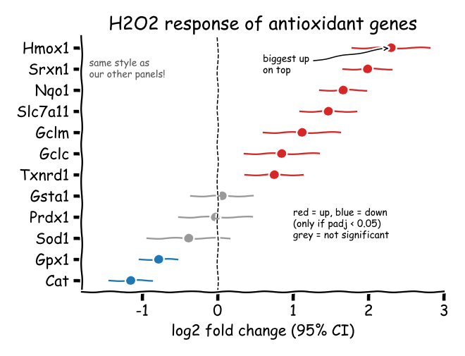
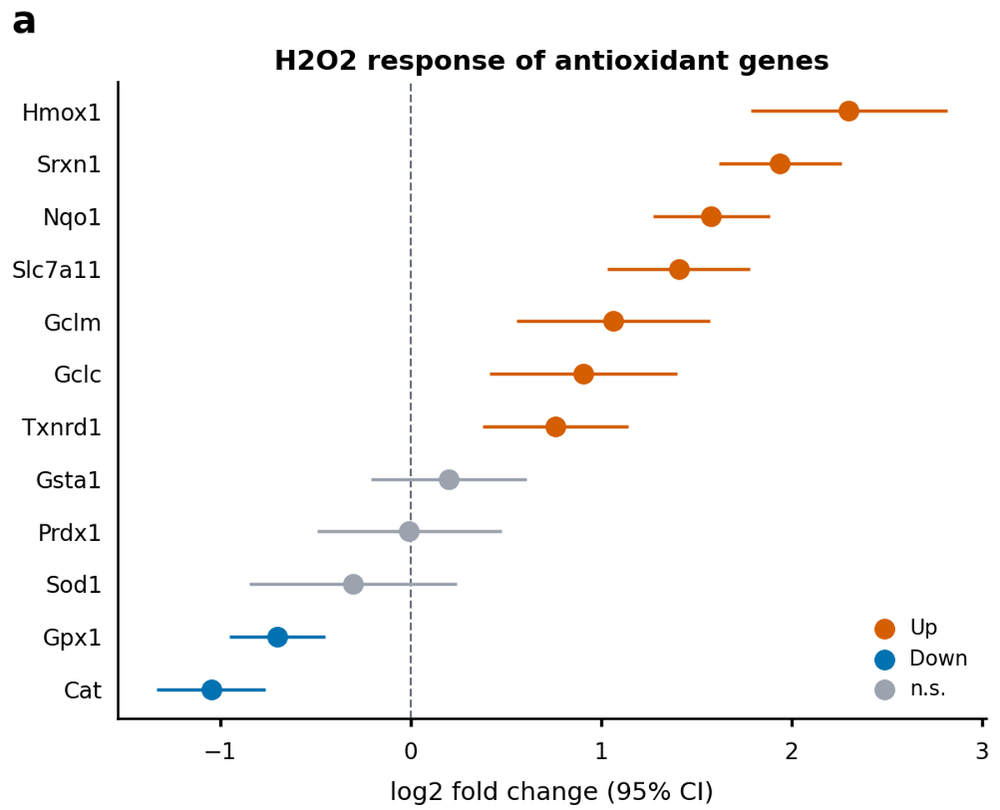

# Tutorial: from a sketch and a table (Case C)

A figure has three entry points, depending on what you have ([guide, chapter 5](../guide/05-entry-paths.md)). This page shows, through one example, Case C: **no code, only data and the shape of the figure you want (a sketch, a capture, a description)**.

In Case C the AI assistant has to **interpret** the figure, so the same request can be interpreted a little differently each time. That is why this page records, rather than commands to follow, **one session as it actually happened** (2026-10-13, Claude Code and the researcher): the interpretation, the questions asked, the answers given and the result. The steps after the bundle is made are commands, and `tests/test_tutorials.py` runs them as written in CI.

The example files are in [`examples/case_c/`](../../examples/case_c/). The data and the sketch are made by simulation (`examples/case_c/make_example.py`); they will be replaced when a better real request comes along.

## 1. The request: data and a sketch

The data (`examples/case_c/request/data.csv`) are, for 12 genes, the log2 fold change, its 95 % confidence interval and the adjusted P.

```text
gene,log2fc,ci_low,ci_high,padj
Hmox1,2.3,1.784,2.817,3.99e-16
Nqo1,1.578,1.272,1.884,2.82e-21
Gclm,1.064,0.554,1.573,0.000596
...
```

And a hand-drawn sketch of the figure wanted, with notes:

<!-- img/: copied or drawn by `fa reference` from this page's own files; do not edit by hand -->


The request to the AI assistant:

> "Make this figure from data.csv and sketch.png in `examples/case_c/request/` (Case C). The project is `antioxidant-effects`."

## 2. The interpretation and its confirmation (before drawing)

By the Case C rules the AI shows its interpretation and gets it approved **before making any code** ([the `ingest_plot` skill](https://github.com/ibs-cmg-ngs/fig-atlas/blob/main/.agents/skills/ingest_plot/SKILL.md), C-2). The interpretation shown this time:

**Settled from the sketch and the data**

1. **Kind of figure:** a dot + 95 % confidence interval per gene. The existing renderer `effect_dots` draws this shape, so it is reused rather than made anew.
2. **Columns:** `gene` → row name, `log2fc` → the dot, `ci_low`/`ci_high` → the ends of the interval.
3. **Order:** largest `log2fc` on top ("biggest up on top").
4. **Colour rule:** up if `padj < 0.05` and increased, down if `padj < 0.05` and decreased, otherwise not significant. The threshold 0.05 is written in the sketch.
5. **Extras:** a dashed line at x = 0, the title, the x-axis title.
6. **"same style as our other panels":** read as the project's print preset (text sizes, line widths, final-size rendering).

**What the sketch could not settle: questions and answers**

| Question | Options | Answer |
|---|---|---|
| A. Colours | the sketch's red and blue as drawn, or a colour-blind-safe palette (recommended: the red-blue pair would trigger a preflight colour warning) | As recommended: the safe palette |
| B. Where to apply the colour rule | (1) add a "colour by threshold" option to the renderer (recommended: adjusted in the config alone, reusable by other projects), (2) have the analysis script compute a class column | As recommended: (1) |
| C. Legend | (1) a small legend, (2) no legend, explained in the figure caption | An item shown without a recommendation. The AI chose (1) and gave its reason (so the figure reads on its own) |
| D. Size | single column (85 mm wide, about 70 mm tall) | As recommended |

The researcher's answer was one line: "Go ahead as recommended." When the AI decides an item that had no recommendation, like C, it says so and why in its report, so the choice can be changed at the review.

## 3. Interpretation → bundle, and what was added to the renderer

Following answer B, three options were added to `effect_dots`. Existing figures are unchanged, and later projects can use them.

- `item_sort: estimate_desc`: rows with larger values on top
- `color_by: threshold` with `sig_col`, `sig_threshold`, `up_color`, `down_color`, `ns_color`, `class_labels`: colours by direction and significance
- `zero_line_style`: the style of the zero line (dashed and so on)

The bundle ([`examples/case_c/effects_bundle/`](../../examples/case_c/effects_bundle/)) holds `inputs/data.csv`, the request's data copied **unchanged**, `metadata/reference.png`, a copy of the sketch, and the confirmed values. Each value is commented with whether it was read from the sketch or answered by the researcher, and `param_source: inferred_from_mockup` says the values were not taken from code.

<!-- file: examples/case_c/effects_bundle/metadata/metadata.yaml -->
```yaml
# Case C example (docs/tutorials/case_c_from_sketch.md): the bundle made from
# request/data.csv and request/sketch.png -- no code. inputs/data.csv is the
# request's table, copied unchanged; metadata/reference.png is the sketch.
# Every plot_params value below was read from the sketch and the data, or is
# an answer the researcher gave at the confirmation step (2026-10-13).
# Synthetic data.
plot_type: effect_dots
param_source: inferred_from_mockup    # not extracted from code: check against reference.png
plot_params:
  # what is plotted (from the data's columns)
  item_col: gene                      # one row per gene
  estimate_col: log2fc                # the dot
  low_col: ci_low                     # the interval, 95 % CI ("log2 fold change (95% CI)")
  high_col: ci_high
  item_sort: estimate_desc            # sketch: "biggest up on top"
  # colour by direction and significance (sketch note; researcher: a renderer option)
  color_by: threshold
  sig_col: padj                       # sketch: "(only if padj < 0.05)"
  sig_threshold: 0.05
  up_color: "#D55E00"                 # researcher: a colour-blind-safe palette, not the sketch's red/blue
  down_color: "#0072B2"
  ns_color: "#9CA3AF"
  class_labels: {up: "Up", down: "Down", ns: "n.s."}
  # marks
  zero_line: true                     # sketch: dashed line at 0
  zero_line_style: "--"
  # text
  title: "H2O2 response of antioxidant genes"
  xlabel: "log2 fold change (95% CI)"
  legend: true                        # researcher: a small legend (the sketch had a note)
```

## 4. Bundle → figure (do it yourself)

From here you can follow along. At the repository root, create the project and attach the bundle.

<!-- run -->
```bash
fa new project antioxidant-effects
mkdir -p raw_data/antioxidant-effects
cp -r examples/case_c/effects_bundle raw_data/antioxidant-effects/
fa bundle check raw_data/antioxidant-effects/effects_bundle
fa ingest bundle raw_data/antioxidant-effects/effects_bundle --project antioxidant-effects
```

Make it single column, as answered in D: change two lines of the `figures` block in `configs/config_antioxidant-effects.yaml`.

<!-- replace: configs/config_antioxidant-effects.yaml | height_mm: 80 -->
```yaml
  height_mm: 70                       # Figure height in mm (width = the page content width); raise if panels feel cramped
```

<!-- replace: configs/config_antioxidant-effects.yaml | width_mm: null -->
```yaml
  width_mm: 85                        # Figure width in mm; null = the page content width, 85 = one journal column
```

<!-- run -->
```bash
fa build antioxidant-effects --preflight
```

You get `[ok] antioxidant-effects: 0 error(s), 0 warning(s)` and `PASS: 5/5 checks passed`.

## 5. Review (after drawing)



With the result, the AI reported what matched the sketch and what did not.

- **As in the sketch:** dot + 95 % confidence interval, largest increase on top, the dashed zero line, the title and axis title, the colour rule (7 up, 2 down, 3 not significant).
- **Changed per the answers:** red and blue → the safe palette, the handwritten note → a legend, the hand-drawn font → the print font and sizes.
- **Asked to be checked:** a single panel carries panel tag `a` at its upper left, there for when it is combined with other panels.

**The researcher decides.** This time it ended with "OK". If something needs fixing, say so — "make the dots a little smaller", "move the legend to the upper right" — and the AI changes only the config's values and builds again. The code does not change.

## 6. What remains

- **The bundle:** the original data (unchanged), the sketch (`reference.png`), and values that say where each came from.
- **The config:** the block `fa ingest bundle` wrote, with every parameter and its explanation. Later adjustments are made here.
- **The renderer:** the new options of `effect_dots`. The next request for this shape only needs interpreting.
- **The provenance record:** which data, code and settings made the figure (`figure_01.provenance.json`).

If the shape matches no existing renderer, the AI makes a new one (`fa new renderer`). Confirming the interpretation and reviewing the result stay the same.
