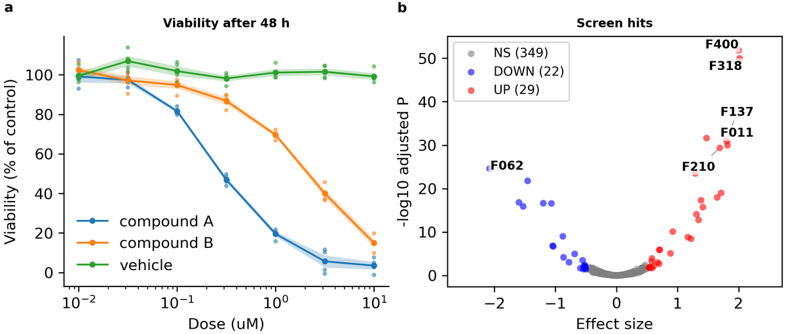
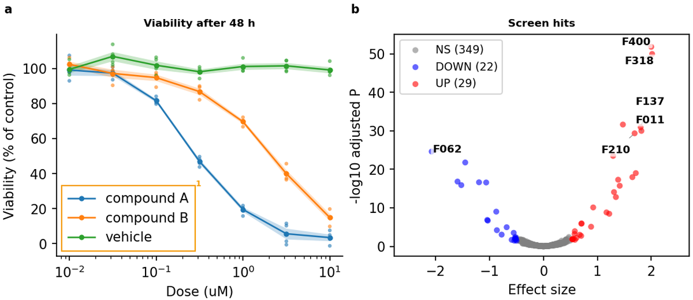
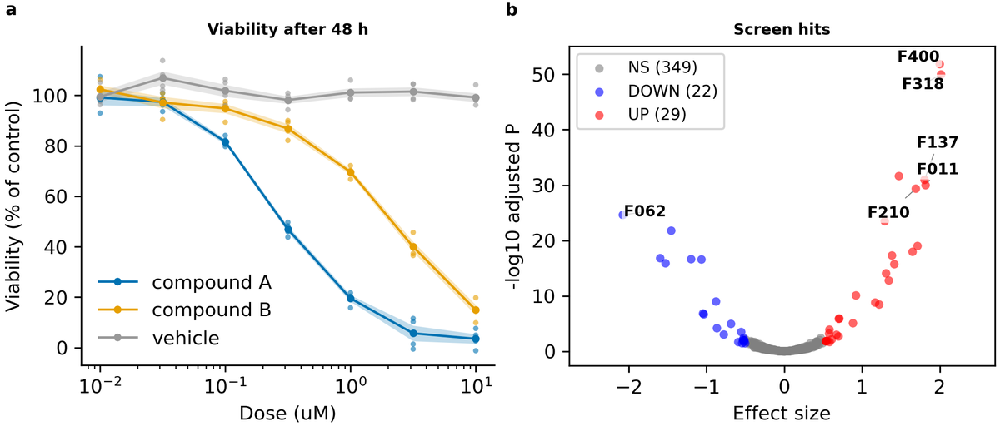

# Tutorial: first figure (15 min)

> **Which entry point:** this starts from an arranged data bundle (a table + `metadata.yaml`): **Case B**. If you have plotting code you wrote, see [Case A](case_a_port_script.md); if you only have a capture or description of the figure you want, see Case C ([guide, chapter 5](../guide/05-entry-paths.md)).

You make one two-panel figure from start to finish with the example data in the repository, without writing a line of code. With commands you create a project, attach data bundles, build, and fix the problem the print check (preflight) reports **by changing only the config**.

`tests/test_tutorials.py` runs this page's commands and config edits as written, in CI. So following this page gives the same result.

## Before you start

Create and activate the environment as in [the README's installation section](../../README.md) (`conda activate fig-atlas`), and start at the repository root. When `fa --help` lists the commands, you are ready.

The example data are in [`examples/`](../../examples/README.md): two bundles made by simulation (not measurements).

| Bundle | Content | Shape of figure (`plot_type`) |
|---|---|---|
| `examples/dose_response` | Cell viability for 3 compounds × 7 doses × 4 replicates | line with error band (`line_band`) |
| `examples/screen_hits` | Effect size and adjusted P for 400 items | effect versus significance scatter (`threshold_scatter`) |

## 1. Create the project

First see what would be created (`--dry-run` writes nothing).

<!-- run -->
```bash
fa new project first-figure --dry-run
```

It says three files will be created: the config, the analysis script and the figure spec (plus a line of the VS Code build list, in a repository that has `.vscode/tasks.json`). Now create them.

<!-- run -->
```bash
fa new project first-figure
```

Give a research unit, as in `--domain lab --category exploratory`, and the project goes under `configs/lab/exploratory/`. This tutorial is practice, so it stays at the root.

## 2. Check the data bundles

A bundle is a folder of `inputs/data.csv` (the table) and `metadata/metadata.yaml` (which figure it is, and its `plot_params`). Before drawing, check its contract (that the columns it needs are there).

<!-- run -->
```bash
fa bundle check examples/dose_response examples/screen_hits
```

For each bundle you get the result, which figure it is (`plot_type`), the contract it matches, the renderer that draws it and its number of rows.

```text
ok           examples/dose_response
    plot_type line_band -> contract core.line_band, renderer fig_atlas.renderers:render_line_band, 84 rows
ok           examples/screen_hits
    plot_type threshold_scatter -> contract core.threshold_scatter, renderer fig_atlas.renderers:render_threshold_scatter, 400 rows
```

Both bundles are `ok` and match the contracts `core.line_band` and `core.threshold_scatter`. If something is wrong, the numbers of errors or warnings replace `ok`, with what is missing below. Generic figures name their columns in `plot_params` (e.g. `x_col: dose_uM`), and the checker sees whether the named columns exist ([table bundle contract](../contracts/table_bundle_contract.md)).

## 3. Attach the bundles as panels

<!-- run -->
```bash
fa ingest bundle examples/dose_response --project first-figure
fa ingest bundle examples/screen_hits --project first-figure
```

Each command writes one block under `plots:` in `configs/config_first-figure.yaml` and builds. The block holds **every** parameter the renderer reads, each with an explaining comment; values from the bundle are marked "(from the bundle)". From now on this file is where you adjust the figure. You do not need to open any Python code.

## 4. Build and check

<!-- run -->
```bash
fa build first-figure --preflight
```

The figure is at `outputs/first-figure/figures/figure_01_main/figure_01.png` (and PDF and SVG). It is drawn **at its printed size**, on the A4 text width (184.6 mm), and the tags of panels a and b sit on each panel's outer edge (tick labels and axis titles included).

<!-- img/: drawn by `fa reference` from this page's own steps; do not edit by hand -->


`--preflight` is the print check. The output reads:

```text
==== first-figure ====
[provenance] 1 figure record(s) written
  Published Figure 1: Title of figure 1 (one sentence: what it shows)
Manifest: outputs/first-figure/manifests/clean_atlas_manifest.csv
[ok] first-figure: 0 error(s), 1 warning(s)

Report: outputs/preflight/preflight_findings.csv  (overlays: outputs/preflight/<project>/)
  warn  cvd_indistinct               1
PASS: 4/5 checks passed, 1 warning(s) - outputs/first-figure/manifests/clean_atlas_verification.csv
  WARN [preflight] warnings: 1 preflight warning(s); see outputs/first-figure/manifests/preflight.csv

ALL 1 PROJECT(S) PASSED
```

Line by line:

- `[provenance] 1 figure record(s) written`: a record of which data, code and settings made the figure.
- `Published Figure 1: Title of figure 1 ...`: the figure is published to `figure_01_main/`. The title is still the template's sentence; you write it in step 6.
- `[ok] first-figure: 0 error(s), 1 warning(s)`: the print check's result. An **error** (overlap, clipping, text too small, ...) makes the build fail. A **warning** recommends a fix but does not stop the build, and an **info** is for reference.
- `warn cvd_indistinct 1`: the kind and number of warnings. The details are in `outputs/first-figure/manifests/preflight.csv`.
- `PASS: 4/5 checks passed, 1 warning(s)`: the check of what was published. Of five items — three figure files (PNG, PDF, SVG), the README and the preflight result — the preflight result has a warning, hence 4/5.
- `ALL 1 PROJECT(S) PASSED`: the build as a whole succeeded.

`preflight.csv` describes the warning like this:

```
warn  cvd_indistinct  legend of axes[0] 'Viability after 48 h': #ff7f0e and #2ca02c look alike with protanomaly
```

It means panel a's orange and green look almost the same to readers with red weakness. Where the problem is, a numbered mark on the overlay picture in `outputs/preflight/first-figure/` shows: box 1 of this warning points to panel a's legend.



## 5. Fix it in the config

In `configs/config_first-figure.yaml`, find the `group_colors` line of the `dose_response` block. Its comment says what the key does ("Colour per group"). Change it to the Okabe–Ito palette, safe for colour-blind readers.

<!-- replace: configs/config_first-figure.yaml | group_colors: {} -->
```yaml
    group_colors:                      # Colour per group: Okabe-Ito, safe for colour-blind readers
      "compound A": "#0072B2"
      "compound B": "#E69F00"
      vehicle: "#999999"
```

Build again.

<!-- run -->
```bash
fa build first-figure --preflight
```

This time it passes without warnings (`0 error(s), 0 warning(s)`). The three colours of panel a are now blue, orange and grey, which colour-blind readers can tell apart. No Python code was touched; one block of the config changed.



Other values — text sizes, axis ranges, thresholds, the number of labels — change the same way. Each key's comment gives its unit and which way to adjust it. To see where a value came from, use `fa param explain first-figure plots.dose_response.band_alpha` and the like.

## 6. Write the figure's description

The figure spec (`figure_specs/figure_01_first-figure.py`) holds the figure's title, the panel notes and what the figure may claim. The build writes them into the figure folder's `README.md`. Change the title:

<!-- replace: figure_specs/figure_01_first-figure.py | title="Title of figure 1 -->
```python
    title="Two compounds lower viability with dose; a screen finds 51 hits",
```

<!-- run -->
```bash
fa build first-figure --preflight
```

The title in the figure folder's `README.md` changes, and the check stays at `0 error(s), 0 warning(s)`. Build without `--preflight` and you get a warning that the last check is older than the figure (`preflight results are older than the published figures`): once the figure changes, check it again.

> In a real figure, a result number such as "51" is not typed by hand. The analysis script records it with `claims.record("n_hits", n)` and the text says `{n_hits}`, so the description follows the data when they change (AGENTS.md §4.5).

## Next

- **With your data**: put bundles of the same shape under `raw_data/<study>/<project>/` and use the same commands. The supported figures and their column rules are in `fa bundle contracts` and [the contracts](../contracts/README.md).
- **Into the paper**: promote an exploratory project to a paper Figure with `fa promote <project> --figure 1 --slug <slug>`.
- **Image figures**: [the microscopy tutorial](imaging_figure.md)
- **With an AI agent**: an agent can do the same with MCP tools ([how to connect](../howto/ai_agents.md)). At each step that changes files, it shows the diff first.
- **Cleaning up**: to remove the practice project, delete the three files it created (`configs/config_first-figure.yaml`, `analysis/first-figure_analysis.py`, `figure_specs/figure_01_first-figure.py`) and `outputs/first-figure/`. In a repository with a VS Code build list, also remove its name from `.vscode/tasks.json`.
