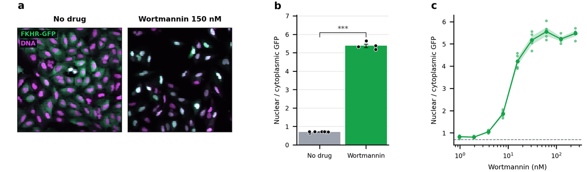
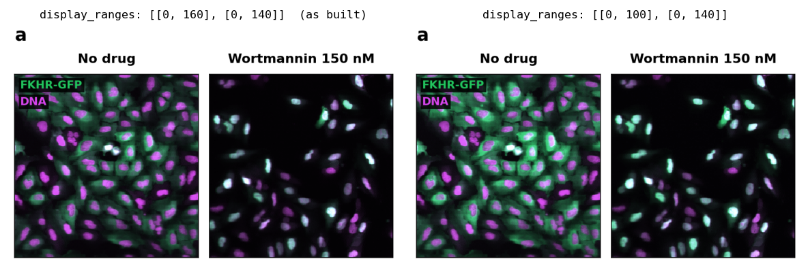

# Tutorial: 공개 이미지 데이터로 출판용 그림 만들기

NGS가 아닌 데이터로 fig-atlas의 전 과정을 따라 합니다. 공개 현미경 이미지 세트 BBBC013에서, U2OS 세포의 FKHR-GFP가 Wortmannin 처리에 따라 세포질에서 핵으로 옮겨 가는 것을 보여 주는 3패널 그림을 만듭니다.

- **a:** 대표 이미지 두 장(약물 없음, 150 nM)
- **b:** 웰별 핵/세포질 GFP 비율과 통계 검정
- **c:** 농도 반응 곡선

완성된 예제가 저장소에 있으므로(프로젝트 `pilot-imaging`), 이 문서는 각 파일이 무슨 일을 하는지 설명하며 직접 빌드해 봅니다. 오믹스 팩은 쓰지 않습니다. 코어(`fig_atlas`)만으로 끝까지 갑니다.

준비물: 저장소 루트에서 `pip install -e .`를 한 Python 환경(README의 설치 절 참고). 시간은 데이터 내려받기(31 MB)를 포함해 10분 안팎입니다.

## 1. 데이터 받기

```bash
python scripts/fetch_bbbc013.py
```

이미지 192장(96웰 × 2채널)과 플레이트 맵이 `raw_data/pilot-imaging/bbbc013/`에 내려받아집니다. 스크립트에 고정된 SHA-256과 대조하므로, 누가 받아도 같은 파일인지 확인됩니다. `raw_data/`는 git이 무시하는 폴더이고, 원본은 받은 뒤 절대 고치지 않습니다(AGENTS.md §1.1).

이 데이터는 CC BY 3.0 라이선스입니다(Ilya Ravkin, Broad Bioimage Benchmark Collection). 스크립트 머리말에 출처와 인용 문구가 있고, 그림의 범례에도 들어갑니다.

## 2. 프로젝트를 이루는 세 파일

| 파일 | 하는 일 |
|---|---|
| `configs/config_pilot-imaging.yaml` | 모든 조정값: 그림 크기, 쓸 웰, 분할 설정, 표시 범위, 색, 글자 크기. 값마다 역할·단위·조정 방향 주석이 있습니다 |
| `analysis/pilot-imaging_analysis.py` | 데이터를 읽고 정량한 뒤 렌더러로 그립니다. 스타일 숫자는 없고 모두 config에서 읽습니다 |
| `figure_specs/figure_01_pilot-imaging.py` | 그림의 제목·패널 설명·주장 범위(claim boundary). 범례의 숫자는 `{n_control_wells}`처럼 분석이 기록한 값을 씁니다 |

분석 스크립트의 핵심은 짧습니다.

- **a 이미지:** `render_image_panel`에 원본 파일 두 개(GFP, DNA)를 넘기고, config의 크롭·표시 범위·색을 적용합니다. 미리 밝기를 올린 사본을 만들지 않습니다(AGENTS.md §4.7).
- **b 정량:** DNA 채널에 Otsu 임계값을 적용해 핵을 찾고, 핵 둘레 고리를 세포질로 삼아 웰마다 GFP 비율을 계산합니다. 검정은 `fig_atlas.stats`(Welch)로 하고, 검정표를 `stats.record`로 등록합니다. 막대와 점은 `render_bar_scatter`가 그립니다.
- **c 농도 반응:** `render_line_band`가 농도별 평균 ± SEM과 웰별 점을 로그 축에 그립니다.
- **범례 숫자:** 웰 수, 핵 수, 이미지 크기, 검정 방법 문구를 `claims.record`로 기록합니다.
- **Source Data:** 패널 b·c가 그린 표를 `source_data.add`로 등록합니다.

## 3. 빌드

```bash
fa build pilot-imaging --preflight
```

한 번의 명령으로 분석 → 출판 → 검사가 이어집니다. 결과가 `[ok] pilot-imaging: 0 error(s), 0 warning(s)`와 `PASS: 12/12 checks passed`이면 됩니다. 그림은 이렇게 나옵니다.

<!-- img/: drawn by `fa reference` from this project where the BBBC013 data is present; do not edit by hand -->


약물이 없으면 GFP(초록)가 세포질 전체에 퍼져 있고, Wortmannin을 넣으면 핵으로 모여 핵이 밝은 청록색으로 보입니다. b와 c는 이를 숫자로 보여 줍니다.

- **preflight:** 실제 인쇄 크기에서 글자·선이 너무 작지 않은지, 글자끼리 겹치지 않는지, 글자 대비가 충분한지 등을 검사합니다. 문제가 있으면 위치를 표시한 이미지가 `outputs/preflight/pilot-imaging/`에 생깁니다.
- **verify:** 출판된 파일, 범례의 기록값, 검정표, 원본 이미지 해시가 모두 맞는지 확인합니다.

## 4. 결과물

`outputs/pilot-imaging/figures/figure_01_imaging_translocation/`에 다음이 생깁니다.

| 파일 | 내용 |
|---|---|
| `figure_01.{png,pdf,svg}` | 그림. A4 본문 폭에 1:1 크기로 그려집니다 |
| `README.md` | 범례(기록값이 채워진 상태), 통계표, Source Data, **Images** 절, 출처 기록 요약 |
| `figure_01_statistics/` | Welch 검정표 |
| `figure_01_source_data/` | 패널별로 그린 값 |
| `figure_01.provenance.json` | 입력 해시, 코드 버전, 실효 설정, 이미지 조정 내역 |

README의 **Images** 절에는 패널 a의 원본 파일, 크롭 좌표, 채널별 표시 범위, 색, 원본 해시가 적힙니다. 저널이 요구하는 이미지 조정 공개에 그대로 쓸 수 있습니다.

그림이 어디서 왔는지는 이렇게 봅니다.

```bash
fa lineage pilot-imaging        # 출력 <- 실행 <- config <- 코드 <- 데이터
fa verify pilot-imaging         # 출판 후 무엇이 바뀌었는지 (원본 이미지가 바뀌면 FAIL)
```

## 5. config만 바꿔 그림 조정하기

파이썬 코드는 건드리지 않습니다. 예를 들어 `configs/config_pilot-imaging.yaml`에서:

- 이미지가 너무 어두우면 `plots.images.display_ranges`의 위쪽 값을 낮춥니다. 값은 채널마다 `[최소, 최대]`이고 순서는 `channel_labels`와 같습니다(GFP, DNA). 예를 들어 GFP만 밝게 하려면 `[[0, 160], [0, 140]]`을 `[[0, 100], [0, 140]]`으로 바꿉니다. 두 조건에 같은 범위가 적용되므로 비교가 공정하게 유지됩니다.
- 다른 시야를 보려면 `plots.images.crop`을 바꿉니다.
- `plots.images.gamma`를 1이 아닌 값으로 바꾸면 비선형 조정입니다. 빌드는 되지만 verify가 범례에 밝히라고 경고합니다.

아래는 GFP 범위만 바꿔 다시 빌드한 패널 a입니다. 오른쪽에서 GFP(초록)가 밝아졌고, 선형 조정이라 README의 **Images** 절에 새 범위가 그대로 기록됩니다.



바꾼 뒤 `fa build pilot-imaging --preflight`를 다시 실행합니다. 어떤 값이 어디서 왔는지 궁금하면 `fa param explain pilot-imaging <키>`로 봅니다.

## 6. 내 데이터로 옮기기

1. **데이터 준비:** 이미지를 [이미지 번들 계약](../contracts/image_bundle_contract.md)에 맞춰 `raw_data/<study>/<project>/<bundle>/`에 둡니다. 채널마다 원본 파일 하나, `metadata.yaml`에 `pixel_size`와 `channels`를 적습니다. `pixel_size`를 알면 `plots.images.scale_bar`로 스케일바가 그려집니다. 이 공개 데이터는 픽셀 크기가 없어 스케일바가 없습니다.
2. **번들 검사:** `fa bundle check <번들 폴더>`로 계약을 검사합니다.
3. **프로젝트 만들기:** `fa new project <이름>`으로 프로젝트를 만들고, 이 프로젝트의 분석 스크립트와 설정을 참고해 채웁니다.
4. **정량 바꾸기:** 핵 분할 같은 정량은 실험에 맞게 분석 스크립트에서 바꿉니다. 그리기는 렌더러가 하므로 그대로 둡니다. 쓸 수 있는 렌더러는 `fa renderers`로 봅니다.

전기생리처럼 분야 전용 데이터 읽기나 레시피가 필요해지면 [새 분야 팩 만들기](../howto/new_domain_pack.md)를 보세요.
