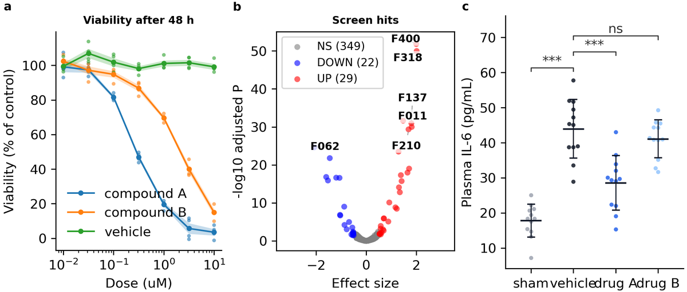
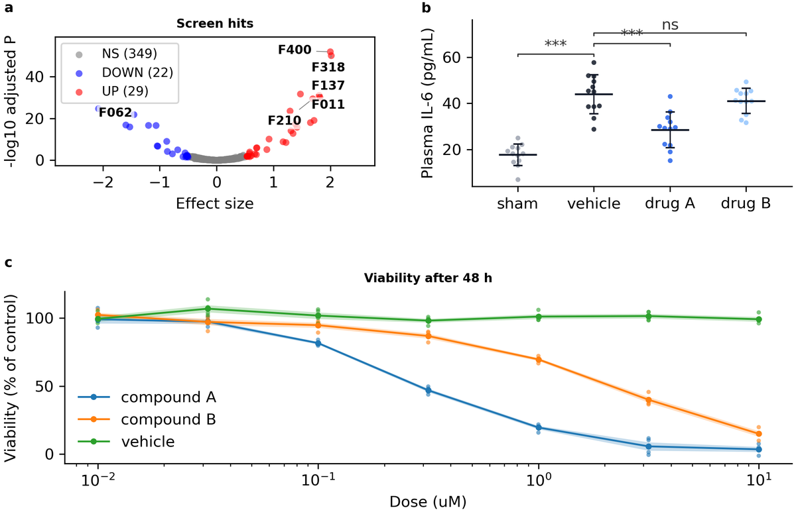
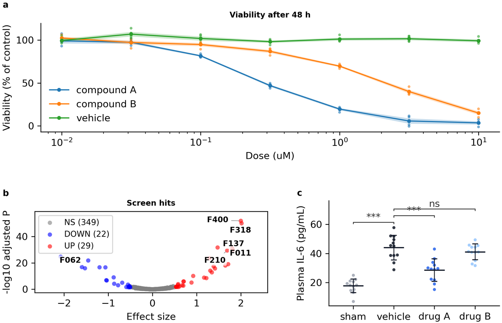

# 튜토리얼: 레이아웃으로 패널 배치하기 (15분)

스크립트 없이 그리면 프로젝트의 패널은 등분 그리드에 놓입니다. 이 튜토리얼은 패널 세 개짜리 그림을 **레이아웃**으로 옮깁니다. 먼저 작은 패널 두 개 아래에 넓은 패널 하나를 놓고, 다음에는 레이아웃 하나로는 없는 모양을 레이아웃 두 개를 겹쳐 만듭니다. 분석 스크립트 몇 줄과 설정 값 몇 개만 바꾸고, 결과가 깔끔한지는 검사가 알려 줍니다.

**배우는 것:** 레이아웃 고르기(`fa layouts`), 그 칸에 패널 그리기, 설정 파일로 다듬기, 두 번째 레이아웃으로 칸 나누기(합성). 개념은 [안내서 7장](../guide/07-layouts.md)에 있습니다.

## 시작하기 전에

[fig-atlas 설치](../howto/install.md)의 "fig-atlas 자체를 고칠 때" 절대로 fig-atlas 저장소 사본을 준비하고, 저장소 루트에서 시작합니다. 이 튜토리얼은 자기 프로젝트를 따로 만들므로 [첫 그림 튜토리얼](first_figure.md) 없이도 되지만, 먼저 해 두면 도움이 됩니다.

## 1. 패널 세 개짜리 프로젝트

프로젝트를 만들고 예제 번들 세 개를 붙입니다. 첫 튜토리얼의 용량-반응 곡선과 스크린, 그리고 갤러리 예제의 혈장 IL-6 비교입니다.

<!-- run -->
```bash
fa new project panel-layout
fa bundle check examples/dose_response examples/screen_hits examples/gallery/column_scatter
fa ingest bundle examples/dose_response --project panel-layout
fa ingest bundle examples/screen_hits --project panel-layout
fa ingest bundle examples/gallery/column_scatter --project panel-layout
```

검사를 켜고 빌드합니다.

<!-- run -->
```bash
fa build panel-layout --preflight
```

```text
[ok] panel-layout: 1 error(s), 3 warning(s)
```

<!-- img/: drawn by `fa reference` from this page's own steps; do not edit by hand -->


스크립트 없이 그리면 세 패널이 한 줄을 나눠 써서, 각각 페이지 폭의 3분의 1이 됩니다. 오류는 패널 c에 있습니다. 그룹 이름이 서로 겹칩니다(`tick_label_collision`). 곡선도 더 넓으면 읽기 좋습니다. 배치를 바꾸면 둘 다 해결됩니다.

## 2. 레이아웃 고르기

<!-- run -->
```bash
fa layouts
fa layouts wide_bottom
```

첫 명령은 레이아웃 다섯 개를 보여 주고, 두 번째는 하나를 자세히 보여 줍니다. 모양, 부르는 법, `figures:`에서 읽는 값 전부입니다. `wide_bottom`은 패널 한 줄 아래에 전체 폭 패널 하나를 놓습니다. 위에 스크린과 IL-6 비교, 아래에 곡선을 전체 폭으로 둡니다.

## 3. 레이아웃의 칸에 패널 그리기

분석 스크립트(`analysis/panel-layout_analysis.py`)는 `draw_plots`로 `plots:` 블록을 모두 그리고, 이 함수가 등분 그리드를 만듭니다. 바꿀 곳은 네 군데입니다. 먼저 불러오기입니다. 레이아웃과, `plots:` 블록 하나를 칸 하나에 그리는 `draw_plot`을 불러옵니다.

<!-- replace: analysis/panel-layout_analysis.py | from fig_atlas.bundle_figure import draw_plots -->
```python
from fig_atlas import layouts  # noqa: E402
from fig_atlas.bundle_figure import draw_plot  # noqa: E402
```

다음은 그리기 위의 주석입니다. 이제 맞지 않으니 바꿉니다.

<!-- replace: analysis/panel-layout_analysis.py | # Every plots.<name> block in the config is one panel -->
```python
    # 어느 plots: 블록을 어느 칸에 놓을지 (글자는 a, b, c 순서로 읽힘)
```

그리기 부분입니다. 레이아웃을 만들고, 블록마다 그 글자의 칸에 그립니다.

<!-- replace: analysis/panel-layout_analysis.py | columns = draw_plots( -->
```python
    lay = layouts.wide_bottom(fig, fcfg, top=("a", "b"), bottom="c")
    panels = {"a": "screen_hits", "b": "column_scatter", "c": "dose_response"}
    for letter, name in panels.items():
        draw_plot(lay.cells[letter], name, CFG["plots"][name], CONFIG.project_root, load=load)
```

마지막으로 `place_panel_tags` 대신 `layouts.finish`가 패널을 칸에 맞춰 넣고 글자를 붙입니다.

<!-- replace: analysis/panel-layout_analysis.py | place_panel_tags(fig, columns -->
```python
    layouts.finish(fig, lay, fcfg)          # 패널을 칸에 맞추고 글자를 붙임
```

두 줄이 되면 높이가 더 필요하고, 레이아웃은 자기 값을 `figures:`에서 읽습니다(설정 파일 `configs/config_panel-layout.yaml`).

<!-- replace: configs/config_panel-layout.yaml |   height_mm: 80 -->
```yaml
  height_mm: 120                      # 그림 높이, mm (폭은 페이지 본문 폭). 패널이 답답하면 올림
```

<!-- replace: configs/config_panel-layout.yaml |   hspace: 0.15 -->
```yaml
  hspace: 0.15                        # 패널 줄 사이 간격 (칸 높이에 대한 비율)
  wide_bottom:                        # [wide_bottom] 레이아웃 자신의 값
    height_ratios: [1.0, 1.2]         # 위 줄 : 아래 줄. 두 번째 숫자를 올리면 곡선이 높아짐
```

<!-- run -->
```bash
fa build panel-layout --preflight
```

```text
[ok] panel-layout: 0 error(s), 1 warning(s)
```



오류가 사라졌습니다. 패널 c의 이름에 자리가 생겼습니다. 남은 경고는 곡선의 색 한 쌍으로, [첫 그림 튜토리얼](first_figure.md)의 5단계에서 고치는 것과 같습니다. 이제 `figures:`의 `wspace`와 `hspace`는 칸 사이의 실제 간격입니다. 패널을 떼어 놓으려면 올리세요.

## 4. 레이아웃 두 개로 만드는 모양

이번에는 곡선을 맨 위에 전체 폭으로 두고, 작은 패널 두 개를 그 아래에 놓습니다. 위쪽이 넓은 레이아웃은 없습니다. 하지만 이 모양은 두 줄짜리 `stack`의 둘째 줄을 둘로 나눈 것, 즉 한 레이아웃의 칸 안에 다른 레이아웃을 넣은 것입니다. 두 번째 레이아웃을 그 칸에서 부르고, 칸의 글자로 시작합니다.

<!-- replace: analysis/panel-layout_analysis.py | lay = layouts.wide_bottom( -->
```python
    lay = layouts.stack(fig, fcfg, letters=("a", "b"))
    layouts.row(lay.cells["b"], fcfg, letters=("b", "c"))    # 칸 b를 b | c로 나눔
```

글자는 새 읽는 순서를 따르므로 이제 곡선이 a입니다.

<!-- replace: analysis/panel-layout_analysis.py | panels = {"a": "screen_hits" -->
```python
    panels = {"a": "dose_response", "b": "screen_hits", "c": "column_scatter"}
```

칸 b를 나눴으므로 패널의 칸이 두 레이아웃에 나뉘어 있습니다. `layouts.panel_cells`가 글자별로 모아 줍니다.

<!-- replace: analysis/panel-layout_analysis.py | for letter, name in panels.items(): -->
```python
    cells = layouts.panel_cells(lay)          # 나눈 칸까지 포함한 모든 패널의 칸
    for letter, name in panels.items():
```

<!-- replace: analysis/panel-layout_analysis.py | draw_plot(lay.cells[letter] -->
```python
        draw_plot(cells[letter], name, CFG["plots"][name], CONFIG.project_root, load=load)
```

바깥 레이아웃은 `figures.stack`을 읽고, 칸 b를 나누는 `row`는 그 칸의 글자 아래 `figures.cells.b`에서 값을 읽습니다.

<!-- replace: configs/config_panel-layout.yaml |   wide_bottom: -->
```yaml
  stack:                              # [stack] 바깥 레이아웃 자신의 값
```

<!-- replace: configs/config_panel-layout.yaml |     height_ratios: [1.0, 1.2] -->
```yaml
    height_ratios: [1.2, 1.0]         # 곡선 줄 : 아래 줄
  cells:                              # 칸 안에 그린 레이아웃의 값, 칸 글자 아래에 둠
    b:
      row:
        width_ratios: [1.3, 1.0]      # b와 c의 폭. 스크린에 자리를 더 줌
```

<!-- run -->
```bash
fa build panel-layout --preflight
```

```text
[ok] panel-layout: 0 error(s), 1 warning(s)
```



`layouts.finish`는 여전히 바깥 레이아웃에 한 번만 부릅니다. 두 단계의 패널을 모두 맞춰 넣고 글자를 정렬합니다. a와 b는 같은 왼쪽 선에, b와 c는 같은 높이에 놓입니다.

## 바뀐 것

| | 어디 | 줄 수 |
|---|---|---|
| 배치 고르기 | 분석 스크립트: 레이아웃 호출, 글자 → `plots:` 블록 대응 | 3–4 |
| 그리기와 마무리 | 분석 스크립트: 글자마다 `draw_plot`, `layouts.finish` 한 번 | 3 |
| 다듬기 | 설정 파일: `figures:` (`height_mm`, 레이아웃 블록, `cells.<글자>`) | 값 몇 개 |

패널 자체(데이터, 색, 크기)는 바뀌지 않았습니다. 놓이는 자리만 바뀌었습니다.

## 다음

- **레이아웃 다섯 가지와 그 값:** `fa layouts`, 그리고 그림이 있는 [레이아웃 카탈로그](../reference/layouts.md).
- **손으로 다듬은 기존 그림을 옮길 때**는 짧은 재조정이 필요합니다. 예전 배치에 맞춘 비율이 달라지고, 축 밖에 축 비율로 놓은 글자는 움직입니다([7장](../guide/07-layouts.md)).
- **AI 도우미와 함께:** "panel-layout의 아래 줄을 패널 두 개로 나눠 줘"라고 말하면 됩니다. AI도 같은 `fa layouts` 목록을 읽습니다.
