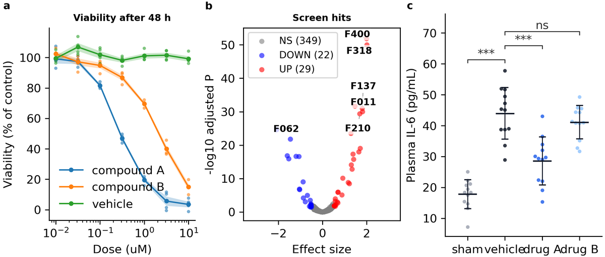
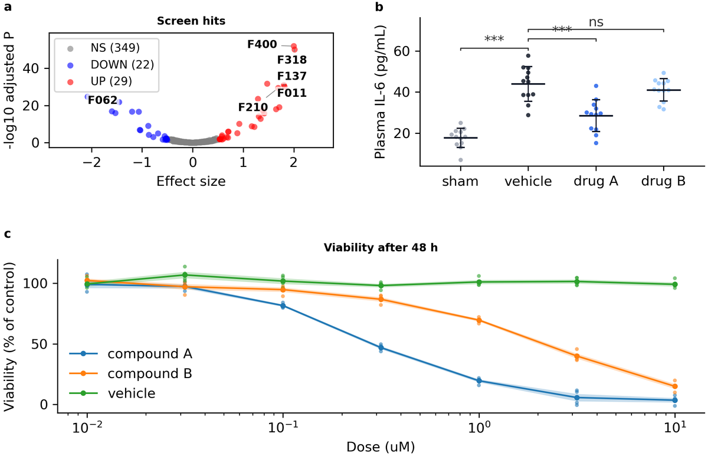
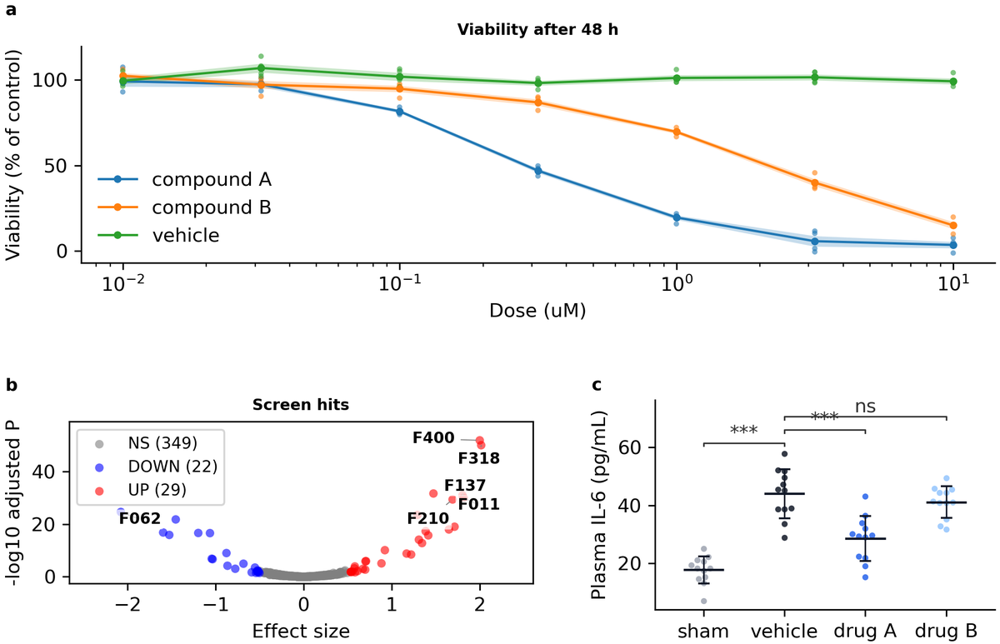

# Tutorial: arrange the panels with a layout (15 min)

Without a script, a project's panels sit in an even grid. This tutorial moves a three-panel figure to a **layout** -- first one wide panel under two small ones, then a shape no single layout has, made of two layouts one inside the other. You change a few lines of the analysis script and a few values in the config; the checks tell you whether the result is clean.

**What you learn:** to choose a layout (`fa layouts`), to draw the panels into its cells, to tune it from the config, and to split a cell with a second layout (composition). The ideas are in [chapter 7 of the guide](../guide/07-layouts.md).

## Before you start

Set up a copy of the fig-atlas repository as in [Install fig-atlas](../howto/install.md), section "Develop fig-atlas itself", and start at the repository root. The tutorial makes its own project, so it does not need the [first-figure tutorial](first_figure.md), though it helps to have done it.

## 1. A project with three panels

Make the project and attach three example bundles: the dose-response curves and the screen of the first tutorial, and a plasma IL-6 comparison from the gallery examples.

<!-- run -->
```bash
fa new project panel-layout
fa bundle check examples/dose_response examples/screen_hits examples/gallery/column_scatter
fa ingest bundle examples/dose_response --project panel-layout
fa ingest bundle examples/screen_hits --project panel-layout
fa ingest bundle examples/gallery/column_scatter --project panel-layout
```

Build it with the checks on.

<!-- run -->
```bash
fa build panel-layout --preflight
```

```text
[ok] panel-layout: 1 error(s), 3 warning(s)
```

<!-- img/: drawn by `fa reference` from this page's own steps; do not edit by hand -->


Without a script the three panels share one row, so each is a third of the page wide. The error is in panel c: its group names run into each other (`tick_label_collision`). The curves would also read better wider. A different arrangement fixes both.

## 2. Choose a layout

<!-- run -->
```bash
fa layouts
fa layouts wide_bottom
```

The first command lists the five layouts; the second shows one in full -- its shape, how to call it and every value it reads from `figures:`. `wide_bottom` puts a row of panels over one full-width panel: the screen and the IL-6 comparison on top, the curves across the bottom.

## 3. Draw the panels into the layout's cells

The analysis script (`analysis/panel-layout_analysis.py`) draws every `plots:` block with `draw_plots`, which makes the even grid. Four lines change. First the imports: the layouts, and `draw_plot`, which draws one `plots:` block into one cell.

<!-- replace: analysis/panel-layout_analysis.py | from fig_atlas.bundle_figure import draw_plots -->
```python
from fig_atlas import layouts  # noqa: E402
from fig_atlas.bundle_figure import draw_plot  # noqa: E402
```

Then the comment above the drawing, which no longer holds:

<!-- replace: analysis/panel-layout_analysis.py | # Every plots.<name> block in the config is one panel -->
```python
    # Which plots: block goes in which cell (the letters read a, b, c).
```

The drawing itself: make the layout, then draw each block into its letter's cell.

<!-- replace: analysis/panel-layout_analysis.py | columns = draw_plots( -->
```python
    lay = layouts.wide_bottom(fig, fcfg, top=("a", "b"), bottom="c")
    panels = {"a": "screen_hits", "b": "column_scatter", "c": "dose_response"}
    for letter, name in panels.items():
        draw_plot(lay.cells[letter], name, CFG["plots"][name], CONFIG.project_root, load=load)
```

And at the end, `layouts.finish` fits each panel into its cell and places the letters, instead of `place_panel_tags`:

<!-- replace: analysis/panel-layout_analysis.py | place_panel_tags(fig, columns -->
```python
    layouts.finish(fig, lay, fcfg)          # fit the panels, place the letters
```

Two rows need more height, and the layout reads its own values from `figures:` (the config, `configs/config_panel-layout.yaml`):

<!-- replace: configs/config_panel-layout.yaml |   height_mm: 80 -->
```yaml
  height_mm: 120                      # Figure height in mm (width = the page content width); raise if panels feel cramped
```

<!-- replace: configs/config_panel-layout.yaml |   hspace: 0.15 -->
```yaml
  hspace: 0.15                        # Gap between panel rows (fraction of a cell height)
  wide_bottom:                        # [wide_bottom] the layout's own values
    height_ratios: [1.0, 1.2]         # Top row : bottom row; raise the second number for a taller curve
```

<!-- run -->
```bash
fa build panel-layout --preflight
```

```text
[ok] panel-layout: 0 error(s), 1 warning(s)
```



The error is gone: panel c's names have room. The warning left is the colour pair of the curves, the one the [first-figure tutorial](first_figure.md) fixes in its step 5. Note that `wspace` and `hspace` in `figures:` are now real gaps between the cells; raise them to separate panels.

## 4. A shape that is two layouts

Now the curves should come first, across the top, with the two small panels below. No layout has a wide top row -- but it is a `stack` of two rows whose second row is split into two: a layout inside a cell of another. Call the second layout on that cell; it starts with the cell's letter.

<!-- replace: analysis/panel-layout_analysis.py | lay = layouts.wide_bottom( -->
```python
    lay = layouts.stack(fig, fcfg, letters=("a", "b"))
    layouts.row(lay.cells["b"], fcfg, letters=("b", "c"))    # split cell b into b | c
```

The letters follow the new reading order, so the curves are now a:

<!-- replace: analysis/panel-layout_analysis.py | panels = {"a": "screen_hits" -->
```python
    panels = {"a": "dose_response", "b": "screen_hits", "c": "column_scatter"}
```

Cell b is split, so the panels' cells are now in two layouts. `layouts.panel_cells` collects them by letter:

<!-- replace: analysis/panel-layout_analysis.py | for letter, name in panels.items(): -->
```python
    cells = layouts.panel_cells(lay)          # every panel's cell, the split ones included
    for letter, name in panels.items():
```

<!-- replace: analysis/panel-layout_analysis.py | draw_plot(lay.cells[letter] -->
```python
        draw_plot(cells[letter], name, CFG["plots"][name], CONFIG.project_root, load=load)
```

The outer layout reads `figures.stack`; the row that splits cell b reads its values under the cell's letter, `figures.cells.b`:

<!-- replace: configs/config_panel-layout.yaml |   wide_bottom: -->
```yaml
  stack:                              # [stack] the outer layout's own values
```

<!-- replace: configs/config_panel-layout.yaml |     height_ratios: [1.0, 1.2] -->
```yaml
    height_ratios: [1.2, 1.0]         # The curves' row : the row below
  cells:                              # Values of a layout drawn inside a cell, under the cell's letter
    b:
      row:
        width_ratios: [1.3, 1.0]      # Widths of b and c; the screen gets more room
```

<!-- run -->
```bash
fa build panel-layout --preflight
```

```text
[ok] panel-layout: 0 error(s), 1 warning(s)
```



`layouts.finish` is still called once, on the outer layout: it fits the panels of both levels and lines their letters up -- a and b on one left edge, b and c on one baseline.

## What changed

| | Where | Lines |
|---|---|---|
| Choose the arrangement | analysis script: the layout call(s) and the letter → `plots:` block map | 3–4 |
| Draw and finish | analysis script: `draw_plot` per letter, `layouts.finish` once | 3 |
| Tune it | config: `figures:` (`height_mm`, the layout's block, `cells.<letter>`) | a few values |

The panels themselves -- data, colours, sizes -- did not change; only where they sit.

## Next

- **The five layouts and their values:** `fa layouts`, and the [layout catalog](../reference/layouts.md) with a picture of each.
- **Moving an existing, hand-tuned figure** to a layout takes a short re-tuning pass: ratios tuned for the old placement change, and labels placed outside the axes by fractions of the axes move ([chapter 7](../guide/07-layouts.md)).
- **With an AI assistant:** "split the bottom row of panel-layout into two panels" -- it reads the same `fa layouts` list.
